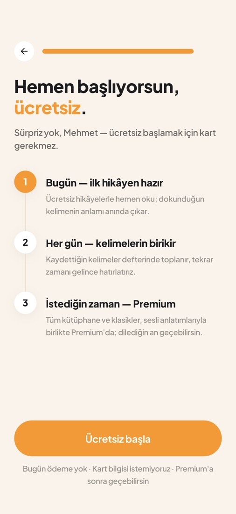
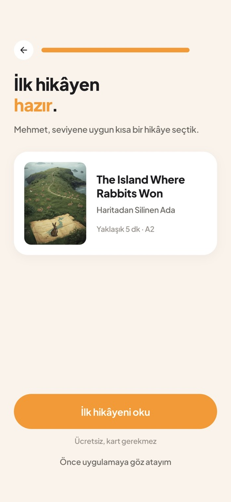
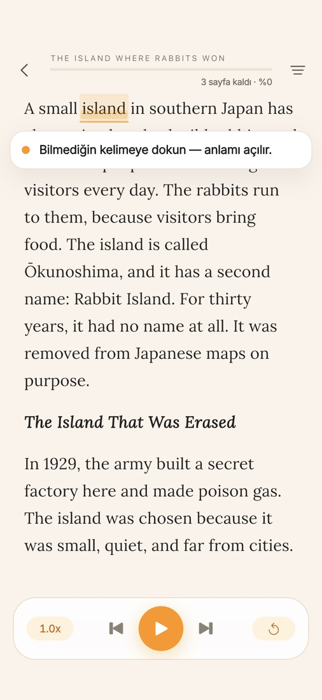
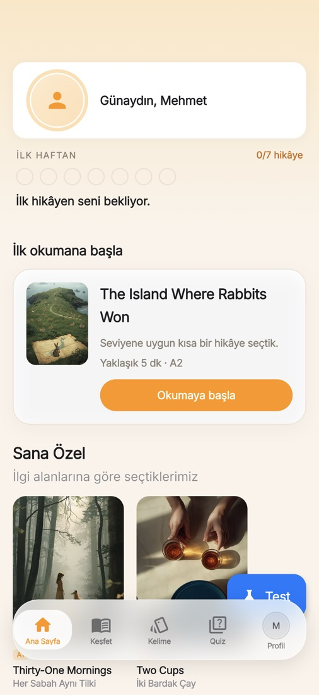
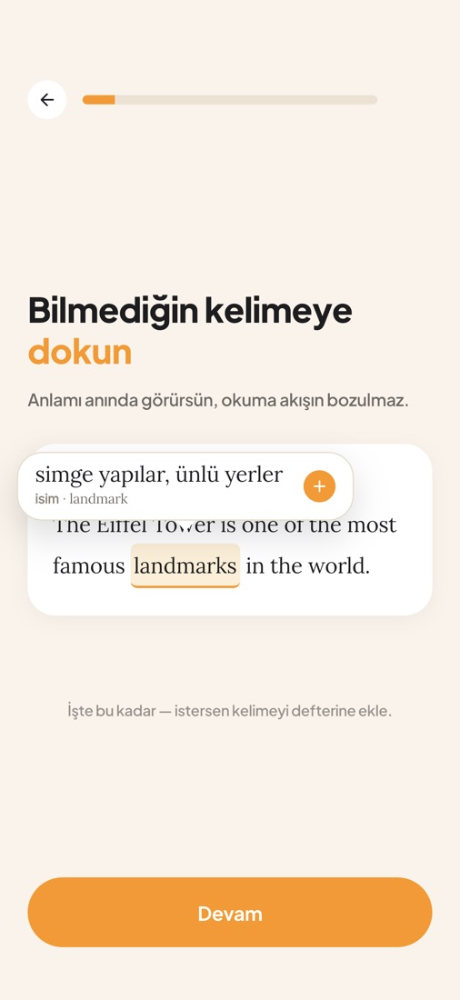
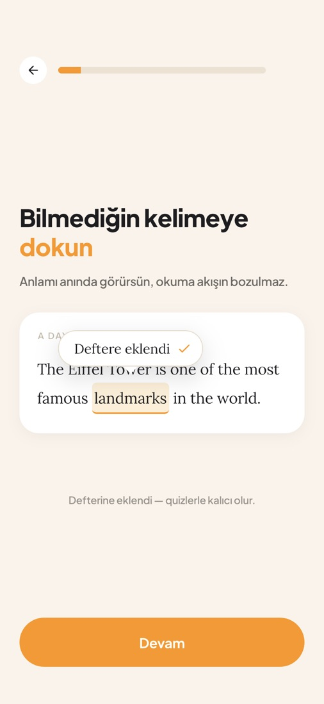
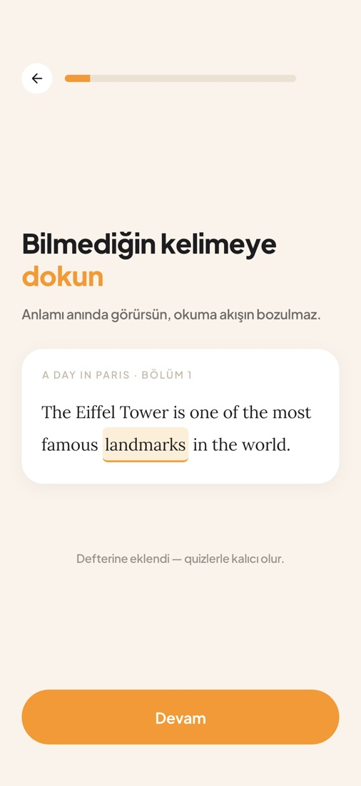
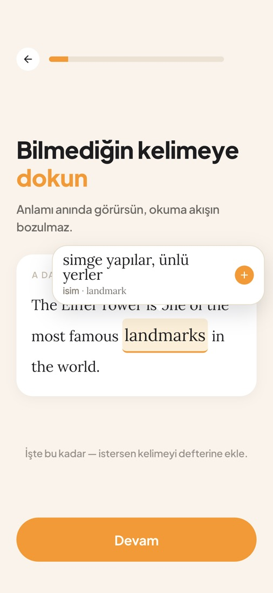
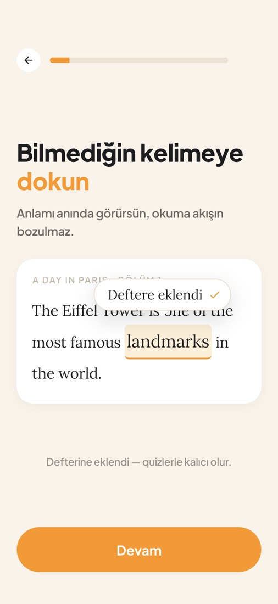
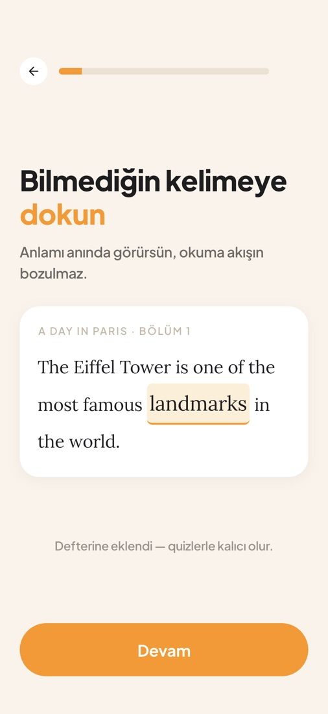

# Editör raporu – Bölüm 1: ekip kararlarının uygulanması

**Tarih:** 15 Kasım 2026 · **Rol:** Kent Bekçi (geliştirme ve kalite). 1a'nın tasarım doğrulaması Don Normal rolünde yapıldı. Tek geçiş, alt ajan yok; üyeler kurgusaldır.
**Görev:** `ortak/editor_gorevi_2026-11-15.md`, Bölüm 1 (1a–1d).
**Nerede çalışıldı:** Flutter deposu, `main` (`967390c`, sürüm 1.0.4+47) üzerinden açılan iki dal; backend yalnız okundu. Görüntüler iOS simülatöründen (iPhone 17 Pro, debug derleme, uygulama her koşudan önce silinip sıfırdan kuruldu). Mağazaya hiçbir şey gönderilmedi, Flutter kodu uzak depoya gönderilmedi.

## Özet

1. **1a – taslak hazır, Mehmet'in onayını bekliyor.** Son onboarding ekranı seçilen hikâyeyi gösteriyor; "İlk hikâyeni oku" okuyucuyu doğrudan açıyor, geri tuşu ana sayfaya dönüyor. Çalışan uygulamada baştan sona denendi. Kod `feat/onboarding-first-story` dalında duruyor, `main`'e girmedi.
2. **1b – bitti (3 commit, `feat/editor-bolum1`).** Quiz turu başlangıcı, ses dinleme ve kelime bakışının metin bilgisi artık gönderiliyor. Kullanıcıya ulaşması için yeni sürüm gerekir.
3. **1c – kesinleşmiş bir hata yok, üç somut risk var.** Android'de satın almanın baştan sona çalıştığı hiç gözlenmemiş. Hata kayıtları okunamadı (izin reddi). Adım adım test tarifi aşağıda.
4. **1d – doğrulandı.** Tooltip sayfayı itmiyor; "Devam" hem varsayılan hem en büyük sistem yazı boyutunda görünür ve basılabilir.
5. **Engeller:** Mac'in diski dolu (228 GB'ta 1–3 GB boş), bu yüzden küçük ekranlı simülatör çalıştırılamadı. Ayrıca 29 Kasım sınavının taban sayısı (8/26) uygulamanın kendi kayıtlarıyla uyuşmuyor olabilir (İtirazlar 1).

## Mehmet'ten beklenenler

1. **1a taslağını onayla ya da düzelt** (aşağıda üç karar noktası var).
2. **Android satın almayı test hesabıyla dene** (tarif 1c'de, yaklaşık 20 dakika).
3. **Diskte yer aç.** Bu hâliyle bir sonraki sürüm derlemesi de yarıda kalabilir.
4. İstersen prod veritabanı okumasına izin ver ya da 1c ve İtirazlar 1'deki iki sorguyu kendin çalıştır.

## Bulgular

| # | Bulgu | Kanıt | Önem | Öneri |
|---|---|---|---|---|
| A1 | Mevcut son ekran hikâyeyi hiç göstermiyor; üç maddenin sonuncusu Premium'u anlatıyor, düğme "Ücretsiz başla". | `ekran_2026-11-15/1a_once_son_ekran.jpg` | yüksek | Taslak (1a). |
| A2 | Ana sayfada "İlk okumana başla" kartı varsayılan yazı boyutunda ilk ekranda ve belirgin. "Ana sayfa bir menü" teşhisi bu görüntüyle zayıflıyor; kayıp büyük olasılıkla geçiş anında. | `1a_once_ana_sayfa_yeni_kullanici.jpg` | orta | Ana sayfaya dokunma (öneriyle aynı). |
| A3 | Önerideki "seviyene ve ilgi alanına göre seçtik" cümlesi doğru değil: seçim yalnız seviyeye, kilitsiz olmasına ve en kısa metin olmasına bakıyor. | `first_read_card.dart:57-60` | orta (README madde 9) | Taslakta "Seviyene uygun kısa bir hikâye seçtik" kullanıldı. |
| A4 | Katalog onboarding boyunca yüklü değil: hesap ancak plan özetinde açılıyor, katalog hesap istiyor. Bu yüzden hikâye son ekranda birkaç saniye geç geliyor; "kitap sayısı" ekranı da yeni kullanıcıya hiç görünmüyor. | Çekimde seviye ekranından doğrudan amaç ekranına geçiliyor (kitap sayısı ekranı yok); `onboarding_v2_page.dart:189-191`; `1a_taslak_son_ekran_ilk_2_5_sn.jpg` | orta | Taslak, hesap açılır açılmaz kataloğu yüklüyor. Bekleme anının tasarımı karar noktası 3. |
| A5 | En büyük sistem yazı boyutunda ana sayfada kart ilk ekranın altında kalıyor, sekme çubuğu etiketleri kesiliyor ("A…", "K…"). | `yan_ana_sayfa_enbuyuk_yazi.jpg` | yüksek | Bölüm 3'e (Dieter Koç). Görev kapsamı dışında, dokunulmadı. |
| A6 | En büyük sistem yazı boyutunda okuyucu: 4 sayfalık metin 43 sayfa oluyor (sayfada 4 kelime), üst şerit taşıyor, ilk kullanım ipucu ekranın üçte birini kaplıyor. | `yan_okuyucu_enbuyuk_yazi.jpg`, `yan_okuyucu_ipucu_enbuyuk_yazi.jpg`; karşılaştırma `1a_taslak_okuyucu.jpg` ("3 sayfa kaldı") | yüksek | Bölüm 3'e. Onboarding'de yazı ölçeği 1,15'te sınırlı, okuyucuda ve ana sayfada sınır yok. |
| B1 | Günün Quizi'ne tekrar giriş hiç sayılmıyordu. | `vocabulary_quiz_page.dart:85,95,113,128` | orta | Yapıldı (`9c89f57`). |
| B2 | Ses dinleme Firebase'e bilerek gönderilmiyordu (cümle başına bir olay), bu yüzden listede hiç yoktu. | `analytics_service.dart:443-451` | orta | Yapıldı (`e120651`): metin başına bir `audio_listened`. |
| B3 | Kelime bakışı hangi metinde yapıldığını taşımıyordu. | `analytics_service.dart:195-230` | orta | Yapıldı (`f08529c`). |
| B4 | Platform ayrımı kodda her olayda var. Firebase tarafında rapor ekranı görülmedi. | `analytics_service.dart:69,278`; `event_service.dart:67,120` | düşük | Firebase'de "Platform" karşılaştırmasıyla bir kez bak. |
| C1 | Mağaza bağlantısı uygulama açılışında bir kez kurulamazsa o oturumda satın alma hiç başlamıyor ve hiçbir olay gönderilmiyor: kullanıcı yalnız "Ödeme başarısız" görüyor. | `in_app_purchase_service.dart:112-126`; `subscription_bloc.dart:400,420` | orta (sıklığı bilinmiyor) | Düzeltme küçük; test sonucuna göre karar. Kod değiştirilmedi. |
| C2 | Android'de ödeme alındıktan sonra sunucu doğrulaması düşerse satın alma kendiliğinden yeniden denenmiyor. Kod yorumu "mağaza yeniden gönderir" diyor; bu iOS için doğru, Android'de uygulama satın almaları yalnız "Geri yükle"de soruyor. Onaylanmayan satın alma 3 gün içinde iade ediliyor. | `in_app_purchase_service.dart:424-430`; `subscription_bloc.dart:939`; `restorePurchases` yalnız kullanıcı "Geri yükle"ye basınca çağrılıyor; [Google: satın almaları işleme](https://developer.android.com/google/play/billing/integrate#process) | yüksek (olursa para alınır, Premium açılmaz) | Test tarifindeki F adımı bunu doğrular ya da çürütür. Kod değiştirilmedi. |
| C3 | Sunucudaki açılış denetimi Play anahtar dosyasının var olduğuna bakmıyor; ayar boş bırakılırsa bile "dolu" sayıyor. Anahtar eksikse her Android doğrulaması "geçici hata" döner ve C2'ye düşer. | backend `Program.cs:909-920`, `appsettings.json:130`, `docker-entrypoint.sh:21-25`, `GoogleReceiptValidator.cs:110-120` | orta (prod'da anahtarın durumu doğrulanmadı) | Railway açılış kaydında "google play credentials written" satırına bak. |
| C4 | `purchase_started` düğmeye basıldığı anda gidiyor, Google'ın ödeme penceresi açılmadan önce. "3 başlattı, 1 tamamladı" tek başına hata göstermez. | `subscription_bloc.dart:394` | düşük | Firebase'de `purchase_cancelled`, `purchase_failed`, `purchase_unavailable` sayılarına platform kırılımıyla bak. |
| D1 | Tooltip okuyucudaki balonla aynı katmanda açılıyor, sayfanın boyu değişmiyor; "Devam" yerinde kalıyor. | `1d_varsayilan_*.jpg`, `1d_enbuyuk_*.jpg` | – | Kapandı. |
| E1 | Disk dolu: iPhone SE simülatörü için derleme "No space left on device" ile düştü. | `df`: 228 GB, 219 MB boş (05:20 civarı) | yüksek | Yer aç. Bu oturumda yalnız kendi oluşturduklarım silindi. |
| E2 | İndirilmiş kitapta çevrimdışı kelime sözlüğü hiç kullanılmıyor: `TranslationService.currentBookId` hiçbir yerde atanmıyor. | `translation_service.dart:37` (tek atama yok; `grep "currentBookId ="` boş) | düşük | Ayrı iş; dokunulmadı. |

---

## 1a – Onboarding'den ilk okumaya geçiş

### Mevcut durum (Don Normal, ekrana bakarak)

| Son ekran | Yeni kullanıcının ana sayfası |
|---|---|
|  |  |

- **Teşhis 2 doğrulandı** (son ekran yanlış şeyi söylüyor). Ekranda hikâye yok; "Bugün – ilk hikâyen hazır" yazıyor ama hikâyenin kendisi görünmüyor. Düğmeden önce okunan son şey Premium.
- **Teşhis 3 zayıfladı** (ana sayfa bir menü). Varsayılan yazı boyutunda kart ilk ekranda, tek turuncu düğmeyle duruyor. Rakipleri: selamlama kartı, "İlk haftan 0/7" sayacı, "Sana Özel" rafı. Sayfa kötü değil. En büyük yazı boyutunda ise kart ekranın altına düşüyor (A5).
- **Teşhis 1 (kapanış hissi) görüntüyle sınanamaz.** 12 Kasım'da uygulamanın kendi kayıtlarından çıkardığım bir not bunu destekliyor: onboarding'i bitiren 128 kişiden 13'ü "Ücretsiz başla"dan sonra hiçbir iz bırakmamış. Bugün yeniden doğrulanmadı.
- **Öneride düzeltilen iki şey:** "ilgi alanına göre seçtik" cümlesi çıkarıldı (A3). Katalog son ekranda hazır değil, hesap açılınca yükleniyor (A4).

### Taslak (çalışan uygulamadan)

| Yeni son ekran | Düğmeye basınca | Geri tuşu |
|---|---|---|
|  |  |  |

En büyük sistem yazı boyutunda aynı ekran: `ekran_2026-11-15/1a_taslak_son_ekran_enbuyuk_yazi.jpg` (düğmeler ekranda, taşma yok).

Ne yapıyor:
- Hikâye, ana sayfadaki kartın seçtiğiyle aynı (`FirstReadCard.pickBook`, aynı seviye kuralı). Görüntüde ikisi de "The Island Where Rabbits Won".
- Kart: kapak, başlık, Türkçe alt başlık, "Yaklaşık 5 dk · A2". Karta dokunmak da hikâyeyi açar.
- "İlk hikâyeni oku" → ana sayfa kurulur, üstüne okuyucu açılır. Okuyucunun üstünde başka pencere çıkmadı. Geri tuşu ana sayfaya döndü.
- Altında küçük not: "Ücretsiz, kart gerekmez". Onun altında sessiz seçenek: "Önce uygulamaya göz atayım" → ana sayfa.
- Hikâye seçilemezse (katalog 8 saniyede gelmezse ya da kilitsiz metin yoksa) eski ekran ve "Ücretsiz başla" aynen kalır.
- Ertelenmiş paywall'a dokunulmadı (`onboarding_v2_page.dart:700`, satır yerinde). Ana sayfadaki kart yerinde. Onboarding'e yeni ekran ya da soru eklenmedi.

Ölçüm (yeni olaylar, Firebase'de bu adlarla görünür):

| Olay | Ne zaman |
|---|---|
| `onboarding_first_story_shown` | Son ekranda hikâye gösterilebildi |
| `onboarding_first_story_unavailable` | Hikâye gösterilemedi, eski ekran kaldı |
| `onboarding_first_story_tapped` | "İlk hikâyeni oku"ya basıldı |
| `onboarding_browse_first_tapped` | "Önce uygulamaya göz atayım" seçildi |

### Mehmet'in karar vereceği üç nokta

1. **Gün çizelgesi kaldırıldı.** Eski ekrandaki üç madde ("Bugün", "Her gün", "İstediğin zaman – Premium") yeni ekranda yok; ekran tek şey söylüyor. Bedeli: Premium'dan bu ekranda hiç söz edilmiyor. İstersen küçük nota "Premium'a sonra geçebilirsin" eklenir. Benim önerim eklememek.
2. **Başlık metni:** "İlk hikâyen hazır." / "Mehmet, seviyene uygun kısa bir hikâye seçtik." Değiştirmek istersen söyle.
3. **Bekleme anı.** Katalog bir koşuda 2,5 saniyeden önce, bir koşuda sonra geldi. Geç geldiğinde kullanıcı önce boş kart ve dönen düğme görüyor (`1a_taslak_son_ekran_ilk_2_5_sn.jpg`), sonra kapaksız kart (`1a_taslak_son_ekran.jpg`), en son kapak geliyor. "Hazır" yazıp boş kart göstermek tutarsız. Önerim: beklerken başlık "Hikâyeni seçiyoruz" olsun, kart gelince "İlk hikâyen hazır"a dönsün ve kapak önceden indirilsin. Onay verirsen eklerim.

### Onaydan sonra kalan iş
Karar noktalarına göre düzeltme, dalın `main`'e alınması, sürüm numarası. Yayın kararı Mehmet'te.

---

## 1b – Analitik eksikleri

| Olay | Ne zaman gider | Taşıdığı bilgi | Commit |
|---|---|---|---|
| `daily_quiz_started` | Günün Quizi turu her başladığında | `first_round` (ilk tur mu) | `9c89f57` |
| `practice_quiz_started` | Alıştırma turu her başladığında | `first_round` | `9c89f57` |
| `audio_listened` | Bir metinde dinlenen ilk cümleyle, uygulama açılışı başına metin başına bir kez | `readingTextId` | `e120651` |
| `word_lookup` (mevcut) | Her kelime bakışında | eklenen: `readingTextId`, `textLevel`, `textWordCount` | `f08529c` |

- **Ses:** Görevdeki tahmin doğru çıktı. `sentence_listened` Firebase'e gitmeyenler listesinde (`analytics_service.dart:449`). Bu bilerek yapılmış: cümle başına bir olay. Listeyi bozmadım; yanına metin başına tek olay ekledim. Uygulamanın kendi kayıtlarında cümle bazlı veri eskisi gibi duruyor.
- **Kelime sayısı:** `textWordCount` katalogdaki kelime sayısı alanından geliyor. Bu alanın bazı metinlerde eski olduğunu daha önce görmüştüm (bir metinde 121 yazıyor, gerçek 250). Paul Ulus'un "50 kelimede 1" ölçüsü bu alan düzeltilmeden o metinlerde yanlış çıkar. Bölüm 2'de kelime sayıları zaten sayılacak; farklar oradan çıkar.
- **Firebase'de görmek için:** olay adları kendiliğinden listeye düşer. Parametreleri raporda kullanmak için Google Analytics'te özel tanım açmak gerekir (Yönetici → Özel tanımlar): `reading_text_id`, `text_level`, `first_round` boyut; `text_word_count` metrik. Bunu Mehmet yapar.
- **Platform:** Her olaya `devicePlatform` ekleniyor ve değer ilk `await`'ten önce atandığı için boş kalamıyor. Firebase'de iOS ve Android ayrı veri akışları (12 Kasım'da kurulduğu kaydedilmişti), yani "Platform" kırılımı hazır olmalı. Rapor ekranını göremediğim için "doğrulanmadı" olarak bırakıyorum.
- **Testler:** `test/analytics_gaps_test.dart` (4 test). Tam tur: 1061 test geçti, 1 atlandı.

---

## 1c – Android satın alma

### Kod ne yapıyor
Düğmeye basılır → `purchase_started` gider → Google'ın ödeme penceresi açılır → onaydan sonra uygulama satın alma belirtecini sunucuya yollar → sunucu Google'a sorar → doğruysa Premium yazılır → uygulama satın almayı Google'a "teslim edildi" diye onaylar.

### Bilinen hata var mı
Kesinleşmiş bir hata bulamadım. Zincirin iki eski kırığı (ürün kimlikleri, belirteç/sipariş no karışıklığı) Eylül'de kapatılmış. Ama notlarıma göre Android'de gerçek bir satın almanın baştan sona çalıştığı hiç gözlenmedi; Play'de gelir de 0. Yani "çalışıyor" demek için kanıt yok. Risk taşıyan üç yer tabloda C1, C2, C3.

### Okunamayanlar
Uygulamanın kendi olay kayıtlarında Android'e ait `purchase_failed` (hata koduyla) ve `purchase_unavailable` (nedeniyle) satırları asıl cevabı verir. Prod veritabanı okuması izin katmanında reddedildi; zorlamadım. İzin verirsen ya da kendin çalıştırırsan sorgu:

```sql
SELECT e."OccurredAt", e."AppVersion", e."EventType", left(e."PayloadJson", 400)
FROM "UserEvents" e
WHERE e."OccurredAt" > now() - interval '21 days'
  AND e."DevicePlatform" = 'android'
  AND e."PayloadJson" ILIKE '%purchase%'
  AND e."PayloadJson" NOT ILIKE '%paywall_impression%'
ORDER BY e."OccurredAt";
```

Play Console'da bakılacak iki yer: Sipariş yönetimi (son 15 günde iptal ya da iade edilmiş sipariş var mı; varsa C2) ve Para kazanma → Abonelikler (dört ürün etkin mi).

### Test tarifi (Mehmet, yaklaşık 20 dakika)

Kaynak: [Google Play faturalandırma testi](https://developer.android.com/google/play/billing/test). Test hesabından para çekilmez; haftalık abonelik 5 dakikada yenilenir, en çok 6 kez; onaylanmayan test satın alması 3 dakikada iade edilir ve e-postası gelir.

**Hazırlık**
1. Play Console → Ayarlar → Lisans testi: test Gmail hesabını ekle.
2. Android telefonda Play Store'a o hesapla gir (telefondaki ilk hesap olsun). Uygulamayı Play'den kur.
3. Uygulama kuruluysa silip yeniden kur ki yeni kullanıcı gibi başlasın.

**A. Paywall'a var.** Onboarding'i bitir, ilk hikâyeyi sonuna kadar oku, ana sayfaya dön. Paywall açılmazsa Profil → Premium.
Beklenen: üç plan, ₺ fiyatlarla (yıllık ₺999,99 ve "7 gün ücretsiz", aylık ₺199,99, haftalık ₺79,99). Fiyatlar farklıysa ya da "7 gün ücretsiz" yoksa ekran görüntüsü al: mağaza ürünleri yüklenmemiş demektir.

**B. Haftalığı seç, satın al.**
Beklenen: Google penceresi açılır, üstünde test satın alması olduğu yazar, ödeme yöntemi "Test kartı, her zaman onaylar".
Pencere hiç açılmadan "Ödeme başarısız" çıkarsa saati yaz (C1 ya da ürün bulunamadı).

**C. Onayla.**
Beklenen: başarı ekranı, Premium açılır. Google onayladıktan sonra "Ödeme başarısız" çıkarsa saati yaz (sunucu doğrulaması, C2/C3).

**D. Kalıcılık.** Uygulamayı tamamen kapatıp aç: Premium duruyor mu? Kilitli bir kitap açılıyor mu? Play Store → Ödemeler ve abonelikler → Abonelikler: Daily English etkin mi?

**E. İade e-postası.** 5 dakika bekle. Google'dan "satın alma iptal edildi/iade edildi" e-postası gelirse uygulama satın almayı onaylamamış demektir; bana haber ver.

**F. Kesinti denemesi (C2'yi sınar).** Aboneliği Play'den iptal et, bitmesini bekle (ya da ikinci test hesabı kullan). Yeniden satın al; Google penceresinde onaya bastığın anda uçak modunu aç. Uygulama hata gösterecek. Uçak modunu kapat, uygulamayı kapatıp aç.
Beklenen (iyi durum): Premium kendiliğinden açılır. Koddan beklediğim (kötü durum): açılmaz, 3–5 dakika sonra iade e-postası gelir; "Satın alımları geri yükle"ye basınca açılır.

**G. Geri yükleme.** Uygulamayı sil, yeniden kur, misafir olarak gir, paywall'da "Satın alımları geri yükle".
Beklenen: Premium geri gelir.

**H. Reddedilen kart.** Yeni satın almada ödeme yöntemini "Test kartı, her zaman reddeder" yap.
Beklenen: anlaşılır bir hata, ekran kilitlenmez, tekrar denenebilir.

**İ. Yıllık ve deneme.** Yıllık planda Google penceresi "7 gün ücretsiz" demeli (testte deneme 3 dakika sürer). Aynı hesapla denemeyi ikinci kez almak için Play Billing Lab uygulaması gerekir.

Her adımda saat ve ekran görüntüsü yeterli; sunucu kayıtlarını o saatlerden bulurum.

---

## 1d – Tooltip düzeltmesi (`e9130b9`)

| | Balon açık | Deftere eklendi | Balon kapandı |
|---|---|---|---|
| Varsayılan yazı |  |  |  |
| En büyük sistem yazısı |  |  |  |

- Balon kelimenin üstünde, ayrı bir katmanda açılıyor. Balon açıkken, "Deftere eklendi" derken ve kapandıktan sonra başlığın, kartın ve "Devam"ın yeri aynı.
- En büyük sistem yazı boyutu: iOS'un en büyük erişilebilirlik ayarı. Onboarding yazıyı en çok 1,15 kat büyütüyor (`v2_scaffold.dart:41`); anlam balonda iki satıra iniyor ama sayfa kaymıyor.
- Küçük ekran: simülatörde denenemedi (E1). Yerine iki otomatik test var ve geçiyor: 360×640'ta 1,6 kat yazıyla balon ve "Devam" (`test/onboarding_tap_word_overflow_test.dart`), 320×568 ve 360×640'ta 2 kat yazıyla bütün adımlar (`test/onboarding_small_screen_sweep_test.dart`, 68 durum).
- Android cihazda denenmedi. Bildirimi yapan kullanıcının telefonunda (Reeder S19 Pro Max) doğrulama, 1.0.4 yayınlanınca ondan istenebilir.

---

## Bilinmeyenler

- Android'de satın almanın gerçekten çalışıp çalışmadığı (test bekliyor).
- Prod'da Play anahtarının yüklü olup olmadığı (C3).
- C1 ve C2'nin gerçekte kaç kullanıcıya denk geldiği; hiç denk gelmemiş olabilir.
- Android eklentisinin açılışta satın almaları kendiliğinden sorup sormadığı. Eklentinin kaynağını okuyamadım; C2 koddaki çağrılara ve Google'ın belgesine dayanan bir çıkarım. Test tarifinin F adımı kesinleştirir.
- Firebase'de platform kırılımının raporda nasıl göründüğü.
- Yeni son ekranın gerçek ağda (mobil veri) bekleme süresi. Simülatörde Wi-Fi ile 2–4 saniye.
- Taslağın Android'de ve küçük ekranlı gerçek cihazda görünümü.

## İtirazlar

1. **Taban sayı tek kaynaktan gelmeli (Nassim Talip'in sorusu).** Firebase 4 günde "26 kişiden 18'i okumaya başlamadı" diyor (%69). Uygulamanın kendi kayıtlarından 12 Kasım'da çıkardığım sayı farklıydı: iki haftada onboarding'i bitiren 128 müşteriden 27'si okumaya başlamamıştı (%21). İkisi aynı şeyi ölçüyorsa biri yanlış; ölçmüyorsa (farklı dönem, farklı kullanıcı tanımı) 29 Kasım'da hangi sayıyla karşılaştırılacağı şimdiden yazılmalı. Bu sayıyı bugün yeniden doğrulayamadım. Önerim: sınav sayısı uygulamanın kendi kayıtlarından, sürüm numarasına göre ayrılarak okunsun.
2. **Yeni ekran eskisinden daha az şey söylüyor.** Premium'un varlığı ilk okuma bitene kadar kullanıcıya söylenmiyor. Yanıltıcı bir cümle yok, ama eski ekran daha açık sözlüydü (karar noktası 1).
3. **Okuyucuya doğrudan girmek, büyük yazı kullanan kişiyi A6'daki hâle sokuyor.** Bu kişiler bugün de aynı okuyucuyu görüyor; taslak sorunu yaratmıyor ama daha çok kişiyi oraya götürüyor.
4. **1a'yı onaydan önce kodladım.** Görev "taslak görüntüsünü göster, onaydan sonra uygula" diyordu. Görüntüyü gerçek uygulamadan almak için ekranı ayrı bir dalda kurdum; `main`'e girmedi, gönderilmedi. Onay çıkmazsa dal silinir.
5. **C2 kanıtlanmış bir hata değil.** Önem "yüksek" yazıldı çünkü gerçekleşirse sonucu ağır; gerçekleştiğine dair veri yok.

## Yan etkiler ve ortam

- **Prod'da dört misafir hesap açıldı** (15 Kasım, yaklaşık 04:10–06:00, ad "Mehmet", iPhone 17 Pro simülatörü, debug derleme). Debug derleme Firebase'e veri göndermez; uygulamanın kendi onboarding sayacına dört kişilik iz düştü.
- **Silinenler:** bu oturumda oluşturduğum iPhone SE simülatörü ve çekim sürücüsünün geçici dosyaları. Başka hiçbir şeye dokunulmadı.
- **Flutter dalları (yerel, gönderilmedi):**
  - `feat/editor-bolum1`: `9c89f57`, `e120651`, `f08529c` (analitik), `d944243` (çekim testine tooltip görüntüleri).
  - `feat/onboarding-first-story` (üstüne): `ed47e7f` (kapak ve süre satırı ortaklaştırıldı), `b325e20` (yeni son ekran).
- **Backend:** değişiklik yok.
