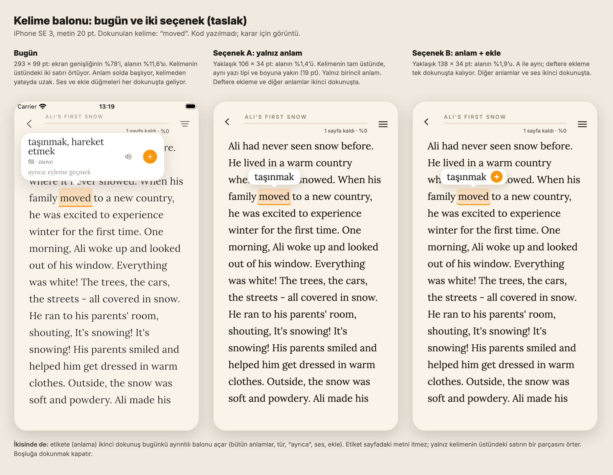
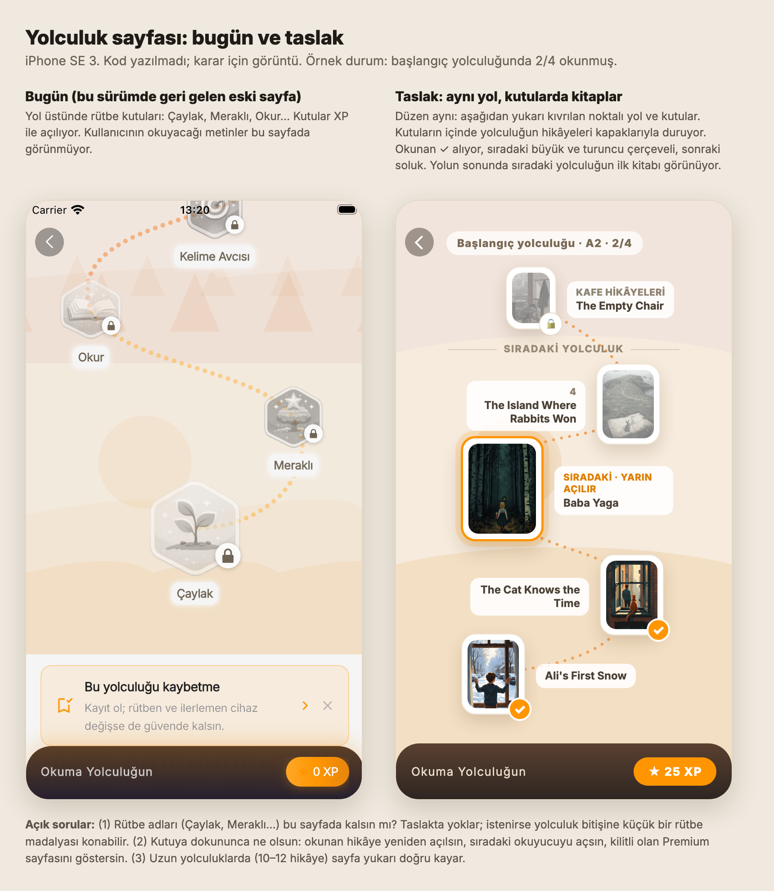

# Cihaz geri bildirimi kararları: uygulama raporu

**Tarih:** 18 Kasım 2026. **Yazan:** editör. **Dayanak:** `raporlar/2026-11-18_cihaz_geri_bildirimi_kararlar.md` ve `raporlar/2026-11-18_surum1_ekip_degerlendirmesi.md`.

**Durum:**
- Sekiz kararın kod gerektirenleri uygulandı; her biri ayrı commit'te.
- Harita ve kelime balonu için yalnız taslak görüntü hazırlandı; kod yazılmadı.
- Görünümü değişen her ekranın SE 3 görüntüsü aşağıda. **Mehmet görmeden yayına girmez.**
- Dallar yerelde, gönderilmedi. Canlıya hiçbir şey yazılmadı. `NextHook` betiği çalıştırılmadı.
- TestFlight derlemesi henüz yapılmadı; sebebi en altta.

## Kararlar ve yapılanlar

| Karar | Yapılan | Commit |
|---|---|---|
| 1. "Durak" → "hikâye" | Kullanıcıya görünen 12 metin değişti: "Sıradaki hikâye", "Sıradaki hikâye yarın açılır", "SIRADAKİ HİKÂYE · 3/4", "Yolculuğunun ilk 4 hikâyesi", "Ücretsiz başla: günde bir hikâye", "Bütün hikâyeler açık, beklemek yok" ve diğerleri. "Yolculuk" kaldı. | Flutter `7754ca76` |
| 2. Harita | `/career` yine eski ilerleme sayfasını açıyor. Yeni liste sayfası koddan kaldırıldı. Yeni tasarım için taslak aşağıda. | Flutter `a0da839b` |
| 3. Kapaklar | Bitiş ekranı: kapak solda, yanında "SIRADAKİ HİKÂYE · n/4" ve ad; merak cümlesi altında tam genişlikte, kesilmiyor. Plan ekranı: dört kapak yan yana, altında adlar; ilkinde "Bugün". | Flutter `7754ca76`, `9cf0033a`, `78104a93`; sunucu `7ccbd8c` |
| 4. Kelime balonu | Kod yok. Ölçüm ve iki seçenek taslağı aşağıda. | (ölçüm kodu testte: `93ef9cbc`) |
| 5. Eski uygulama (1.0.2) | Çeviri isteği metin kimliği taşımıyorsa eski sayım (yalnız sözlük dışı kelime, önbellekte olmayan cümle). Taşıyorsa yeni sayım. 1.0.2 yeni sunucuya karşı SE 3'te çalıştırıldı. | sunucu `6de0ae3` |
| 6. Onboarding teklifi için sunucu anahtarı | Ortam değişkeni `Features__OnboardingOffer=false` teklifi yeni derleme çıkmadan kapatır. Tanımlı değilse açık. | sunucu `a97dc18`; Flutter `c2f95207` |
| 7. "İlk gün 2 hak" | Değişiklik yok (takvim günü). | — |
| 8. Teklif başlığı | Üst satır "{ad}, yolculuğun hazır". Deneme süresi biliniyorsa "Beklemeden oku: 7 gün ücretsiz", bilinmiyorsa "Beklemeden oku". | Flutter `c2f95207`, `b014a11e` |

**Önceki değerlendirmenin kararları (Sürüm 1 ekip değerlendirmesi):**

| Karar | Yapılan | Commit |
|---|---|---|
| 2. Bitişte iki kapı | Sıradaki yarın açılıyorsa "Premium'la şimdi oku" dolu turuncu ana düğme, hemen altında aynı boyda çerçeveli "Yarın hatırlat". Quiz bağlantıya indi: "Bu hikâyenin quizini çöz". 1. hikâye bitişinde ana düğme "Sıradaki hikâye". | Flutter `7754ca76` |
| 5. Bildirim düzeni kapalı | Günde iki bildirim düzeni sunucu dalından geri alındı. "Yarın hatırlat" telefonun kendi bildirimi; etkilenmedi. | sunucu `6b09cf5` |
| 6. Merak cümleleri | Betik 44 satıra çıktı (32 + 12 başlangıç); Rabbits cümlesi şimdiki zamanda. Yerel kopyada denendi: 44 yazıldı, ikinci çalıştırma güvenli, geri alma eski hâli getiriyor. **Canlıda çalıştırılmadı.** | sunucu `0a6a197` |

**Kararın harfinden ayrıldığım iki yer:**
- Quiz bağlantısı kararda "Bu metnin quizini çöz" idi. Karar 1'e uysun diye "Bu hikâyenin quizini çöz" yazdım.
- Bitiş kartını beyaz zeminli bir karta aldım. Bitiş sahnesinin koyu geçişi üstünde ad ve cümle zor okunuyordu.

## Sürüşte çıkan ve düzeltilen sorunlar

**Teklif başlığı küçük ekranda kayboluyordu** (`b014a11e`).
- Belirti: SE 3'te, seçili planı düğmenin yanına getiren kaydırma yeni başlığın üstünü ekrandan çıkardı; "{ad}, yolculuğun hazır / Beklemeden oku:" görünmüyor, yalnız "7 gün ücretsiz" kalıyordu.
- Düzeltme: yolculuk başlığı kaydırılan gövdenin üstünde sabit duruyor. Başlık, seçili plan, düğme ve ücretsiz yol aynı anda görünüyor.

**Plan ekranında adlar büyük yazıda düğmenin altında kalıyordu** (`78104a93`).
- Belirti: en büyük yazıda başlık iki satıra çıkınca kapaklar görünüyor, altlarındaki adlar düğmenin arkasında kalıyordu.
- Düzeltme: yolculuk varken kutlama simgesi büyük yazıda da çizilmiyor (kısa ekranda zaten çizilmiyordu). Testi düzeltmesiz düşüyor, düzeltmeyle geçiyor.

## Ekran görüntüleri (iPhone SE 3)

Klasör: `raporlar/ekran_2026-11-18b/`. "Büyük yazı" iOS'un en büyük erişilebilirlik boyutu.

| Ekran | Karar | Normal | Büyük yazı |
|---|---|---|---|
| Plan: "{ad}, yolculuğun hazır" + dört kapak | 1, 3 | [görüntü](ekran_2026-11-18b/normal/116_plan_yolculuk.png) | [görüntü](ekran_2026-11-18b/buyuk_yazi/116_plan_yolculuk.png) |
| Onboarding sonu teklifi: sabit başlık, seçili plan, "Ücretsiz başla: günde bir hikâye" | 1, 8 | [görüntü](ekran_2026-11-18b/normal/116b_onboarding_teklif.png) | [görüntü](ekran_2026-11-18b/buyuk_yazi/116b_onboarding_teklif.png) |
| 1. hikâye bitişi: kapaklı kart, "Sıradaki hikâye", quiz bağlantı | 1, 3 | [görüntü](ekran_2026-11-18b/normal/31_durak1_bitis.png) | [görüntü](ekran_2026-11-18b/buyuk_yazi/31_durak1_bitis.png) |
| 2. hikâye bitişi: "Sıradaki hikâye yarın açılır", iki kapı | 1, 3 | [görüntü](ekran_2026-11-18b/normal/33b_durak2_bitis_kapilar.png) | [görüntü](ekran_2026-11-18b/buyuk_yazi/33b_durak2_bitis_kapilar.png) |
| Ana sayfa kartı (yalnız kelime değişti) | 1 | [görüntü](ekran_2026-11-18b/normal/35_ana_sayfa_kart.png) | [görüntü](ekran_2026-11-18b/buyuk_yazi/35_ana_sayfa_kart.png) |
| İlerleme sayfası (eski sayfa geri) | 2 | [görüntü](ekran_2026-11-18b/normal/35b_ilerleme_sayfasi.png) | — |
| Kilitli içerik sayfası (yalnız gövde metni değişti) | 1 | [görüntü](ekran_2026-11-18b/normal/36_kilitli_icerik.png) | — |
| Kelime balonu (bugünkü hâli, ölçüm için) | 4 | [görüntü](ekran_2026-11-18b/normal/30b_balon1.png) | — |

Notlar:
- Fiyatlar simülatörün StoreKit dosyasından (dolar). Türkiye fiyatı TestFlight'ta görülür.
- Teklif ekranında madde listesi duruyor, ama SE 3'te seçili planı gösteren kaydırma onu başlığın altına itiyor; yukarı kaydırınca görünüyor. Başlık, seçili plan, düğme ve ücretsiz yol kaydırmadan görünüyor.
- Büyük yazıda plan ekranında adlar düğmenin altında kalıyordu; kutlama simgesi büyük yazıda kaldırılarak düzeltildi (`78104a93`).

## Kelime balonu: ölçüm

Ölçüm uygulama koduna dokunmadan, sürüş testinin içinden alındı. iPhone SE 3 (375 × 667 pt), metin 20 pt.

| Dokunulan kelime | Balon (pt) | Ekran genişliğine oranı | Ekran alanına oranı | İçerik |
|---|---|---|---|---|
| moved | 293 × 99 | %78 | %11,6 | anlam 2 satır + "fiil · move" + "ayrıca: eyleme geçmek" + ses + ekle |
| (anlamı "yaşamak" olan kelime) | 205 × 79 | %55 | %6,5 | anlam 1 satır + tür + "ayrıca" + ses + ekle |
| (anlamı "her şey" olan kelime) | 185 × 60 | %49 | %4,4 | anlam 1 satır + tür + ses + ekle |
| moved (büyük yazı) | 293 × 121 | %78 | %14,1 | aynı içerik, daha yüksek |

Diğer ölçüler:
- Balon her zaman kelimenin 20 pt üstünde açılıyor.
- Anlam 19 pt (metin 20 pt). Alt satırlar 12,5–13 pt.
- Balonun en geniş hâli ekranın %78'i; anlam balonun sol kenarından başlıyor, yani kelimenin tam üstünde değil.

**Ne gösteriyor:**
- En büyük hâlinde balon, kelimenin üstündeki iki satırı (okurun az önce okuduğu yeri) örtüyor.
- Gözün gittiği yer her dokunuşta değişiyor: balon bazen 185, bazen 293 pt geniş; anlam kelimeden yatayda uzaklaşabiliyor.
- Balonda üç ayrı yazı boyu var (19, 13, 12,5 pt).

**Ölçümün göstermediği:** Mehmet'in tarif ettiği yorgunluğun bu üç etkenden hangisinden geldiği. Bu, taslaklar cihazda denenince anlaşılır.

## Kelime balonu: iki seçenek (taslak)

| | Bugün | Seçenek A: yalnız anlam | Seçenek B: anlam + ekle |
|---|---|---|---|
| İlk dokunuş | Tam balon | Kelimenin tam üstünde tek satır anlam | A + küçük ekle düğmesi |
| Boyut | 185–293 × 60–121 pt | yaklaşık 106 × 34 pt | yaklaşık 138 × 34 pt |
| Ekran alanı | %4–14 | yaklaşık %1,4 | yaklaşık %1,9 |
| Deftere ekleme | 1 dokunuş | 2 dokunuş | 1 dokunuş |
| Diğer anlamlar, tür, ses | Hemen | 2. dokunuşta | 2. dokunuşta |

- İkisinde de etikete ikinci dokunuş bugünkü ayrıntılı balonu açar.
- İkisinde de etiket metni itmez; yalnız üst satırın kelime kadar bir parçasını örter.
- **Editörün önerisi: B.** Deftere ekleme ürünün ana döngüsü; onu ikinci dokunuşa itmek kayıt sayısını düşürebilir. A daha sade, ama bedeli bu.
- Açık soru: uzun anlamlarda ("taşınmak, hareket etmek") etiket yalnız birincil anlamı mı göstersin? Taslak öyle çizildi.

## Yolculuk sayfası: taslak

- Düzen eski sayfanınki: aşağıdan yukarı kıvrılan noktalı yol ve kutular.
- Kutuların içinde rütbe simgesi yerine yolculuğun hikâyeleri kapaklarıyla duruyor.
- Okunan ✓ alıyor; sıradaki büyük ve turuncu çerçeveli; sonraki soluk.
- Yolun sonunda sıradaki yolculuğun ilk kitabı görünüyor.
- Açık sorular:
  1. Rütbe adları (Çaylak, Meraklı…) bu sayfada kalsın mı? Taslakta yoklar.
  2. Kutuya dokununca ne olsun?
  3. 10–12 hikâyeli yolculuklarda sayfa yukarı kayar; onun için ayrı bir kare çizilmedi.

## Eski sürüm (1.0.2) doğrulaması

1.0.2'nin kodu (`383edc66`) ayrı bir kopyada derlendi ve yeni sunucuya (yerel veritabanı) bağlanarak SE 3'te sürüldü.

| Adım | Sonuç |
|---|---|
| Onboarding → ana sayfa | Çalıştı. Yolculuk kartı yok (beklenen); eski "İlk okumana başla" kartı geliyor. |
| Okuyucu, kelimeye dokunma | Çalıştı; balon açıldı. İstek metin kimliği taşımadığı için eski sayım uygulandı. |
| Cümle çevirisi | Çalıştı. |
| Metni bitirme | Bitiş ekranı açıldı. |
| Hak bitince | Günlük hak sunucuda 25'e çekildi. Uygulama kendi sınır sayfasını gösterdi ("Bugünkü çevirilerin bitti"), okuma sürdü. Çökme ya da hata kaydı yok. |

- Sınır sayfası uygulamanın kendi ön kontrolüyle açıldı (hak bilgisini sunucudan okuyup). Sunucunun 402 cevabı bu sürüşte tetiklenmedi. 402'yi karşılayan kod 1.0.2'de mevcut ve cevabın biçimi değişmedi; ama o yol cihazda görülmedi.
- Sunucu tarafındaki kural dört testle korunuyor: eski istemci sözlükteki kelimede hak harcamaz, sözlük dışında harcar; yeni istemci her dokunuşta harcar, başlangıç hikâyesinde harcamaz.

Görüntüler: `ekran_2026-11-18b/eski_surum/`.

## Testler

- Sunucu: tam takım geçti (1543 test). Sayı önceki rapordaki 1553'ten düşük, çünkü geri alınan bildirim düzeninin testleri de gitti; yeni sayımın 4 testi eklendi.
- Flutter: `flutter analyze` temiz, tam takım geçti.
- SE 3 sürüşü normal ve en büyük yazıda uçtan uca tamamlandı.
- **Sürüşte bir kez görülen, bu işle ilgisiz hata:** onboarding'in "dinle" adımında simülatörün ses oynatıcısı hata verdi ve test çatısı bunu yakalanmamış hata olarak yazdı (8 sürüşte 1 kez). Akış devam etti. Kod eski; bu turda dokunulmadı. Gerçek cihazda aynı hata olursa çökme paneline düşer; ayrı bir iş olarak bakılmalı.

## TestFlight derlemesi neden henüz yok

1. **Sunucu canlıda değil.** Derleme canlı sunucuya bağlanır; yolculuk uçları orada yokken uygulama eski kartlara düşer. Ekibin beş maddelik TestFlight listesi bu hâlde denenemez.
2. **Görüntüler Mehmet'in onayını bekliyor** (karar: görmeden yayına girmez).
3. **Disk.** Mac'in diski bu oturumda bir kez tamamen doldu ve test koşularında yeniden 0,4 GB'a indi; temizlikten sonra yaklaşık 5 GB boş. Arşiv derlemesi birkaç GB ister.

**Önerilen sıra:**
1. Mehmet bu rapordaki görüntülere bakar.
2. Sunucu dalları `master`'a birleşir ve yayınlanır (Mehmet). Yayınla birlikte yolculuk tabloları canlıya yazılır.
3. Mehmet "yaz" derse `NextHook` betiği çalıştırılır.
4. Editör 1.0.4 için yeni derleme numarasıyla TestFlight derlemesini yükler.
5. En az bir gün kullanım; sonra mağaza kararı Mehmet'te.

## Mehmet'ten beklenenler

| # | Soru | Editörün önerisi |
|---|---|---|
| 1 | Bitiş ekranı, plan ekranı ve teklif başlığı bu hâliyle olur mu? | — |
| 2 | Balon: A mı, B mi, başka bir şey mi? | B |
| 3 | Yolculuk sayfası taslağı doğru yönde mi? Rütbe adları kalsın mı? | Yön doğruysa sonraki sürümde yapılır |
| 4 | Sunucu yayını ve `NextHook` yazımı için söz | — |
| 5 | TestFlight derlemesi için diskte yer (10 GB kadar) | — |
