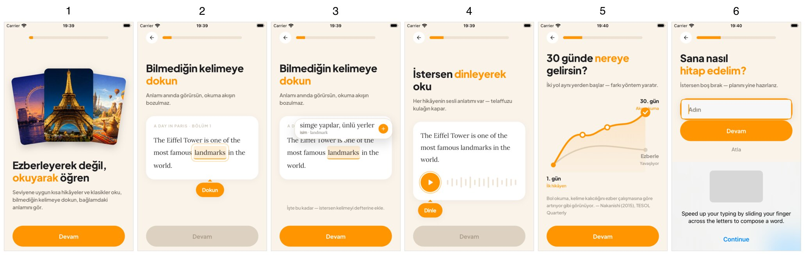
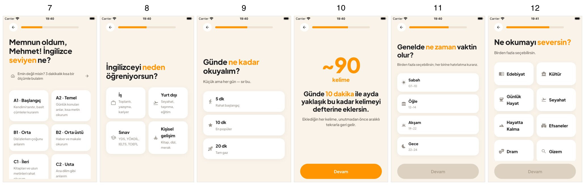
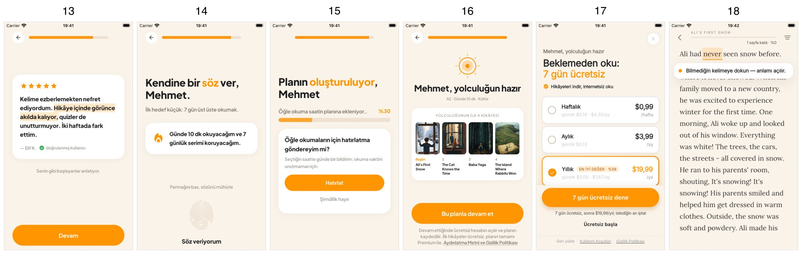
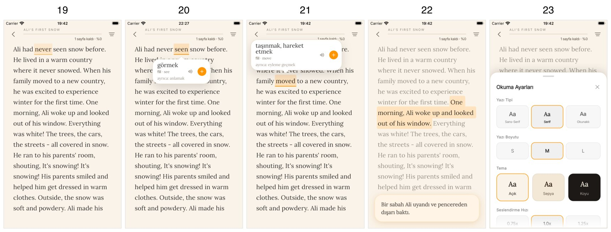
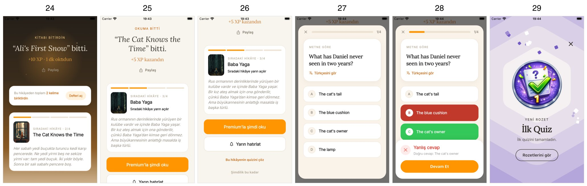
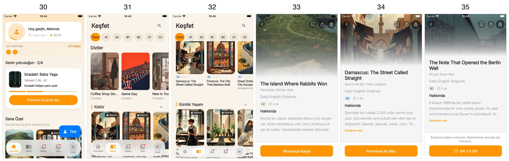
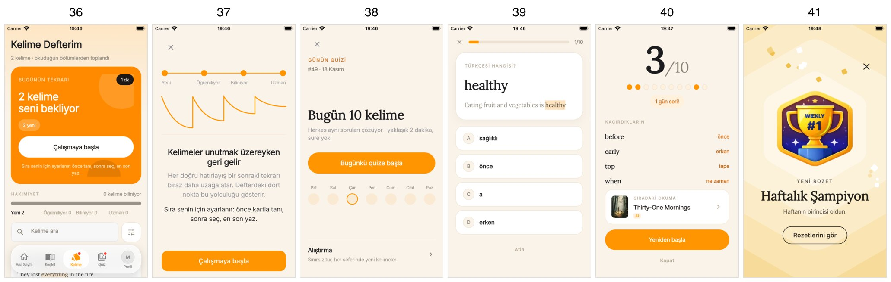
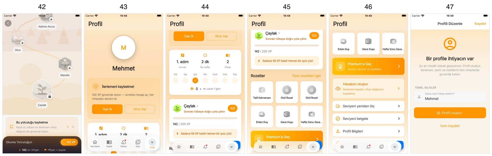
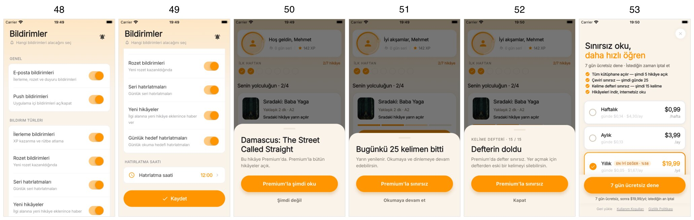
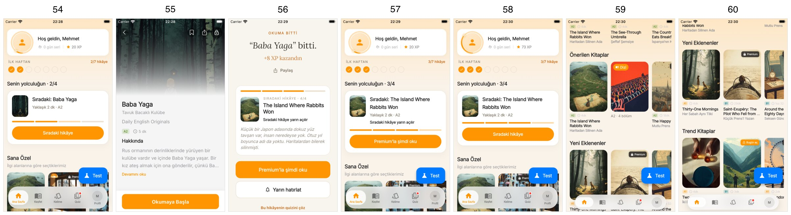

# Genel durum raporu – yol haritası toplantısı için

**Yazan:** editör. **Tarih:** 18 Kasım 2026. **Veri kesimi:** 18 Kasım 19:35 (TR); 18 Kasım yarım gündür.
**Görev:** `ortak/editor_gorevi_2026-11-18_genel_durum_raporu.md` ve `ortak/editor_gorevi_2026-11-18_xp_ekonomisi.md` (veri kısmı).
**Kurallar:** Kod ve veritabanı değişmedi. Canlıya `default_transaction_read_only = on` ile bağlanıldı; canlıda hiçbir satır değişmedi. Yalnız `AccountKind = 'customer'`; e-posta, ad, makbuz alınmadı.
**Görüntüler:** `raporlar/ekran_genel/` (SE 3, Sürüm 1 dalı, Mac'teki yerel sunucu ve yerel veritabanı).

## En üstte yedi satır

1. **Müşterinin elindeki uygulama 6 Kasım'ın uygulaması.** App Store'da 1.0.2 (45) yayında; müşterilerin en yeni sürümü iki platformda da 1.0.2+45. O günden beri yazılan 73 commit (ana dalda 29, Sürüm 1 dalında 44) hiçbir müşteriye ulaşmadı. Ölçüm düzeltmeleri de bunun içinde.
2. **Müşterilerin yarısı son 7 günde geldi ve eski ilk deneyimi gördü.** 311 müşterinin 158'i 12–18 Kasım'da kaydoldu; 76'sı yalnız 17 Kasım'da.
3. **Kayıp hâlâ ilk hikâyenin içinde.** 311 müşterinin 247'si okumaya başladı, 169'u bir hikâye bitirdi, 67'si ikinciyi bitirdi. Ertesi gün dönen 60/288 (%21), 7. gün dönen 4/153.
4. **Satış: 4 satın alma, hepsi iOS; 12 Kasım'dan beri 1 yeni.** Satın almaya basan 15 kişinin 11'i tamamlamadı; neden tamamlamadıkları kayıtlarda yok. Android'de gerçek satın alma hiç olmadı.
5. **Bildirim izni ve bildirimin ulaşması hâlâ ölçülemiyor.** 1.015 gönderime karşılık 18 açılış kaydı var. İzin alanı 311 müşterinin 310'unda boş.
6. **Sürüm 1'in kodu yalnız bu Mac'te.** Sunucu dalı (16 commit) ve uygulama dalı (44 commit) uzak depoda yok. Sunucu dalı ana dalın 26 commit gerisinden açılmış; çakışmasız birleşiyor ama birleşmiş hâli test edilmedi.
7. **Bilinmeyenler:** bildirim izni oranı, Play yorumları, e-postayla gelen şikâyetler, kullanıcının gördüğü hata iletileri, onboarding'i hesap açmadan bırakanlar, 11 kişinin ödemeyi neden tamamlamadığı.

---

## 1. Ne canlıda, ne bekliyor

### 1.1 Müşterilerin sürümü

Kişinin son olayındaki sürüm (`UserEvents.AppVersion`). 311 müşteri.

| Platform | Sürüm | Kişi | Son 7 günde görülen |
|---|---|---|---|
| iOS | 1.0.2+45 | 131 | 106 |
| iOS | 1.0.1+43 | 40 | 3 |
| iOS | 1.0.0+37 | 3 | 2 |
| iOS | sürüm yazılmamış ya da hiç olay yok | 20 | 8 |
| Android | 1.0.2+45 | 68 | 59 |
| Android | 1.0.0+41 | 36 | 5 |
| Android | 1.0.0+39 | 1 | 0 |
| Android | sürüm yazılmamış ya da hiç olay yok | 12 | 7 |

- App Store (ASC, salt okuma): 1.0.2 yayında. Yüklü derlemeler: 45 (6 Kas, yayındaki), 46 (12 Kas, yayınlanmadı). 47 numaralı derleme ASC'de yok.
- Play'de hangi sürümün yayında olduğu: **bilinmiyor** (bu oturumda Play Console'a erişimim yok). Android müşterilerin en yenisi 1.0.2+45.
- 32 müşterinin hiç olayı yok.

### 1.2 Canlı sunucu

- Canlı veritabanındaki son şema değişikliği `AddPhraseTypeAndUsage` (15 Kas). Bu, sunucu deposunda `master` dalının (`4e38267`, 16 Kas) son değişikliğiyle aynı.
- Canlıda `/api/Journey/starter` 404 dönüyor; yolculuk tabloları yok. Yani Sürüm 1'in sunucu kodu canlıda değil.
- Yayındaki commit'in kimliğini Railway'den doğrulayamadım (komut yanıt vermedi): **kesin commit bilinmiyor**, yukarıdaki iki gözlem `master` ile tutarlı.

### 1.3 Dallar

**Sunucu** (`DailyEnglish`)

| Dal | İçinde ne var | Uzak depoda | `master`'a göre | Durum |
|---|---|---|---|---|
| `master` | Canlıdaki kod: anlam motoru, kalıp türleri, bağlam anlamları | evet | – | canlıda |
| `feat/free-limits` | Okuma sayacı silindi; her çeviri sayılır; defter ilk günden 15 | **hayır** | 2 commit ileri, 26 geri | `feat/journey-core` içinde |
| `feat/journey-core` | Yolculuk tabloları ve uçları, ortak günlük hak, başlangıç önizlemesi (kapaklarla), onboarding teklifi anahtarı, eski sürüm için eski sayım, 44 satırlık merak cümlesi betiği | **hayır** | 16 commit ileri, 26 geri | birleşmedi |
| `feat/relative-word-gloss` | İlgi zamiri kuralı (13 Kas) | **hayır** | 1 commit ileri | birleşmedi; unutulmuş duruyor |
| Diğer 9 yerel dal | – | – | 0 ileri | hepsi `master`'da |

**Uygulama** (`Flutter`)

| Dal | İçinde ne var | Uzak depoda | `main`'e göre |
|---|---|---|---|
| `main` (`d5e43437`, 16 Kas) | 1.0.4+47 kodu: onboarding son ekranı ilk hikâyeyi açar, şerit ilk metinden sonra, kalıp türü etiketi, ölçüm düzeltmeleri | evet | – |
| `fix/paywall-trigger-attribution` | Paywall'u neyin açtığı kaydı | evet | 3 ileri |
| `feat/free-limits` | Sınır sayfaları, `limit_reached` | **hayır** | 5 ileri |
| `feat/journey-core` | Sürüm 1'in tamamı + 18 Kasım cihaz düzeltmeleri | **hayır** | 44 ileri, 0 geri |

Dallar zincir: `main` ← paywall-trigger (3) ← free-limits (2) ← journey-core (39).

**Hangisi yayına hazır:** hiçbiri tek başına. Sıra:
1. Sunucu: `master`'ı `feat/journey-core`'a birleştir, tam testi koş. Birleştirme denemesi çakışmasız; birleşmiş hâlin testi **koşulmadı**. Dalın kendi testi 1.543 geçti.
2. Sunucu yayını (Mehmet). Yayında `AddJourneys` değişikliği ve yolculuk tohumu canlıya kendiliğinden yazılır.
3. 44 satırlık merak cümlesi betiği (Mehmet "yaz" deyince).
4. Uygulama: kalan üç küçük iş (1.4), yeni derleme numarası (47 kullanılmış), TestFlight.
5. Mehmet'in beş kontrolü, bir gün kullanım, mağaza.

### 1.4 `guncel_is_listesi.md` A bölümü

| # | Madde | Durum |
|---|---|---|
| A1 | Teklif ekranında yarım görünen madde satırı (SE 3); büyük yazıda durum çubuğunun altına giren "Paylaş" | **başlanmadı** |
| A2 | Parmak izi %20 küçük | bitti (`f0abc66c`) |
| A2 | Teklifte ikinci yol yalnız "Ücretsiz başla" | bitti (`53a37f02`) |
| A2 | Ana sayfa kartından önce kapak sayfası | bitti (`824b4dc4`) |
| A2 | Karttan kapağa, kapaktan okumaya geçişin ayrı olaylarla ölçülmesi | kodda var: karttaki dokunuş `journey_next_tapped` (kaynak `home`), kapaktan okumaya geçiş `journey_stop_started` (kaynak `preview`). Kapak sayfasının **görüntülenmesi** ayrı olay değil. Olayların sunucuya düştüğünü yeni akışta ayrıca doğrulamadım |
| A3 | Kilitli 3. hikâyede iki kapı ("Premium'la devam et" / "Ücretsiz devam et: {tek hikâye}") | **başlanmadı** |
| A4 | Kariyer sayfası eski hâliyle; rütbe adları değişmez | bitti (`a0da839b`) |
| A5 | Değişen ekranların görüntüsü rapora | **yarım**: öğlene kadarkiler `2026-11-18_cihaz_geri_bildirimi_uygulama.md`'de; akşamki değişikliklerin (parmak izi, "Ücretsiz başla", kapak sayfası, balon düğme aralığı ve çentik, erişim reddi) görüntüleri bu raporun 2. bölümünde |
| A5 | TestFlight derlemesi | **başlanmadı**; sunucu yayınını bekliyor |
| Mehmet 1 | Mac'te 10 GB yer | var (12 GB boş) |
| Mehmet 2–4 | Sunucu yayını, "yaz", beş kontrol, mağaza | bekliyor |

Listede olmayan, 18 Kasım akşamı Mehmet'in doğrudan istediği ve biten işler: kelime balonunda düğme alanı 105 → 82 pt; balonun çentiğiyle gövdesi arasındaki çizgi kalktı; katalog önbelleği kilit bilgisini taşıyor (`aa1f9edc`); okuyucu sunucudan "erişim yok" alınca boş sayfa yerine kilit sayfasını gösteriyor. Hepsi yerel dalda.

### 1.5 Yarım kalmış bütün işler

Büyüklük: küçük = bir oturum; orta = birkaç oturum; büyük = bir haftadan uzun.

| İş | Ne durumda | Bitmesi için | Büyüklük |
|---|---|---|---|
| **Sürüm 1 (ilk oturum)** | 12 madde ve iki tur cihaz düzeltmesi yerel dallarda. A1 ve A3 kaldı. | 1.3'teki sıra | orta (çoğu bekleme) |
| **Çeviri elle düzeltme (tur04)** | 261 parçanın 62'si bitti (22:35). 4 işçi çalışıyor. Akşam 19:44'e kadar saatte 7–8 parça bitiyordu; bu raporun sürüşleri çalışırken 19:44–22:25 arasında yalnız 1 parça bitti, üç işçi yeniden başladı. Nedeni (makine yükü mü, kullanım sınırı mı) **bilinmiyor**. Önceki turlardan 50/263 premium metin canlıda. | İyi hızda kalan yaklaşık 25 saat işçi süresi; sonra doğrulama, kabul, SQL üretimi, yerel deneme, Mehmet onayıyla canlıya | büyük (süre); emek küçük |
| **Anlam motoru** | Geliştirme 16 Kasım'da kararla kapatıldı (`2026-11-16_motor_gelistirme_sonuc.md`). | Açıkta kalanlar: ilgi zamiri dalı (birleşmedi); sözlükte karşılığı olmayan 1.636 kelime; 795 makine çevirisi kaydı; sözlüğe eklenecek 41 ifade ve 52 birleşik isim adayı. Yapılıp yapılmayacağı karar. | orta |
| **Ölçüm olayları – kodda var, müşteride yok** | Paywall'u açan yüzey; `purchase_cancelled` / `purchase_failed`; telefonun bildirim izni; Android'de bildirimin ulaşması; `limit_reached`; kelime bakışında metin kimliği; yolculuk olayları | Yeni sürümün müşteriye ulaşması | iş yok; yayın bekliyor |
| **Ölçüm olayları – hiç yok** | Bildirime dokunuşta tür (kayıt var, tür boş); günün quizine giriş; onboarding'i hesap açmadan bırakan; kullanıcının gördüğü hata iletisi; kapak sayfasının görüntülenmesi | Kod | küçük |
| **Günde iki bildirim düzeni** | Yazıldı, ekip kararıyla geri alındı (`6b09cf5`) | Karar | küçük |
| **"Senin Yolculuğun" sayfası (harita)** | Yazıldı, Mehmet beğenmedi, eski kariyer sayfası geri geldi. Taslak: `ekran_2026-11-18b/taslak_harita.png` | Yeni taslak (XP görevi B), Mehmet onayı, sonra kod | orta |
| **Kelime balonu A/B** | Mehmet 18 Kas akşamı "tasarım aynı kalsın" dedi; yalnız düğme aralığı daraltıldı. Listede hâlâ "A mı B mi" yazıyor. | Listenin düzeltilmesi | – |
| **Onboarding sonu teklifi** | Yazıldı; sunucudan kapatılabilir (`Features__OnboardingOffer`) | Yayın | – |
| **Okuma değerlendirmesi ve sertifika** | Notlarıma göre sunucusu 7 Kasım'da canlıda, uygulama kodu `main`'de, 176 soru insan okumasından geçmedi. Profildeki "Seviyeni belgele" satırı buraya açılıyor. Müşteride hangi sürümle göründüğü: **bugün doğrulanmadı** | Soru okuması; karar | orta |
| **Merak cümleleri (`NextHook`)** | 287 metnin hepsinde boş. Başlangıç ve ilk yolculukların 44 satırı için betik hazır, yerel kopyada denendi | Mehmet "yaz" | küçük |
| **Kampanyalar** | Notlarıma göre (21 Eylül) paywall'daki indirimli fiyatın mağazada karşılığı yok. `winback_offer_shown` 2 müşteride kaydedilmiş. Bugünkü durumu **doğrulanmadı** | İnceleme | küçük |
| **Boşluk doldurma soruları** | Notlarıma göre (16 Ekim) hiç servis edilmiyor | Karar | küçük |
| **Onboarding "dinle" adımı ses hatası** | Simülatörde 8 sürüşte 1 kez görüldü; incelenmedi | İnceleme | bilinmiyor |
| **Bildirim tercihini kaydetme hatası** | 6 müşteride `PUT /api/mobile/notification-preferences` 500 döndü (5. bölüm); incelenmedi | İnceleme | bilinmiyor |
| **Android satın alma** | Gerçek satın almayla hiç doğrulanmadı; Play kapalı test kanalı bekliyor | Mehmet + deneme | küçük |
| **Test takımı veritabanı sızdırıyor** | Her koşu `de_test_*` bırakıyor; 18 Kasım'da 123 tane birikti ve disk doldu | Kod | küçük |
| **A1 içeriği** | 24 metin, 7.250 kelime; `2026-11-17_katalog_dokumu.md` | İçerik | büyük |
| **Eski notlar** | `API_CLIENT_SECRET` yenilenmesi (Temmuz'dan beri); iOS en düşük sürümün 15'e çıkması (Nisan 2027'den önce). Bugün doğrulanmadı | Mehmet | küçük |

### 1.6 Kırılgan yerler

Son iki haftada (4–18 Kas, bütün dallar) uygulamada 80 commit'in 33'ü, sunucuda 66 commit'in 21'i düzeltme.

| Uygulama: dosya | Düzeltme commit'i |
|---|---|
| `premium_paywall_page.dart` | 6 |
| `advanced_reader_page.dart` | 6 |
| `word_balloon.dart` | 4 |
| `advanced_reader_bloc.dart`, `v2_scaffold.dart`, `step_13_plan_summary.dart`, `step_11_commitment.dart`, `home_page.dart` | 3'er |

Akışa göre: okuyucu 10, paywall 9, onboarding 5, ağ katmanı 2. Sunucuda: kelime anlamı 6 (`ReadingTextData.cs` 4), yönetim paneli 4.

Sayının göstermediği, benim gördüğüm üç yer:
- **Küçük ekran + büyük yazı.** Paywall ve onboarding'e her dokunuşta SE 3'te bir şey taştı ya da gizlendi (seçili plan, başlık, plan adları, "Paylaş"). Bugün elle iki sürüşle yakalanıyor.
- **Ağ ve önbellek.** Hatalar sessiz: aynı isteği birleştiren katman önbelleğin önündeydi ve bir isteği 45 saniye bekletiyordu; katalog önbelleği kilit bilgisini saklamıyordu ve kilitli metin açık görünüyordu. İkisi de testlerde değil, cihazda bulundu.
- **Bitiş ekranı.** Okuyucu sayfasının içinde (`advanced_reader_page.dart`, iki haftada 6 düzeltme); hatırlatma, teklif, quiz, sıradaki hikâye aynı yerde yarışıyor.

**Çökme paneli** (41 kayıt; 20'si geliştirici, 12'si testçi, 3'ü müşteri, 6'sı hesapsız). Tekrar sayısına göre ilk beş:

| # | Kayıt | Tekrar | Tarih | Sürüm | Müşteri | Çözüldü |
|---|---|---|---|---|---|---|
| 1 | `FormatException: Invalid radix-10 number` | 6 | 17–19 Eyl | iOS 1.0.0 | 0 | evet |
| 2 | Sunucu 504 (`DioException`) | 6 | 21–23 Eyl | Android 1.0.0+14…22 | 0 | evet |
| 3 | Apple ile giriş başarısız (`apple/sdk/unavailable`) | 3 | 31 Eki, 14 Kas | iOS 1.0.0+37, 1.0.2+45 | 0 (hesapsız) | **hayır** |
| 4 | `Null check operator used on a null value` | 3 | 25 Eyl – 4 Eki | iOS 1.0.0+23, +29 | 0 | hayır |
| 5 | `Bad state: No element` | 2 | 3 Eyl, 3 Kas | iOS 1.0.0, 1.0.0+37 | 1 | hayır |

Son iki haftada panele 3 kayıt düştü: Google ile giriş hatası (16 Kas, testçi, Android 1.0.2+45), sertifika doğrulama hatası (15 Kas, müşteri, iOS), Apple ile giriş (14 Kas). Panelin müşteride neredeyse boş olması çökme olmadığını mı, kaydın gelmediğini mi gösteriyor: **bilinmiyor**.

---

## 2. Uygulama turu

SE 3, Sürüm 1 dalı (`feat/journey-core`), normal yazı boyu, yeni kullanıcı (ad "Mehmet", seviye A2, günde 10 dk). Her pano soldan sağa numaralı. Tek tek kareler aynı klasörde.

**Görüntülerdeki üç yapaylık:** fiyatlar dolar (simülatörün mağazası; müşteri TL görür); mavi "Test" düğmesi yalnız deneme derlemesinde çıkar; "Haftalık Şampiyon" rozeti yerel veritabanında tek kullanıcı olduğu için düştü.

### 2.1 Onboarding (15 ekran) ve teklif

1. **Değer önerisi.** "Ezberleyerek değil, okuyarak öğren." Tek düğme: Devam.
2. **Kelimeye dokun.** Örnek cümlede "landmarks" işaretli; dokunmadan Devam açılmıyor.
3. **Balon açıldı.** Anlam görünür; turuncu artıyla deftere eklenir (isteğe bağlı). Devam açılır.
4. **Dinleyerek oku.** Örnek cümleyi oynatır; dinlemeden Devam açılmıyor. (Bilinen ses hatası bu adımda.)
5. **30 günde nereye gelirsin.** Okuma ile ezberi karşılaştıran çizim; Devam.
6. **Ad.** Yazar ya da "Atla".

7. **Seviye.** A1–C2 kutuları; üstte "3 dakikalık kısa bir ölçüm" bağlantısı (yerleştirme sınavına gider).
8. **Neden öğreniyorsun.** İş, yurt dışı, sınav, kişisel gelişim.
9. **Günde ne kadar.** 5, 10, 20 dakika.
10. **Kelime tahmini.** "Günde 10 dakika ile ayda yaklaşık 90 kelime"; Devam.
11. **Ne zaman vaktin olur.** Sabah, öğle, akşam, gece; seçilen her saate hatırlatma kurulacağını söyler.
12. **Ne okumayı seversin.** İlgi alanları; başlangıç yolculuğunun seçiminde kullanılır.

13. **Kullanıcı yorumu.** Beş yıldız, "Elif K., doğrulanmış kullanıcı". Gerçek yorum mu: bilmiyorum (6.1).
14. **Söz ver.** "Günde 10 dk okuyacağım ve 7 günlük serimi koruyacağım"; parmak izine basılı tutulur (18 Kasım'da %20 küçüldü).
15. **Plan oluşturuluyor + hatırlatma sorusu.** "Hatırlat" derse telefonun bildirim izni penceresi açılır; "Şimdilik hayır" derse açılmaz. **Bildirim izni ilk kez burada istenir.** Sistem penceresinin kendisi turda yakalanmadı.
16. **Yolculuğun hazır.** Seviyenin dört başlangıç hikâyesi kapaklarıyla; "Bu planla devam et" misafir hesabı açar.
17. **Teklif.** "Beklemeden oku: 7 gün ücretsiz"; üç plan; altta "Ücretsiz başla". Başlığın altındaki madde satırlarından yalnız biri görünüyor (A1'deki açık düzeltme).
18. **İlk hikâye açıldı.** "Ücretsiz başla" doğrudan birinci hikâyeyi açar; ana sayfa araya girmez. İlk saniyede "Bilmediğin kelimeye dokun" ipucu.

### 2.2 Okuma

19. **Okuyucu.** Üstte geri, ilerleme çizgisi, ayarlar. Sayfa kaydırılarak çevrilir.
20. **Kelime balonu** (18 Kasım akşamki hâli: düğmeler sıkı, çentik gövdeyle tek parça). Anlam, tür, "ayrıca" satırı; hoparlör kelimeyi okur, artı deftere ekler.
21. **Balon, uzun anlam.** Anlam iki satıra sarınca balon genişler. Artıya basınca kelime deftere eklenir ve balon kendiliğinden kapanır.
22. **Cümle çevirisi.** Cümleye basılı tutulur; cümle işaretlenir, Türkçesi altta kart olarak çıkar. Ekranda bunu söyleyen bir işaret yok.
23. **Okuma ayarları.** Yazı tipi, boyut, tema, seslendirme hızı.

**Dinleme karesi yok.** Okuyucunun altındaki oynatma çubuğu yerel deneme veritabanında ses kaydı olmadığı için çıkmadı. Canlıda çubukta oynat/duraklat düğmesi var; okunan cümle metinde işaretlenir.

### 2.3 Bitiş ve metin quizi

24. **1. hikâye bitti.** XP, "Paylaş", bu hikâyeden deftere giren kelimeler, sıradaki hikâyenin kartı (kapak, 2/4, merak cümlesi). Altta ana düğme "Sıradaki hikâye" (karede kartın altında).
25. **2. hikâye bitti (ilk günün ikinci hakkı kullanıldı).** Kartta "Sıradaki hikâye yarın açılır". Ana düğme "Premium'la şimdi oku" (paywall'a gider).
26. **Aynı ekranın altı.** İkinci kapı "Yarın hatırlat" (bildirim izni burada da istenebilir), "Bu hikâyenin quizini çöz" bağlantısı, "Şimdilik bu kadar" (ana sayfa). SE 3'te ikinci kapı ilk bakışta ekranın altında kalıyor.
27. **Metin quizi.** Dört soru, "Türkçesini gör" bağlantısı.
28. **Cevap.** Yanlışta doğru şık gösterilir; "Devam Et".
29. **Rozet kutlaması.** Quizden sonra "İlk Quiz" tam ekran; "Rozetlerini gör" ya da çarpı. Quiz sonuç ekranının karesi boş çıktı (çekim anı mı, hata mı: bilinmiyor).

### 2.4 Ana sayfa, Keşfet, kapak sayfası

30. **Ana sayfa (ilk gün, iki hikâyeden sonra).** Kişi kartı (seri, XP; karede "0 gün seri" yazıyor, oysa günün quizi sonucu aynı oturumda "1 gün seri" diyor: yerel ortama mı özgü, hata mı, bilinmiyor), "İlk haftan 2/7 hikâye", "Senin yolculuğun · 2/4" kartı: sıradaki hikâye yarın açılır, düğme "Premium'la şimdi oku". Altında "Sana Özel" rafı. Alt çubuk: Ana Sayfa, Keşfet, Kelime, Quiz, Profil.
31. **Keşfet.** Seviye süzgeci, "Diziler" rafı, kategori rafları.
32. **Keşfet, aşağısı.** Kartların çoğunda "Premium" etiketi.
33. **Kapak sayfası, açık metin.** Başlık, Türkçe alt başlık, seviye, süre, "Hakkında"; düğme "Okumaya Başla".
34. **Kapak sayfası, kilitli metin.** Aynı sayfa; düğme "Premium ile Oku" (paywall).
35. **Kapak sayfası, günlük havuz metni, hak kullanılmış.** "Bugünkü hakkını kullandın. Beklemeden okumak için Premium." ve gece yarısına geri sayım.

### 2.5 Kelime ve quiz

36. **Kelime Defterim.** "Bugünün tekrarı: 2 kelime seni bekliyor", "Çalışmaya başla"; altında hakimiyet çizgisi ve kelime listesi.
37. **Kelime çalışması girişi.** Aralıklı tekrarı anlatan ekran; "Çalışmaya başla" kartlara götürür. Kartların kendisi turda çekilmedi.
38. **Quiz sekmesi.** "Günün Quizi #49 · Bugün 10 kelime", haftanın günleri, altta "Alıştırma".
39. **Günün quizi sorusu.** Kelime, örnek cümle, dört Türkçe şık; "Atla".
40. **Günün quizi sonucu.** Skor, kaçırılan kelimeler, "Sıradaki okuma" kartı, "Yeniden başla".
41. **Rozet.** (Yerel veritabanına özgü; yukarıdaki not.)

### 2.6 Kariyer ve profil

42. **Kariyer sayfası (eski hâli).** Rütbe düğümleri bir yol üzerinde: Çaylak, Meraklı, Okur, Kelime Avcısı; hepsi kilitli. Altta "Okuma Yolculuğun 142 XP" ve misafire "Bu yolculuğu kaybetme" uyarısı.
43. **Profil.** Misafir kullanıcıya "İlerlemeni kaybetme! Üye ol / Giriş yap".
44. **Profil, özet.** Unvan, haftalık süre, kitap sayısı, haftanın günleri, seri.
45. **Profil, rütbe ve rozetler.** "Çaylak 142/200 XP · Sadece 58 XP kaldı! Hemen bir quiz çöz!"; rozet ızgarası.
46. **Profil, bağlantılar.** Premium'a geç, hesabını oluştur, seviyeni yeniden ölç, seviyeni belgele, profil bilgileri.
47. **Profil oluştur.** Misafir için ad ve hesap açma.

### 2.7 Ayarlar, kilit, sınırlar, paywall

48. **Bildirim ayarları.** E-posta ve push ana anahtarları; türler: ilerleme, rozet, seri, yeni hikâyeler, günlük hedef.
49. **Bildirim ayarları, altı.** Hatırlatma saati ve "Kaydet". (Canlıda 6 müşteri bu kayıtta sunucu hatası aldı; 5. bölüm.)
50. **Kilitli içerik sayfası.** "Bu hikâye Premium'da"; "Premium'la şimdi oku" / "Şimdi değil". A3'teki iki kapı ("Ücretsiz devam et: {hikâye}") henüz yok.
51. **Çeviri sınırı.** "Bugünkü 25 kelimen bitti. Yarın yenilenir"; "Premium'la sınırsız" / "Okumaya devam et".
52. **Defter sınırı.** "Defterin doldu 15/15"; "Premium'la sınırsız" / "Kapat".
53. **Paywall (normal).** "Sınırsız oku, daha hızlı öğren"; dört madde; haftalık, aylık, yıllık; "7 gün ücretsiz dene"; altta geri yükle ve koşullar. Maddelerde "şimdi 5 hikâye açık" yazıyor; bu sayının doğruluğunu denetlemedim.

### 2.8 İkinci gün ve yedinci gün

54. **2. gün, ana sayfa.** Yolculuk kartında dün "yarın açılır" yazan hikâye açık; düğme "Sıradaki hikâye". "İlk haftan 2/7". Altında "Sana Özel" rafı. O güne özel başka kart yok: günün quizi, kelime tekrarı ya da seri için ana sayfada ayrı bir kart çıkmıyor.
55. **Kapak sayfası.** Karttaki düğme önce buraya getirir (18 Kasım değişikliği); "Okumaya Başla" hikâyeyi açar.
56. **2. gün, 3. hikâye bitti.** Kartta 4/4 ve "Sıradaki hikâye yarın açılır"; "Premium'la şimdi oku" ve "Yarın hatırlat". İkinci günden itibaren günde bir hikâye.
57. **2. gün, okuduktan sonra ana sayfa.** "Senin yolculuğun · 3/4", sıradaki yarın açılır, düğme "Premium'la şimdi oku".
58. **7. gün, ana sayfa** (2. günden sonra beş gün hiç açmamış kullanıcı). Düzen aynı: kişi kartı, "İlk haftan 3/7", yolculuk kartında "Sıradaki hikâye" açık. "Geri döndün", kırılan seri ya da kaçırılan günler için bir kart **yok**.
59. **7. gün, aşağısı.** "Sana Özel", "Önerilen Kitaplar".
60. **7. gün, en alt.** "Yeni Eklenenler", "Trend Kitaplar" (günlük havuz metninde "Bugün aç" etiketi).

**Bu iki günün sınırı:** günler, yerel deneme veritabanında kullanıcının tarihleri geri alınarak elde edildi. Sunucudan gelen her şey (yolculuk, günlük hak, raflar) doğru günü gördü. Telefonun kendi sakladığı tarihlere bakan bir kart varsa (ör. ilk hafta sayacı, geri kazanma teklifi) burada çıkmamış olabilir; hangilerinin öyle olduğunu ayrıca taramadım. Her gün okuyan birinin 7. gününü (kesintisiz seri) bu yöntemle üretemedim: **bilinmiyor**.

---

## 3. Sayılar

**Kimler:** 311 müşteri (iOS 194, Android 117). İlk kayıt 30 Ekim. **Gün:** Türkiye takvim günü. **"Son 7 gün":** 12–18 Kasım. Kişi sütunlarında "son 7 gün" o günlerde kaydolanları, olay sütunlarında o günlerde olanı gösterir; hangisi olduğu başlıkta yazıyor.
Önceki raporda olan sayının yanında raporun adı var; yanında ad olmayan sayı bu rapor için sorgulandı.

### 3.1 Müşteri

| | Bugüne kadar | Son 7 günde kaydolan |
|---|---|---|
| Hepsi | 311 | 158 |
| iOS | 194 | 98 |
| Android | 117 | 60 |

| Kayıt haftası | Müşteri | iOS | Android |
|---|---|---|---|
| 26 Eki (30 Eki'den) | 27 | 5 | 22 |
| 2 Kas | 99 | 69 | 30 |
| 9 Kas | 65 | 51 | 14 |
| 16 Kas (3 gün) | 120 | 69 | 51 |

Gün gün (12–18 Kas): 13, 8, 11, 6, 21, **76**, 23 (yarım gün). 17 Kasım'daki 76'nın 44'ü App Store, 29'u Play. Sıçramanın nedeni: **bilinmiyor** (uygulama kayıtlarında kaynak ayrıntısı yok).

### 3.2 Onboarding ve ilk hikâyeler

| | Bugüne kadar (311) | Son 7 günde kaydolan (158) |
|---|---|---|
| Hesabı açılan (onboarding'i bitiren) | 311 | 158 |
| Okumaya başlayan | 247 (%79) | 128 (%81) |
| Bir hikâye bitiren | 169 (%54) | 94 (%59) |
| İki hikâye bitiren | 67 (%22) | 38 (%24) |
| Dört hikâye bitiren | 12 | 5 |

- Hesap onboarding'in sonunda açılıyor. **Onboarding'i yarıda bırakıp hesap açmayan kişi sayısı bilinmiyor.** Ekran sayacı (`OnboardingScreenCounts`) test cihazlarını da sayıyor ve ilk altı ekranı yalnız yeni sürümlerde yazıyor; bu soruya cevap vermiyor.
- Hesabı açılanlarda adım kaydı düz: 258 kişinin adım olaylarında her adıma 246–253 kişi varmış.
- "Bitiren": ilerleme kaydı (`IsCompleted`) ya da `reading_completed` olayı. Yalnız ilerleme kaydıyla 163, yalnız olayla 129.

### 3.3 Dönüş

Tanım `2026-11-16_neden_kalmiyorlar.md` ile aynı: kayıt gününden N gün sonraki takvim gününde hata dışı en az bir olay. O raporda (15 Kas'a kadar): D1 36/185, D3 17/166, D7 3/126.

| Kayıt haftası | D1 | D3 | D7 |
|---|---|---|---|
| 26 Eki, 2 Kas | önceki raporda | önceki raporda | önceki raporda |
| 9 Kas (yeni: hafta tamamlandı) | 12/65 | 5/65 | 1/27 (9–11 Kas kaydolanlar) |
| 16 Kas (16–17 Kas kaydolanlar) | 23/97 | henüz yok | henüz yok |
| **Bugüne kadar** | **60/288 (%21)** | **19/191 (%10)** | **4/153 (%3)** |

| | D1 bugüne kadar | D1, 11–17 Kas kaydolanlar |
|---|---|---|
| iOS | 44/184 (%24) | 20/91 |
| Android | 16/104 (%15) | 10/48 |

17 Kasım'da kaydolan 76 kişinin D1'i yarım günle ölçüldü; 16 Kas haftasının sayısı alt sınırdır.

### 3.4 Satış hunisi

`2026-11-17_satin_alma_anlari.md` (17 Kas'a kadar, 261 müşteri): ilk 2 dakikada şerit gören 195, paywall gören 93, satın almaya basan 14, alan 4.

| | Şerit gören | Şeride dokunan | Paywall gören | Satın almaya basan | Alan |
|---|---|---|---|---|---|
| Bugüne kadar (311) | 295 | 30 | 113 | 15 | 4 |
| iOS | 184 | 22 | 75 | 11 | 4 |
| Android | 111 | 8 | 38 | 4 | 0 |
| Son 7 gün (olayın günü) | 172 | 15 | 67 | 6 | 1 (13 Kas) |

**Yüzeye göre.** Müşteri sürümleri paywall'u neyin açtığını yazmıyor (hepsi `manual`). Aşağıdaki tablo paywall gösteriminden önceki 60 saniyedeki son olaydan çıkarım:

| Paywall'dan hemen önce | Gösterim | Kişi | iOS | Android |
|---|---|---|---|---|
| Kayıt yok | 50 | 38 | 23 | 15 |
| Premium şeridine dokunuş | 33 | 30 | 22 | 8 |
| Hikâye bitişi | 24 | 24 | 17 | 7 |
| Kilitli kitap | 15 | 14 | 9 | 5 |
| Kilitli dizi bölümü | 8 | 7 | 5 | 2 |
| "N. gün dönüşü" kaydı (uygulama açılışı) | 8 | 8 | 3 | 5 |
| Bitiş ekranı düğmesi | 7 | 7 | 4 | 3 |
| Diğer (12 ayrı olay) | 25 | – | – | – |

Kilit yüzeyleri (paywall'dan ayrı; kilide dokunma):

| Yüzey | Dokunuş | Kişi | Son 7 gün: dokunuş / kişi |
|---|---|---|---|
| Kilitli dizi bölümü | 306 | 55 | 173 / 34 |
| Kilitli kitabın kapak sayfası | 192 | 77 | 91 / 47 |
| Kapak sayfasında "okumaya başla" | 7 | 5 | 5 / 3 |
| Kariyer sayfası şeridi | 13 | 10 | 4 / 4 |

Satın almaya basanların tek tek yüzeyi: `2026-11-17_satin_alma_anlari.md` S1–S6. Basıp tamamlamayan 11 kişi için neden: **bilinmiyor**.

**Abonelik (bugün):**

| | Sayı |
|---|---|
| Etkin ödeyen | 3 (1 yıllık: denemeden ücretliye döndü; 2 aylık) |
| Deneme durumunda | 0 |
| İptal eden | 1 (yıllık denemeyi 7. günde kapattı; süresi doldu) |
| Android | 0 |

### 3.5 Özellik kullanımı

| Özellik | Kullanan (311'de) | Kişi başı ortanca | Toplam | Son 7 günde kullanan | Son 7 gün toplam |
|---|---|---|---|---|---|
| Kelimeye dokunma | 210 (%68) | 21 | 7.627 | 128 | 4.318 |
| Cümle dinleme | 181 (%58) | 22 cümle | 5.378 | 105 | 2.879 |
| Cümle çevirisi | 69 (%22) | 9 | 1.325 | 44 | 659 |
| Deftere ekleme | 110 (%35) | 7,5 kelime | 1.454 | 67 | 824 |
| Metin quizi | 125 (%40) | 1 | 236 | 76 | 145 |
| Günün quizi | 85 (%27) | 1 tur | 149 (139 bitti) | 49 | 65 |
| Kelime alıştırma turu | 60 (%19) | 1 tur | 118 | 36 | 52 |
| Kelime çalışması (defterden) | 47 (%15) | 1 oturum | 86 | 27 | 41 |
| Günlük hakla metin açma | 62 (%20) | 1 | 84 | 45 | – |
| Kariyer sayfası | 37 (%12) | 1 | 49 açılış | 23 | 26 |

- Kariyer sayfası için önceki sayı: 25/243 (`2026-11-17_okuma_yolculugu_verisi.md`). Açılışların kaynağı: kutlama 26, profil sayfası 12, ana sayfa kişi kartı 11.
- Defterde en az bir kez tekrar edilmiş kelime: 568 (35 kişi).
- **Seri.** En uzun seri: 0 gün 90 kişi, 1 gün 170, 2 gün 34, 3 gün 6, 4 gün 5, 5 gün 2, 7 ve üzeri 4. Bugün serisi 2 ve üzeri olan 19 kişi.

### 3.6 Dönenleri dönmeyenlerden ayıran ne

İlk dört satırın 15 Kasım'a kadarki hâli `2026-11-16_neden_kalmiyorlar.md` S2'de (127 okur). Aşağıda aynı tanımla 17 Kasım'a kadar kaydolan ve ilk 24 saatte okumaya başlayan 204 müşteri var. Sütunlar: ertesi gün dönen / o eylemi yapan ya da yapmayan.

| İlk 24 saatte | Yaptı | Yapmadı |
|---|---|---|
| Bir hikâye bitirdi | 42/112 (%38) | 13/92 (%14) |
| Cümle çevirdi | 25/52 (%48) | 30/152 (%20) |
| Metin quizi çözdü | 37/99 (%37) | 18/105 (%17) |
| Deftere kelime ekledi | 28/85 (%33) | 27/119 (%23) |
| Cümle dinledi | 42/157 (%27) | 13/47 (%28) |
| **Yeni:** günün quizini çözdü | 25/56 (%45) | 30/148 (%20) |
| **Yeni:** kelime alıştırma turu yaptı | 19/39 (%49) | 36/165 (%22) |
| **Yeni:** defterden kelime çalıştı | 17/31 (%55) | 38/173 (%22) |
| **Yeni:** günlük hakla metin açtı | 21/42 (%50) | 34/162 (%21) |
| **Yeni:** bildirim izni verdi | **bilinmiyor** | |
| Bildirim adresi (token) var | 54/184 (%29) | 1/20 |

- İlk 24 saatte hiç okumayan 84 kişiden ertesi gün dönen 5.
- Dinleme ayırmıyor. Okumanın **dışına** çıkan her eylem (quiz, kelime çalışması, ikinci bir metni açma) dönüşle birlikte görülüyor.
- Bu bağıntıdır. Hevesli kullanıcı her şeyi daha çok yapar; bu eylemleri yaptırmanın aynı kişiyi geri getireceğini göstermez. Hücreler 30–60 kişi.

### 3.7 Bildirim

- **İzin oranı: bilinmiyor.** `OsNotificationPermission` 311 müşterinin 310'unda boş (alanı dolduran derleme 46 ve sonrası; müşteriler 45'te).
- Bildirim adresi olan: iOS 189/194 (%97), Android 93/117 (%79). Adres izin demek değildir.
- **Ulaşma: bilinmiyor.** `ReceivedAt` 1.015 gönderimin hepsinde boş.
- 246 müşteriye 1.015 bildirim gitti (16 Kasım raporunda 177 kişi, 803). Bildirime dokunma kaydı: 18 (10 kişi); son 7 günde 8. Dokunma kaydı türü taşımıyor; türe göre açılma **bilinmiyor**.

Son 7 gün (12–18 Kas), 212 kişiye 494 gönderim; "2 saat içinde uygulamada" bildirimin etkisi demek değildir:

| Tür | Bugüne kadar gönderim | Son 7 gün gönderim | Son 7 gün: 2 saat içinde uygulamada |
|---|---|---|---|
| Günün quizi | 187 | 103 | 7 |
| Kelime tekrarı | 177 | 107 | 3 |
| Seri başlat | 154 | 68 | 5 |
| Günlük açılan metin | 154 | 16 | 0 |
| İlk okumaya çağrı | 139 | 72 | 2 |
| Geri dön | 130 | 85 | 1 |
| Günlük hatırlatma | 39 | 35 | 4 |
| Seri hatırlatma | 24 | 5 | 0 |
| Seri telafisi, tanıtım, deneme bitiyor | 11 | 3 | 0 |
| **Toplam** | **1.015** | **494** | **22 (%4)** |

15 Kasım'a kadarki tür tablosu: `2026-11-16_neden_kalmiyorlar.md` S7.

### 3.8 XP ve rütbe (`editor_gorevi_2026-11-18_xp_ekonomisi.md`, veri kısmı)

**1. Kurallar** (`GamificationConstants.cs`, `LevelLadder.cs`; özet `2026-11-18_rutbe_esikleri_ve_adlari.md` bölüm 1'de)

| Eylem | XP |
|---|---|
| Okuma | dakika başına 10 |
| Metin quizi | doğru başına 5 (5 soruda en çok 25) |
| Kelime quizi (günün quizi, alıştırma) | doğru başına 2 |
| Defterde kart çalışması | doğru kelime başına 1 |
| Seri | gün başına 10 |
| 2. gün sürprizi | 25, bir kez |
| Sürpriz sandık | 25, 50 ya da 75; %8 olasılık, 7 günde bir |
| Rozet | 10–100 (müşteride görülen 10–60) |
| Günlük tavan | 300 (2. gün sürprizi ve rozet tavandan muaf) |
| **Premium çarpanı** | **yok** (kodda XP'yi Premium'a göre değiştiren bir kural bulamadım; Premium'un farkı seri dondurma hakkında) |

`LevelSystems` tablosunun tamamı (18 satır; 12'si etkin):

| Sıra | Ad | İngilizce | Bölge | Kademe | Min XP | Max XP | Etkin |
|---|---|---|---|---|---|---|---|
| 1 | Çaylak | Rookie | Başlayan | 1-1 | 200 | 899 | evet |
| 2 | Meraklı | Curious | Başlayan | 1-2 | 900 | 1.939 | evet |
| 3 | Okur | Reader | İlerleyen | 2-1 | 1.940 | 3.289 | evet |
| 4 | Kelime Avcısı | Word Hunter | İlerleyen | 2-2 | 3.290 | 5.049 | evet |
| 5 | Hikâye Avcısı | Story Seeker | Alışan | 3-1 | 5.050 | 7.329 | evet |
| 6 | Kâşif | Explorer | Alışan | 3-2 | 7.330 | 10.299 | evet |
| 7 | Kitap Kurdu | Bookworm | Derinleşen | 4-1 | 10.300 | 14.169 | evet |
| 8 | Aydın | Scholar | Derinleşen | 4-2 | 14.170 | 19.189 | evet |
| 9 | Simyacı | Alchemist | Ustalaşan | 5-1 | 19.190 | 25.709 | evet |
| 10 | Usta | Master | Ustalaşan | 5-2 | 25.710 | 34.199 | evet |
| 11 | Bilge | Sage | Evinde | 6-1 | 34.200 | 45.219 | evet |
| 12 | Efsane | Legend | Evinde | 6-2 | 45.220 | 9.999.999 | evet |
| – | Öğrenci, Rehber, Öncü, Amiral, Fatih, Efsane (eski) | | | x-3 | 1.800 … 350.000 | | hayır |

"Kademe" sütunu tablodaki `CefrLevel`-`SubLevelNumber` alanlarıdır; adı öyle olsa da dil seviyesi değil, bölge numarasıdır. 200 XP'nin altındaki kullanıcının rütbesi yok.

**XP nereden geliyor** (müşterilerin toplam 37.422 XP'si):

| Kaynak | Pay | Kişi |
|---|---|---|
| Okuma | %49 | 208 |
| Rozet | %21 | 172 |
| Kelime quizi | %11 | 85 |
| Metin quizi | %8 | 120 |
| Sürpriz sandık | %5 | 40 |
| 2. gün sürprizi | %3 | 43 |
| Seri | %2 | 44 |
| Kart çalışması | %1 | 31 |

**2. Dağılım** (311 müşteri; ortanca 53, %75'lik 154, %90'lık 329, en yüksek 1.318)

| Toplam XP | Kişi |
|---|---|
| 0 | 90 |
| 1–19 | 24 |
| 20–49 | 40 |
| 50–99 | 47 |
| 100–149 | 30 |
| 150–199 | 20 |
| 200–499 | 47 |
| 500–899 | 10 |
| 900–1.939 | 3 |

| Rütbe | Varan | Kayıttan kaç gün sonra (çeyrekler) | O an bitmiş hikâye (çeyrekler) |
|---|---|---|---|
| Çaylak (200) | 60 (%19) | 0,02 – 0,5 – 1,1 gün; 28'i kayıt gününde, 22'si ertesi gün | 1 – 2 – 2 |
| Meraklı (900) | 3 (az veri) | 3,9 – 4,2 – 4,3 gün | 5 (4–7) |
| Okur ve üstü | 0 | | |

Bitirilen hikâyeye ve etkin güne göre bugünkü toplam XP (çeyrekler):

| Biten hikâye | Kişi | XP | | Etkin gün | Kişi | XP |
|---|---|---|---|---|---|---|
| 0 | 148 | 0 – 0 – 15 | | 0–1 | 225 | 0 – 31 – 101 |
| 1 | 98 | 57 – 95 – 150 | | 2 | 49 | 53 – 152 – 283 |
| 2 | 31 | 127 – 189 – 280 | | 3 | 20 | 14 – 73 – 271 |
| 3 | 23 | 308 – 341 – 482 | | 4 | 7 (az veri) | 156 – 199 – 412 |
| 4 ve üzeri | 11 (az veri) | 386 – 660 – 879 | | 5 ve üzeri | 10 (az veri) | 568 – 711 – 817 |

**3. İlk oturum** (17 Kas'a kadar kaydolan 288 müşteri)

| İlk gün kazanılan XP | Ortanca | %75 | %90 |
|---|---|---|---|
| Kayıt günü, herkes (288) | 30 | 103 | 182 |
| Kayıt günü, XP'si olanlar (185) | 70 | 147 | 214 |
| İlk 24 saat, XP'si olanlar | 83 | 170 | 260 |

Kayıt gününde 200 XP'yi geçen 24 kişi, 300'ü geçen 9 kişi (en yüksek 390).

N. hikâye bittikten sonraki 5 dakikada birikmiş XP (okuma + quiz + o an düşen rozetler; çeyrekler):

| | Quizsiz | Quizli | Hepsi |
|---|---|---|---|
| 1. hikâye | 36 – 55 – 77 (60 kişi) | 87 – 117 – 157 (103) | 59 – 92 – 136 (163) |
| 2. hikâye | 74 – 106 – 177 (10, az veri) | 181 – 246 – 314 (55) | 158 – 224 – 302 (65) |
| 4. hikâye | yok | 364 – 390 – 627 (11, az veri) | aynı |

İlk hikâye bitene kadar yalnız okumadan gelen XP: %10'luk 21, ortanca 44.

**4. Kutlama**

| | Kişi | Ertesi gün dönen |
|---|---|---|
| Çaylak'a yükselen (17 Kas'a kadar) | 51 | 18 (%35) |
| Bir günde 100–199 XP kazanıp rütbeye varmayan | 41 | 4 (%10) |

Bu karşılaştırma görevin istediği "aynı etkinlik düzeyi"ni tam karşılamıyor: rütbe gününde ortanca 214 XP kazanılmış, karşılaştırma grubunda en çok 199. Fark, rütbenin değil o günkü etkinliğin farkı olabilir. Az veri; neden-sonuç değil.

**5. "1. hikâyede ilk, başlangıç bitince ikinci, ilk hafta sonunda üçüncü" için eşikler**

| Rütbe | Hedef an | Verinin gösterdiği | Eşik için okuma |
|---|---|---|---|
| 1. | 1. hikâye bitişi | Quizsiz bitirenin alt çeyreği 36, yalnız okumanın %10'luğu 21 | 20 hemen herkesi kapsar (159/163) |
| 2. | Başlangıcın 4. hikâyesi | 2. hikâyede ortanca 224, 4. hikâyede 390 (11 kişi) | 150 çoğunu **2. hikâyede** yükseltir; "4. hikâye" isteniyorsa 300–350 aralığı gerekir. 4 hikâye bitiren 11 kişi var: **az veri** |
| 3. | İlk hafta sonu | 5 ve üzeri gün etkin 10 kişi: ortanca 711 | 500 bu 10 kişinin çoğunu kapsar. 10 kişiyle eşik seçilmez: **az veri** |

**6. Önerilen merdivenin denemesi** (20, 150, 500, 1.200, 2.400, …)

Bugünkü 311 müşteri:

| Rütbe | Bugünkü eşik | Bugün varan | Önerilen eşik | Öneride varan |
|---|---|---|---|---|
| Çaylak | 200 | 60 | 20 | 197 |
| Meraklı | 900 | 3 | 150 | 80 |
| Okur | 1.940 | 0 | 500 | 13 |
| Kelime Avcısı | 3.290 | 0 | 1.200 | 2 |
| Hikâye Avcısı ve üstü | 5.050 | 0 | 2.400 | 0 |

Eşikler değişirse 137 kişi ilk kez rütbe alır, 77 kişi Meraklı'ya, 13 kişi Okur'a çıkar. Bunların çoğu artık uygulamayı açmıyor.

Yeni kullanıcı (geçmiş müşterilerin o andaki XP'siyle):

| An | Quizsiz | Quizli |
|---|---|---|
| 1. hikâye bitti | Çaylak 56/60; Meraklı 3/60 | Çaylak 103/103; **Meraklı 30/103** |
| 2. hikâye bitti | Meraklı 3/10 (az veri) | Meraklı 47/55 |
| 4. hikâye bitti | veri yok | Meraklı 11/11; Okur 5/11 (az veri) |

- Quiz çözen her üç kişiden biri ilk hikâyede iki rütbe birden atlar.
- **İlk hikâye bitişinde aynı anda düşenler (bugün):** 163 kişide bitişten sonraki 2 dakikada rozet sayısı: hiç 28, bir 49, iki 58, üç 23, dört 5. Düşen rozetler: İlk Kitap 133, İlk Quiz 80, Top 100 20, Gece Kuşu 18. Önerilen eşikle buna rütbe eklenir: tipik quizli kullanıcıda **üç kutlama** (İlk Kitap, İlk Quiz, Çaylak), her üç kişiden birinde dördüncü (Meraklı).
- "Top 100" rozeti 311 müşterinin 65'inde var; müşteri sayısı az olduğu için neredeyse herkes ilk yüzde.

---

## 4. İçerik

### 4.1 Seviyeye göre etkin metin ve eksikler

Metin sayıları `2026-11-17_katalog_dokumu.md` ile aynı (287 metin, hepsi etkin). Eksikler bu rapor için sayıldı:

| Seviye | Metin | Kapaksız | Sessiz | Quizsiz | Türkçe açıklamasız | Merak cümlesi boş | Her zaman açık | Günlük açma havuzu |
|---|---|---|---|---|---|---|---|---|
| A1 | 24 | 0 | 0 | 0 | 0 | 24 | 2 | 7 |
| A2 | 60 | 0 | 0 | 0 | 0 | 60 | 1 | 7 |
| B1 | 107 | 0 | 0 | 0 | 0 | 107 | 0 | 5 |
| B2 | 72 | 0 | 0 | 0 | 0 | 72 | 0 | 2 |
| C1 | 20 | 0 | 0 | 0 | 0 | 20 | 0 | 0 |
| C2 | 4 | 0 | 0 | 0 | 0 | 4 | 0 | 0 |
| **Toplam** | **287** | **0** | **0** | **0** | **0** | **287** | **3** | **21** |

- "Sessiz" = hiç ses klibi olmayan metin. Her metnin en az 8 klibi var (ortanca 53). Her cümlenin klibinin olup olmadığı: **bilinmiyor** (canlıda cümle tablosu boş; cümle sayısıyla karşılaştıramadım). Bir metinde klip sayısı kelime sayısına göre seyrek.
- 379 bölümün (`Chapter`) merak cümlesi de boş. Bitiş cümlesi (`FinishLine`) 287 metnin hepsinde boş.
- 44 metin için merak cümlesi betiği hazır (`MigrationScripts/SetJourneyNextHooks_2026_11_18.sql`); çalıştırılmadı.

### 4.2 Yolculuklar

**Canlıda tanımlı yolculuk yok** (tablolar Sürüm 1 dalıyla gelecek). Dalda tanımlı altı yolculuk:

| Yolculuk | Tür | Seviye | Hikâye | Ücretsiz | Sonraki |
|---|---|---|---|---|---|
| Başlangıç A1: First Ramadan in London · Two Cups · Thirty-One Mornings · The Bench | başlangıç | A1 | 4 | 4 | Kasabaya Yeni Geldi |
| Başlangıç A2: Ali's First Snow · The Cat Knows the Time · Baba Yaga · The Island Where Rabbits Won | başlangıç | A2 | 4 | 4 | Kafe Hikâyeleri |
| Başlangıç B1: The Village That Whistles · Why Penguins Can't Fly · The Note That Opened the Berlin Wall · The Girl Who Fell From the Sky | başlangıç | B1 | 4 | 4 | Dünya Şehirleri |
| Kasabaya Yeni Geldi (New in Town dizisi) | seviye | A1 | 10 | 2 | Kafe Hikâyeleri |
| Kafe Hikâyeleri (Coffee Shop dizisi) | seviye | A2 | 12 | 2 | Dünya Şehirleri |
| Dünya Şehirleri | seviye | B1 | 10 | 2 | yok |

B2, C1, C2 için yolculuk yok. B2 ve üstünü seçen kullanıcıya hangi başlangıcın düştüğünü bu rapor için yeniden doğrulamadım.
Her seviyede yolculuk yapılabilecek diziler ve gruplar (ad, metin sayısı): `2026-11-17_katalog_dokumu.md`, "Gruplar" ve "En üstte" tabloları.

### 4.3 En çok başlanan ve en çok yarıda bırakılan metinler

287 metnin 35'ini en az bir müşteri açtı; 10 ve üzeri okuru olan 6 metin var (17 Kasım'da 32 metin açılmıştı; `2026-11-17_katalog_dokumu.md`).

| # | Metin | Seviye | Kelime | Erişim | Okur | Bitiren | Oran | Bırakan |
|---|---|---|---|---|---|---|---|---|
| 1 | Two Cups | A1 | 217 | açık | 128 | 92 | %72 | 36 |
| 2 | Why Penguins Can't Fly | B1 | 332 | günlük | 85 | 49 | %58 | 36 |
| 3 | The Island Where Rabbits Won | A2 | 287 | açık | 76 | 53 | %70 | 23 |
| 4 | The Village That Whistles | B1 | 281 | günlük | 37 | 24 | %65 | 13 |
| 5 | Thirty-One Mornings | A1 | 254 | açık | 30 | 22 | %73 | 8 |
| 6 | First Ramadan in London | A1 | 137 | günlük | 14 | 13 | %93 | 1 |
| 7 | Breakfast in New York | A1 | 104 | günlük | 9 | 9 | az veri | 0 |
| 8 | Ali's First Snow | A2 | 121 | günlük | 6 | 6 | az veri | 0 |
| 9 | The Bench | A1 | 251 | günlük | 5 | 3 | az veri | 2 |
| 10 | Sunday Lunch with Grandma / Famous People's First Jobs | A1 / B1 | 89 / 319 | günlük | 5'er | 5 / 3 | az veri | 0 / 2 |

- En çok yarıda bırakılan (kişi sayısıyla): Two Cups 36, Penguins 36, Rabbits 23, Village 13, Thirty-One Mornings 8. Oranla en kötüsü Penguins (%58).
- 6. sıradan sonrası hüküm vermek için az. Kısa metinler (104–137 kelime) neredeyse hep bitiyor: **hipotez**.

### 4.4 Çeviri kalitesinde bilinen açık sorunlar

Hepsi önceki raporlarda; yeniden ölçülmedi.
- Premium metinlerde balon doğruluğu %79,9, yanlış %6,0; ücretsiz rafta yanıltmayan %97 (`2026-11-16_motor_gelistirme_sonuc.md`, `2026-11-16_ceviri_dogruluk_olcumu.md`).
- Motorun tavanı yaklaşık %83–84; kalan hataların çoğu sözlük karşılığının kaba ya da eksik olması ve cümleye göre değişen anlam (`2026-11-16_ceviri_motoru_sinirlari.md`).
- Kalıpların tanınanı doğru (26/27), kapsama yaklaşık %59.
- Elle düzeltme 263 premium metnin 50'sinde canlıda; tur04 62/261 parçada.
- Müşteri dokunuşlarının %98,5'i ücretsiz rafta: premium metinlerdeki hatayı bugün neredeyse hiçbir müşteri görmüyor. Sürüm 1'le başlangıç yolculukları 12 metne yayılınca dokunuşlar elle düzeltilmemiş metinlere de gidecek; bu 12 metnin kaçının elle düzeltildiğini bu rapor için saymadım: **bilinmiyor**.

---

## 5. Destek ve geri bildirim

| Kaynak | Ne var |
|---|---|
| Uygulama içi geri bildirim (`UserFeedbacks`) | **Müşteriden 0 mesaj.** Tablodaki 3 mesaj geliştirici ve testçi hesaplarından |
| App Store yorumları (ASC, salt okuma) | 7 yorum, 31 Eki – 13 Kas; altısı 5, biri 4 yıldız |
| Play yorumları | **bilinmiyor** (Play Console'a erişimim yok) |
| E-posta | **bilinmiyor** (destek kutusuna erişimim yok) |
| Mehmet'in cihaz testi | `2026-11-18_mehmet_cihaz_geri_bildirimi.md`, `2026-11-18_cihaz_geri_bildirimi_uygulama.md` |

| Tarih | Kaynak | Özet | Çözüldü mü |
|---|---|---|---|
| 13 Kas | App Store, 5★ | "Okuma parçaları güzel" | istek yok |
| 8 Kas | App Store, 5★ | Parçalar ve çeviri güzel; **"cümle çevirisini tesadüf eseri keşfettim"** | **hayır**; Sürüm 1'de de bununla ilgili bir şey yok |
| 7 Kas | App Store, 5★ | Instagram'dan takip ediyormuş; beğenmiş | istek yok |
| 7 Kas | App Store, 4★ | "Farklı seçeneklerle sıkılmadan" | istek yok |
| 7 Kas | App Store, 5★ | "Keyifle vakit geçiriyorum" | istek yok |
| 1 Kas | App Store, 5★ | Sade tasarım, okumaya odak; "gelişmeye devam etsin" | – |
| 31 Eki | App Store, 5★ | Kelimenin cümledeki anlamını göstermesi çok iyi | istek yok |
| 2 Kas | Uygulama içi, testçi | "Kelime quizinde sürekli aynı kelimeler geliyor" | **bilinmiyor** |
| 31 Eki | Uygulama içi, geliştirici | "Great app…" (deneme mesajı) | – |
| 4 Eki | Uygulama içi, geliştirici | "Android'de Gmail girişi çalışmıyor" | 4 Ekim'de düzeltildi (imza parmak izi). 16 Kasım'da bir testçi Android'inde Google girişi yine hata kaydı düşürdü: yeniden mi bozuldu, **bilinmiyor** |

7 Kasım'daki üç yorum aynı gün. Yorum isteği profildeki bağlantıdan açılıyor (3 müşteri, 11 açılış).

**Kullanıcının gördüğü en sık üç hata iletisi: doğrudan bilinmiyor.** Uygulama, ekranda gösterdiği hata iletisini kaydetmiyor. Elimde yalnız sunucunun müşteri hesaplarına verdiği hata yanıtları var (30 Ekim'den beri 46.959 istekte 366 tane 4xx, 13 tane 5xx):

| # | Sunucu yanıtı | Kaç kez | Kişi | Kullanıcı büyük olasılıkla ne gördü |
|---|---|---|---|---|
| 1 | Metin gövdesi isteğine 403 | 263 | 95 | 165'i kilitli kitabın kapak sayfası (tasarım gereği; hata görünmez). 19'u raftan metin açarken, 4'ü okuma başlarken: bu kişilerin ne gördüğü **bilinmiyor** (1.0.2'de boş okuyucu olabilir) |
| 2 | Deftere eklemeye 403 | 42 | 1 | Defter sınırı sayfası. Tek müşteri son 7 günde 42 kez ekleyememiş |
| 3 | Bildirim tercihini kaydetmeye 500 | 6 | 6 | Ayar kaydedilmedi; ekranda ne yazdığı **bilinmiyor**. İncelenmedi |

Ayrıca: bildirim adresi kaydına 500 (3 kişi), olay gönderimine 500 (4 kişi). Uygulamanın kendi hata olayı 7 müşteride 21 kez; 15'i yazı tipinin internetten indirilememesi (uygulama yazı tipini çalışırken indiriyor).

---

## 6. Benim görüşüm

### 6.1 Kullanıcıya en çok zarar verdiğini düşündüğüm beş şey

**1. İlk hikâye.** 311 müşterinin 64'ü hiç okumaya başlamadı; başlayan 247'nin 78'i ilk hikâyeyi bitirmedi. Bitirmeyenin ertesi gün dönüşü %14, bitirenin %38 (3.6). A2 seçen okura B1 etiketli 332 kelimelik "Penguins" düşüyor ve %58'i bitiriyor; 104–137 kelimelik metinler neredeyse hep bitiyor (4.3). Sürüm 1 bunu seviyeye göre başlangıçla çözüyor ama müşteride değil.

**2. Okumadan önce satış.** 311 müşterinin 295'i Premium şeridini gördü; 261'in 251'i hiç metin bitirmeden (`2026-11-17_satin_alma_anlari.md`). Kilitli dizi bölümüne 55 kişi 306 kez dokundu; bitiş ekranındaki öneri kartı ücretsiz okuru kilitli diziye götürüyor (`2026-11-16_neden_kalmiyorlar.md` S6). Karşılığı 4 satın alma; üçü ürünü kullanmadan, ilk üç dakikada.

**3. Ödemeye basan tamamlayamıyor ve nedenini bilmiyoruz.** 15 kişi satın almaya bastı, 4'ü aldı. Android'de 4 kişi bastı, hiçbiri almadı; Android'de gerçek satın alma hiç doğrulanmadı. İptal ve hata olayları 15 Kasım'da yazıldı ama müşteride değil. Bu, gelirin en kısa yolu olabilir ya da olmayabilir: bilmiyoruz, çünkü göremiyoruz.

**4. Dönmek için bir neden ve bir kanal yok.** 7. gün dönen 4/153. En uzun serisi 3 günü bulan 17 kişi var. Tek kanal bildirim: 1.015 gönderim, 18 dokunuş; izin verip vermediklerini ve bildirimin telefona ulaşıp ulaşmadığını bilmiyoruz. Altı müşteri bildirim tercihini kaydederken sunucu hatası aldı.

**5. En çok işe yarayan özellikler görünmüyor.** Cümle çevirisini müşterilerin %22'si kullandı; kullananın ertesi gün dönüşü %48, kullanmayanın %20. Tek yazılı istek de bu: "tesadüf eseri keşfettim". Günün quizi %27, kelime çalışması %15; ikisi de dönüşle birlikte görülüyor. İpucu balonları 231 kişiye 521 kez gösterildi, 3 kez işe yaradı kaydı var.

Listeye almadığım ama söylemem gereken: onboarding'deki beş yıldızlı "Elif K., doğrulanmış kullanıcı" yorumunun gerçek bir kullanıcı yorumu olup olmadığını bilmiyorum (tur, kare 13). Gerçek değilse hem kullanıcıya hem mağaza kurallarına karşı risk; birinin doğrulaması gerek.

### 6.2 Beni yavaşlatan ya da çelişen talimatlar

Olduğu gibi yazıyorum.

1. **Çeviri işi.** `guncel_is_listesi.md` D: "eski ayarlarla, 2 işçi, TestFlight yüklendikten sonra". Mehmet aynı gün doğrudan: "eski ayarlara dön, 4 paralel başlat". Mehmet'in sözüne uydum; şu an 4 işçi çalışıyor. Liste güncel değil.
2. **Balon.** Liste B: "Mehmet A mı B mi seçer, editör uygular". Mehmet 18 Kasım akşamı: "kelime balonu tasarımı aynı kalsın", yalnız düğme aralığı. Uygulandı. İki taslak ve B bölümü boşa çıktı; listede hâlâ duruyor.
3. **"TestFlight derlemesi hazırla."** Aynı mesajda "sunucu yayını Mehmet'te", başka mesajda "Mehmet görmeden yayına girmez". Sunucu yayınlanmadan derleme yolculuğu göstermiyor. Derleme numarasını kimin vereceği yazılı değil (47 kullanılmış). Derleme üç ayrı onayın arkasında; sırası hiçbir yerde yazmıyor. Sonuç: başlamadı.
4. **"Görünümü değişen ekran için önce taslak, kod yok" kuralı** ile Mehmet'in telefon elindeyken verdiği doğrudan kod talimatları (parmak izi, kapak sayfası, balon aralığı, çentik). Doğrudan talimatı uyguladım; ekip bunları sonradan listeye A2 diye yazdı. Kuralın "Mehmet doğrudan söylerse taslak gerekmez" istisnası yazılı değil; her seferinde ben karar veriyorum.
5. **Harita.** Yolculuk planı benden `/career` sayfasını rütbesiz haritaya çevirmemi istedi (bölüm 6). Yaptım. Ertesi gün ekip kararı "harita dönüşümü kapalı" dedi; Mehmet sayfayı görünce "çok kötü" dedi ve beklentisinin baştan farklı olduğu çıktı (eski sayfanın kutularına kapaklar). Görev taslaksız yazılmıştı. Yarım gün gitti; geri alındı.
6. **Bildirim düzeni.** Plan bölüm 8 "günde en çok iki bildirim"i istedi; yazıldı; ertesi gün karar 5 ile geri alındı.
7. **Bitiş ekranı metinleri.** Karar metninde "Bu metnin quizini çöz" yazıyor; aynı kararlar "her yerde hikâye" diyor. "Bu hikâyenin quizini çöz" yazdım. Kart için "en çok 4 satır" ile "merak cümlesi kesilmez" birlikte verilmişti; kesmedim, SE 3'te kart uzuyor ve ikinci kapı ekranın altında kalıyor (tur, kare 25–26).
8. **Aynı gün içinde çerçeve değişiyor.** 18 Kasım'da altı ayrı belge görev tanımladı: Sürüm 1 görevi, ekip değerlendirmesi, cihaz kararları, güncel iş listesi (19:10), XP görevi, bu rapor. XP görevi "Sürüm 1 işlerinden sonra" diyor; bu rapor "rapor önce" diyor ve XP verisini içine alıyor. Sırayı şöyle anladım: bu rapor, Sürüm 1'in kalanı, XP taslakları. Yanlışsa düzeltin.
9. **"Önceki sayıyı yeniden hesaplama" ile "bugüne kadar ve son 7 gün ayrı".** Önceki raporlar 191, 243, 261, 268 müşteriyle farklı günlerde kesilmiş; "bugüne kadar" sütunu onlardan çıkmıyor. Aynı tanımla güncel toplamı verdim, eski sayıyı rapor adıyla yanına yazdım.
10. **Karar sahibi.** Raporlarda "karar Dieter'de", "Kent karar verir" yazıyor; fiilen her kararı Mehmet'e soruyorum. Hangi kararı Mehmet'e sormadan ekibin yazdığı gibi uygulayabileceğim belli değil; belirsiz kalınca bekliyorum.
11. **Push yasağı.** Her push için ayrı onay gerekiyor. Sonuç: Sürüm 1'in 60 commit'i yalnız bu Mac'te. Bugün disk %98 doldu ve bir süre hiçbir komut çalışmadı. Özellik dallarını (ana dal değil) sormadan uzak depoya gönderebilsem bu risk kalkar.
12. **Her ekran değişikliğinde SE 3 + büyük yazı görüntüsü.** Doğru kural; bedeli sürüş başına 15–25 dakika ve simülatörün yeniden başlatılması. Küçük bir metin değişikliği yarım saat sürüyor.
13. **Çeviri işi benim çalışma sınırımı da yiyor.** 4 işçi aynı kullanım sınırından harcıyor. "Hem raporu yaz hem çeviri sürsün" ikisini birden yavaşlatıyor; önceki turda sınır dolduğu için iş durmuştu. Bu rapor yazılırken de 2 saat 40 dakikada yalnız 1 parça bitti (1.5).

### 6.3 Bir ay içinde tek bir şey

**Sürüm 1'i, ölçümüyle birlikte, müşterinin eline vermek; sonra dört hafta ona yeni bir şey eklememek.**

Neden:
- 6 Kasım'dan beri verilen her karar, artık yazdığımız kodu yansıtmayan bir sürümün verisiyle verildi. Bu arada müşterilerin yarısı geldi ve gitti.
- Bu raporun "bilinmiyor" satırlarının yarısı (bildirim izni, ulaşma, paywall'u açan yüzey, ödemenin neden yarım kaldığı, sınıra çarpma) yazılmış ama yayınlanmamış kodda duruyor.
- En büyük kayıp ilk hikâyede; Sürüm 1 tam orayı değiştiriyor. İşe yarayıp yaramadığını ancak yayınlayınca öğreniriz.
- Şu an sırada balon, ilerleme sürümü, harita, XP eşikleri, bildirim düzeni var. Hepsi aynı ilk oturuma dokunuyor. Hepsi birlikte çıkarsa hangisinin işe yaradığı ayrılamaz.

Bunun için gereken iş küçük (1.3'teki beş adım); geri kalanı bekleme ve onay.

---

## Ek: yöntem

- Müşteri satırları (e-posta, ad, makbuz, IP olmadan) yerel bir çalışma veritabanına kopyalandı; sorgular orada koştu. Kopya rapor gönderildikten sonra silinecek. Okunan tablolar: `Users`, `UserProfiles`, `UserEvents`, `ReadingProgresses`, `ReadingSessions`, `LearningActivities`, `PushNotificationLogs`, `PaywallAnalyticsEvents`, `Subscriptions`, `SubscriptionHistories`, `LevelSystems`, `CrashReports`, `UserFeedbacks`, `ReadingTexts` (gövdesiz), `ReadingQuizResults`, `VocabularyQuizRounds`, `UserVocabularySessions`, `UserVocabularies` (kelimesiz), `FreeTextUnlocks`, `UserBadges`, `Badges`, `AuditLogs`, `OnboardingScreenCounts`, `RequestMetrics` (yalnız hata yanıtları).
- App Store yorumları ve derleme durumu App Store Connect'ten salt okundu.
- Tur için uygulamanın sürüş testine yalnız teste ait bir "tur" kipi eklendi (commit edilmedi). İkinci ve yedinci gün, yerel deneme veritabanında o kullanıcının tarihleri geri alınarak elde edildi; canlıya dokunulmadı.
- Sorgular depoya betik olarak kaydedilmedi; tanımlar ilgili bölümlerde.
