# Sürüm adayı 1.0.4 (48): iş listesi bölüm 1, adım 1–9

**Yazan:** editör. **Tarih:** 19 Kasım 2026. **Görev:** `ortak/guncel_is_listesi.md` bölüm 1; metinler `ortak/uygulamanin_sesi.md`; mağaza metni `ortak/surum_notlari_1.0.4.md`.
**Canlıya dokunulmadı.** Sunucu yayını Mehmet'te (adım 7); o yapılmadan 8. adım çalıştırılmadı.
**Görüntüler:** `raporlar/ekran_2026-11-19/` (SE 3, sürüm adayı, yerel sunucu). Panolardaki N = normal yazı, B = en büyük yazı.

## Durum

| # | Adım | Durum |
|---|---|---|
| 1 | Özellik dallarını gönder | **bitti.** Sunucu ve uygulamada `feat/free-limits`, `feat/journey-core` uzak depoda; sunucuda `feat/relative-word-gloss` da gönderildi |
| 2 | `master`'ı sunucu dalına birleştir, tam test | **bitti.** Çakışma yok; 1.677 test geçti, 0 hata, 3 atlandı |
| 3 | Y1: bitiş ekranı SE 3'te | **bitti** (`088e098a`); N10–N12, B10–B12 |
| 4 | Y2: teklifte yarım satır; "Paylaş" durum çubuğunda | **bitti** (`ba5971ff`, `088e098a`); N5, B5 |
| 5 | Y3: gerçek App Store yorumu | **bitti** (`7936333f`); N2. Aşağıda bir not var |
| 5a | Y5: cümle çevirisi görünür | **bitti** (`8508fd9e`); N1, N6, N7 |
| 5b | Y6: XP satırı rütbeye bağlı | **bitti** (`0ebcbbd2`); N10–N12, N15 |
| 5c | Y7: alt çubukta belirgin işaret | **bitti** (`8a1863b5`); N14, N15 |
| 5d | Metinler tablodaki gibi | **bitti** (`9277c1eb`, `088e098a`); N11, N17, N19–N21 |
| 6 | Eski sürüm (1.0.2) birleşmiş sunucuya karşı | **bitti.** 48 istek, hata yanıtı yok |
| 7 | Sunucu yayını | **hazır, Mehmet'i bekliyor:** https://github.com/inanmehmett/DailyEnglish/pull/9 |
| 8 | 44 merak cümlesi | **bekliyor** (7'den hemen sonra). Betik yerel kopyada denendi: 44 satır yazıldı, yedek tablo doldu |
| 9 | Sürüm adayı sürüşü ve TestFlight | **bitti.** Sürüş: SE 3, normal ve en büyük yazı (görüntüler aşağıda). TestFlight: **1.0.4 (48) yüklendi**, App Store Connect'te işlendi (19 Kas 02:11). Derleme canlı sunucuya bağlı; yolculuğu ancak 7. adımdan sonra gösterir |

Uygulama dalı `feat/journey-core`, sürüm `1.0.4+48`. Tam uygulama testi: 1.135 geçti, 0 hata.

## Mehmet'in bilmesi gereken beş şey

1. **"Elif K." yorumunu müşteriler hiç görmemiş.** Uydurma yorumlar yalnız deneme derlemesinde çıkıyordu; mağaza sürümünde yorum listesi boştu ve o ekran gizliydi. Gerçek yorumu ekleyince ekran müşteriye de açıldı: **onboarding'e bir ekran eklendi** (N2). İstenmiyorsa tek satırla kapanır.
2. **Tabloda olmayan bir cümle yazdım.** "Bugünlük iki hikâye, harika gidiyorsun…" yalnız ilk gün doğru (iki hak). İkinci günden itibaren günde bir hikâye var; o günler için "Bugünün hikâyesini okudun, harika gidiyorsun. Sıradaki yarın seni bekliyor." yazdım. Paul bakmalı.
3. **Defter sınırında reddedilen kelimenin adı artık yazmıyor.** Eski başlık "{kelime} sığmadı" idi; tablodaki tek metin geldi (N21).
4. **SE 3'te, sıradaki hikâye yarın açılıyorsa merak cümlesi iki satırda kesiliyor** (N11). İki kapının birlikte görünmesi için gerekti; büyük telefonda kesilmez. Aynı durumda defter kartı kapıların altına iner.
5. **Sürüşte bilinen "dinle" hatası yine çıktı** (onboarding'in dinleme adımı, `step_02_listen.dart:99`). Ekran çalışıyor, hata arka planda kalıyor; bu sürümde dokunulmadı. Yayından sonra çökme panelinde izlenecekler listesinde.

## Değişen ekranlar – SE 3, normal yazı

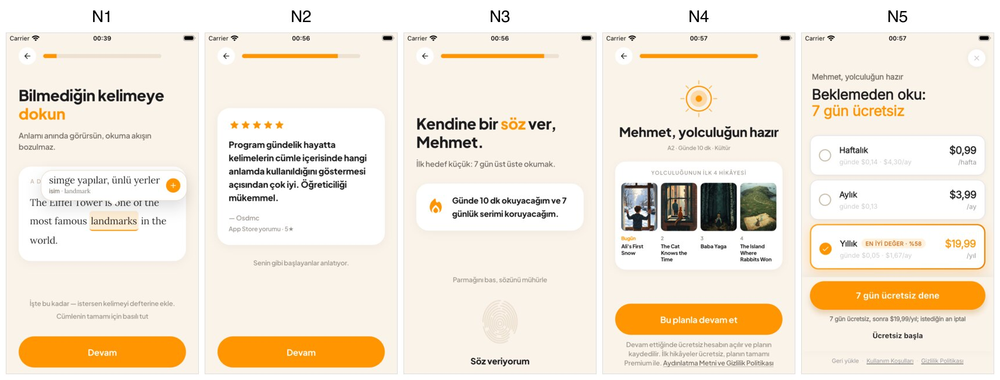

- **N1** Onboarding balon adımı: altta yeni satır "Cümlenin tamamı için basılı tut".
- **N2** Yorum ekranı: App Store'daki 31 Ekim yorumu kelimesi kelimesine; altında takma ad "Osdmc" ve "App Store yorumu · 5★". "Doğrulanmış kullanıcı" ibaresi yok.
- **N3** Söz ekranı: parmak izi %20 küçük.
- **N4** Yolculuğun hazır: dört kapak.
- **N5** Teklif: başlığın altında yarım satır yok; ikinci yol "Ücretsiz başla".

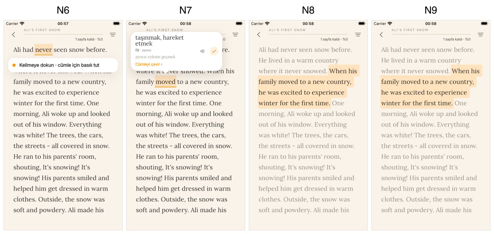

- **N6** İlk ipucu: "Kelimeye dokun · cümle için basılı tut".
- **N7** Balonun en altında "Cümleyi çevir ›". Düğmelerin ölçüsü aynı (ekle 44×48, ses 38×48; testle kilitli).
- **N8, N9** Bağlantıya dokununca ve basılı tutunca cümle işaretleniyor. **Çeviri kartı bu iki karede yok:** yerel sunucuda çeviri servisi olmadığı için önbellekte bulunmayan cümle boş döndü. Büyük yazı sürüşünde aynı bağlantı önbellekteki bir cümleye denk geldi ve kart açıldı (B8). Canlıda çeviri servisi olduğu için her cümlede açılır; TestFlight'ta bakılacak ilk şey bu.

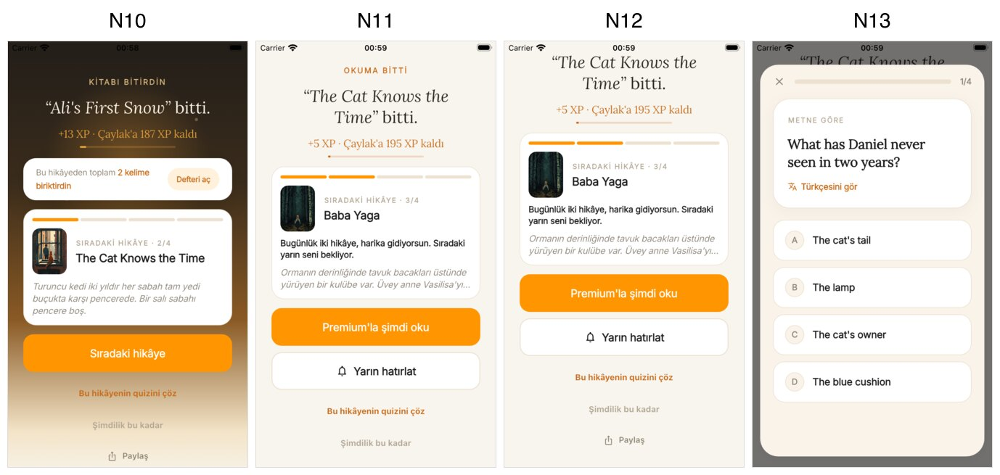

- **N10** 1. hikâye bitti: "+13 XP · Çaylak'a 187 XP kaldı" ve altında ince çizgi (dokununca kariyer). "Sıradaki hikâye" kaydırmadan görünüyor. "Paylaş" en altta.
- **N11** 2. hikâye bitti: "Bugünlük iki hikâye, harika gidiyorsun. Sıradaki yarın seni bekliyor." İki kapı birlikte görünüyor.
- **N12** Aynı ekranın altı: quiz bağlantısı, "Şimdilik bu kadar", "Paylaş". Kaydırılan içerik artık durum çubuğunun altına girmiyor.
- **N13** Metin quizi (değişmedi).

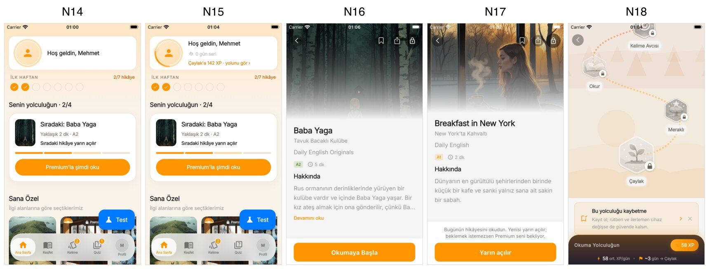

- **N14** Ana sayfa: alt çubukta Kelime'de "2", Quiz'de "1" (dolu turuncu, sayılı). Bu karede kişi kartında XP satırı henüz yok: sayaç sunucudan gecikmeli geliyor (önceki sürüşlerde de böyleydi).
- **N15** Birkaç dakika sonra: "Çaylak'a 142 XP · yolunu gör ›" (dokununca kariyer). Toplam XP sayısı artık yazmıyor.
- **N16** Karttaki düğme önce kapak sayfasını açıyor.
- **N17** Günlük hak kullanılmış: "Bugünün hikâyesini okudun. Yenisi yarın açılır; beklemek istemezsen Premium seni bekliyor." Düğme "Yarın açılır"; geri sayım yok.
- **N18** Kariyer sayfası eski hâliyle.

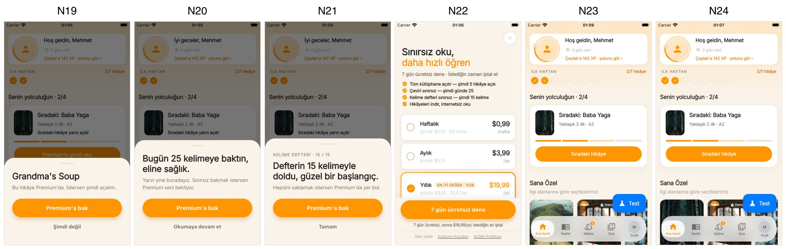

- **N19** Kilitli içerik: "Bu hikâye Premium'da. İstersen şimdi açalım." / "Premium'a bak" / "Şimdi değil".
- **N20** Çeviri sınırı: tablodaki metin; "Premium'a bak" / "Okumaya devam et".
- **N21** Defter sınırı: tablodaki metin; "Premium'a bak" / "Tamam".
- **N22** Paywall (değişmedi; fiyatlar simülatörün dolar fiyatı).
- **N23** 2. gün ana sayfası: sıradaki hikâye açık.
- **N24** 7. gün ana sayfası (beş gün ara verilmiş).

Bütün kareler: `ekran_2026-11-19/normal/`.

## Aynı ekranlar – SE 3, en büyük yazı

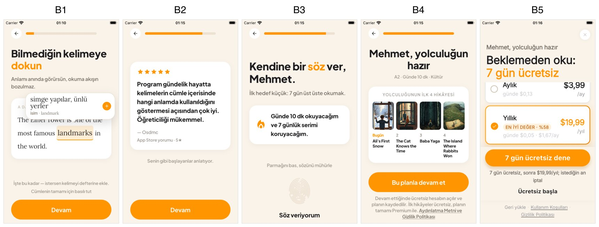
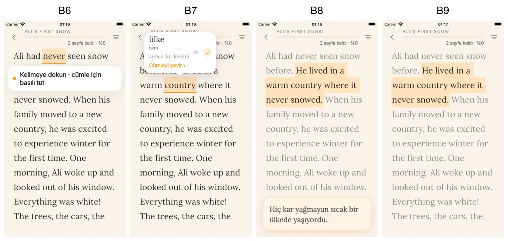
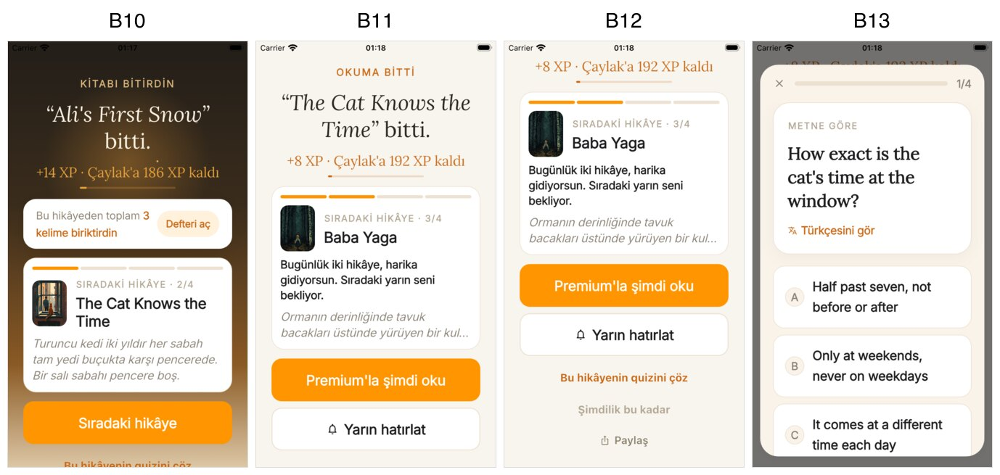
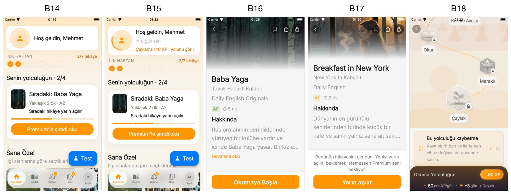
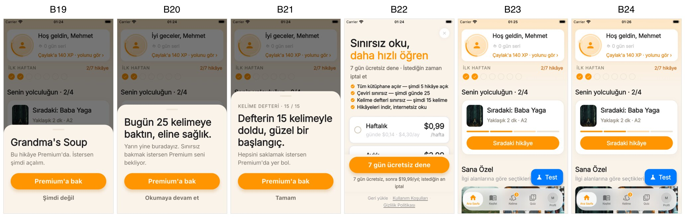

Kare numaraları normal yazıdakiyle aynı sırada (B1 = N1'in büyük yazısı).

- **B5** Teklif: başlık sabit, seçili plan ve "7 gün ücretsiz dene" görünüyor; yarım kalan avantaj satırı yok. Üstteki plan kartının bir kısmı başlığın altında kalıyor (kart, satır değil).
- **B7, B8** Balonda "Cümleyi çevir ›" ve dokununca açılan çeviri kartı.
- **B10** 1. bitiş: "Sıradaki hikâye" kaydırmadan görünüyor.
- **B11** 2. bitiş: iki kapı birlikte görünüyor.
- **B12** Kaydırınca içerik durum çubuğunun altına girmiyor; "Paylaş" en altta.
- **B14, B15** Alt çubuk rozetleri büyük yazıda büyümüyor (bilerek; çubuk taşmasın).
- **B17, B19–B21** Yeni metinler sığıyor.
- **B18** Kariyer sayfasında en üstteki rütbe etiketi durum çubuğuna değiyor. Bu sayfa bu sürümde değişmedi; eski hâlindeki bir kusur, dokunulmadı.

Bütün kareler: `ekran_2026-11-19/buyuk/`.

**İki sürüşün sonucu:** bütün ekranlar açıldı ve çekildi. İki sürüşte de test koşusu "hatalı" diye kapandı; tek neden onboarding'in dinleme adımındaki yakalanmayan ses hatası (`step_02_listen.dart:99`, ses dosyasını çalma çağrısı). Bu satır mağazadaki 1.0.2 ile aynı; bu sürümün getirdiği bir şey değil. Simülatör bu gece sıfırlandığı için orada her seferinde çıkıyor olabilir; gerçek cihazdaki durumu **bilinmiyor**, Mehmet'in telefonundaki iki kurulumda bu adım çalıştı.

## Eski sürüm (1.0.2, build 45) birleşmiş sunucuya karşı

SE 3'te mağaza sürümünün kodu, birleşmiş sunucuya ve canlı şemanın kopyasına karşı sürüldü: onboarding, hesap açma, ana sayfa, okuma, kelime balonu, cümle çevirisi, bitiş, bildirim izni. Sunucu 48 isteğin hiçbirine hata dönmedi. Eski sürüme yolculuk atanmıyor (0 atama); ana sayfası eski hâliyle çalışıyor. Çeviri hakkı bitince eski sürüm kendi sınır sayfasını gösterdi. Kareler: `ekran_2026-11-19/eski_surum/`.

## Sunucu yayını (adım 7) – Mehmet

- Birleştirme isteği: https://github.com/inanmehmett/DailyEnglish/pull/9. `master`'a birleşince yayın kendiliğinden başlar.
- Yayın kendi başına şunu yapar: `AddJourneys` (yalnız yeni tablolar) ve altı yolculuğun tohumu. Canlı şemanın kopyasında denendi: 6 yolculuk, 44 hikâye yazıldı.
- Geri alma: birleştirmeyi geri al; yolculuk tabloları kalabilir.
- Onboarding sonu teklifini derlemesiz kapatmak için: `Features__OnboardingOffer=false`.
- Yayından sonra ben: 44 merak cümlesini yedek tablosuyla yazar, sayıyı ve örnekleri bu rapora eklerim.

## Sürüm notlarının doğrulaması (`ortak/surum_notlari_1.0.4.md`)

| Madde | Sürümde var mı | Kanıt |
|---|---|---|
| Seviyene göre seçilmiş hikâyelerle okuma yolculuğu; bir hikâye bitince sıradaki bekliyor | evet, **sunucu yayınından sonra** (yayın yoksa uygulama eski ana sayfaya düşer) | N4, N10, N14 |
| Cümlenin tamamını çevirmek: kelimeye dokun, "Cümleyi çevir" de | evet | N7 |
| Her hikâyeden sonra ne kadar yol aldığını gör | evet; XP kazanılan her bitişte rütbe satırı ve çizgi | N10, N11 |
| Daha akıcı ilk okuma, küçük ekranlarda daha rahat görünüm | evet | N5, N10–N12 |
| Arka planda birçok düzeltme | evet | 6 Kasım'dan beri 80'den fazla commit |

Silinmesi gereken madde yok. İngilizce metindeki "Translate sentence" uygulamadaki İngilizce bağlantıyla aynı.

## Ölçüm: bu sürümle gelen yeni olaylar

- `sentence_translate_opened` (kaynak: `balloon` / `long_press`). Sürüşte sunucuya düştüğü görüldü.
- `career_opened` (kaynak: `finish`, `home_card`, `profile_card`, `profile_page`, `celebration`). Eski `screen_view / career_journey` kaydı da sürüyor; önceki raporlarla karşılaştırma bozulmaz.

## Bu sürüme girmeyenler (listeye uygun olarak)

Kilitli 3. hikâyede iki kapı, rütbe eşikleri, kutlamaların azaltılması, "Senin Yolculuğun" sayfası, onboarding "dinle" hatası, bildirim tercihini kaydetme hatası.

## Ek – 19 Kasım, öğleden önce

**Sunucu yayını yapılamadı.** Ekip mesajıyla PR #9'u `master`'a birleştirmem istendi; birleştirme komutunu çalışma ortamımın izin katmanı reddetti (canlıya yayın sayıldığı için). Etrafından dolaşmadım. Birleştirmeyi Mehmet yapmalı; yayından sonraki doğrulama, bir saatlik 5xx izlemesi ve merak cümleleri bende. Yayın öncesi taban: son 24 saatte 10.565 istekte 1 tane 5xx.

**Merak cümleleri 43 oldu (Mehmet'in doğrudan sözü).** "Doğrudan olsun, gereksiz ifade olmasın." 19 cümle kısaltıldı; Varanasi'nin cümlesi kaldırıldı. Yerel kopyada yeniden denendi: 43 satır yazıldı, yedek tablo doldu, ikinci çalıştırma bir şey bozmadı. İki örnek:
- Two Cups'tan sonra: "Emma her sabah tilkiye biraz daha yaklaşıyor. Tilki her sabah kaçıyor. Şimdilik."
- Başlangıç A2 ve Kasabaya Yeni Geldi bitince: "Howard her sabah 8.15'te aynı sandalyeye oturur. Bu sabah sandalye boş."

**Derleme 49 hazırlığı (derleme çıkarılmadı):**
- **T1 bitti** (`3889e7a6`). "Cümleyi çevir ›" kendi satırını almıyor; "ayrıca" satırının sağ ucunda, o satır yoksa tür satırının ("fiil · move") sağ ucunda duruyor. Yanındaki metin tek satır; sığmazsa üç noktayla kısalır. Düğmeler aynı. Testler bağlantılı balonun yüksekliğini bağlantısız hâliyle karşılaştırıyor (kısa anlam, uzun anlam, uzun "ayrıca", "ayrıca" yok; normal ve büyük yazı): hiçbirinde daha yüksek değil, kısa metinlerde birebir eşit.
  - **Karardan bir sapma:** kararda "'ayrıca' yoksa bağlantı o satırın yerinde durur" yazıyordu. Öyle yapınca balon bir satır büyüyor ve "bağlantısız hâlinden yüksek olamaz" kuralı bozuluyor. Bu yüzden bağlantı o durumda tür satırına taşındı.
  - **Bağlantının çizilmediği tek durum:** balonda ne tür ne "ayrıca" satırı varsa (yalnız anlam). Anlam satırını paylaşmak büyük yazıda satır ekliyordu. Basılı tutma o durumda da çalışıyor. Kaç balonun böyle olduğunu ölçmedim: **bilinmiyor**; sözlükteki kelimelerin türü var, makine çevirisiyle gelenlerin olmayabilir.
  - Ekranda henüz görülmedi; derleme 49'un tam sürüşünde görüntüsü gelecek.
- **T3 bitti** (`42a03345`). Yorum ekranı kapalı; onboarding mağazadaki sürümle aynı sayıda ekran. Gerçek yorum verisi kodda duruyor.

## Ek – 19 Kasım, öğlen: sunucu yayını ve merak cümleleri

- **Adım 7 bitti.** Mehmet'in yazılı izniyle PR #9 12:04'te `master`'a birleşti (`60640af`); 12:07'de canlıda `/api/Journey/starter` 200 dönmeye başladı. Canlı veritabanında son şema değişikliği `AddJourneys`; **6 yolculuk, 44 hikâye** (başlangıçlar 4'er, Kasabaya Yeni Geldi 10, Kafe Hikâyeleri 12, Dünya Şehirleri 10).
- **Adım 8 bitti.** 12:13'te **43** merak cümlesi yazıldı; yedek tablo `Backup_NextHook_2026_11_18` 43 satır (hepsinin eski değeri boştu). Varanasi'nin cümlesi bilerek boş. İki örnek, canlıdan okundu:
  - Ali's First Snow: "Turuncu kedi iki yıldır her sabah tam yedi buçukta karşı pencerede. Bir salı sabahı pencere boş."
  - Two Cups: "Emma her sabah tilkiye biraz daha yaklaşıyor. Tilki her sabah kaçıyor. Şimdilik."
- **5xx izlemesi bitti: yayından sonra 5xx yok.** 12:04–14:27 arasında 507 istek, 0 tane 5xx, 35 tane 4xx. (İzleme 12:52 ile 14:27 arasında ölçüm almadı; son ölçüm o aralığı da kapsıyor.) Geri alma gerekmedi.
  - 4xx'lerin 15'i yayın bitmeden önce (12:04–12:07) benim yayını yoklayan isteklerim (`/api/Journey/starter` 404). Yayından sonra yolculuk uçlarına gelen 10 isteğin hiçbiri hata dönmedi.
  - Bir tane `validate-receipt` 400 (12:38, testçi hesabı): makbuz doğrulaması reddedilmiş. Müşteri değil; nedenine bakmadım.
  - Canlıda ilk yolculuk ataması yapıldı (1 hesap).

## Taslak – yorum ekranı (Mehmet'in 12:10 sözü)

Mehmet: "App Store yorumlarından en iyi iki ya da üçünü seç, alt alta göster; hafif kaydırılabilir olabilir." Bu, T3 kararının ("ekran kapatılır; Mehmet 'kalsın' derse kalır") "kalsın" kolu. Kod yok; önce taslak:

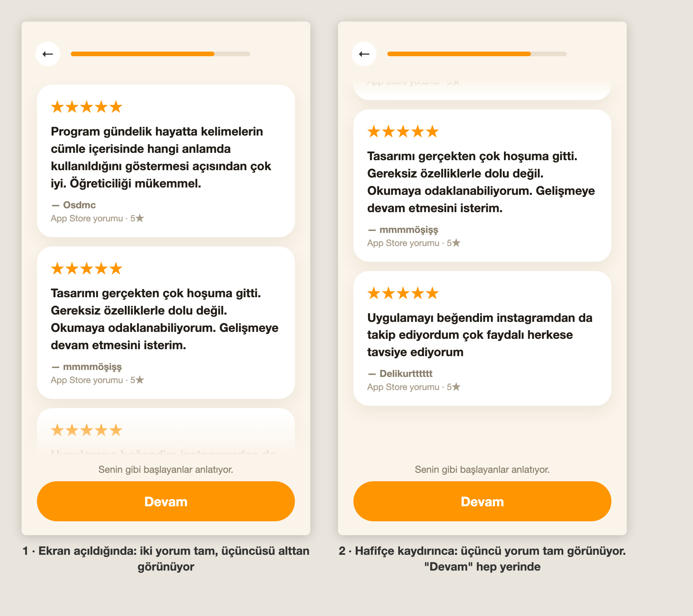

Seçilen üç yorum (kelimesi kelimesine, takma adlarıyla): Osdmc (31 Eki), mmmmöşişş (1 Kas), Delikurtttttt (7 Kas); üçü de 5 yıldız. Seçilmeyenler: şikâyet içeren (8 Kas), emoji içeren (7 Kas), 4 yıldızlı (7 Kas), çok kısa olan (13 Kas).

## T6 – Android'de deneme süresi: koddan doğrulama (19 Kasım)

Yalnız kod okundu ve canlı kayıtlara salt okunur bakıldı; hiçbir şey değiştirilmedi. **Kod değişikliği gerekmedi.**

**1. Deneme teklifi seçilip Google'a gönderiliyor mu? Evet, Play teklifi döndürüyorsa.**
- Play her teklifi ayrı bir kayıt olarak veriyor. Satın alma başlarken kod, o ürünün kayıtları içinde **ücretsiz aşaması olanı** seçiyor; yoksa temel planı (`in_app_purchase_service.dart`, `_purchaseProductFor`).
- Seçilen kaydın teklif anahtarını (offerToken) Google'a eklenti gönderiyor (`in_app_purchase_android` 0.5.0: satın alma çağrısı anahtarı seçilen kayıttan alıyor).
- Bu düzeltme 30 Eylül'den beri kodda (`d97ff80f`); mağazadaki 1.0.2'de de, sürüm adayında da var.
- Yani Google sayfası "Başlangıç tarihi: bugün · ₺999,99" gösterdiyse, **Play o hesaba o an denemeli bir teklif döndürmemiş** demektir. Kod, dönmeyen bir teklifi gönderemez.

**2. Deneme yokken düğme yine "7 gün ücretsiz dene" mi yazıyor? Koda göre hayır.**
- Android'de gösterilen deneme süresi sabit değil; Play'in döndürdüğü tekliflerdeki ücretsiz aşamanın süresinden okunuyor (`_storeTrialDays`). Ücretsiz aşama yoksa süre 0.
- Süre 0 iken: düğme "Premium'a geç", altındaki satır yalnız fiyat ("₺999,99/yıl"), onboarding teklifinin başlığı "Beklemeden oku" (sayısız). Süre varsa: "7 gün ücretsiz dene" ve "7 gün ücretsiz, sonra …".
- Mağazaya ulaşılamazsa Android'de deneme hiç vaat edilmiyor (sunucudan gelen yedek fiyatlarda süre 0).
- Başlangıç yolculuğu bitişindeki teklif düğmesi Android'de zaten hiçbir zaman süre söylemiyor.
- "7 gün ücretsiz dene" metnini koşulsuz yazan tek yer (`tryFreeSevenDays`) hiçbir ekrandan çağrılmıyor; ölü kod.
- Düğmedeki süre ile gönderilen teklif aynı listeden çıkıyor; ikisinin ayrışacağı bir yol bulamadım. Testle kilitli olan kısım gösterim kuralı ("Android yalnız mağazadaki ücretsiz aşamayı gösterir", `test/trial_days_single_source_test.dart`). Teklifin seçilmesinin (`_purchaseProductFor`) testi **yok**; onu kod okuyarak doğruladım, cihazda gerçek bir denemeli satın almayla doğrulanmadı.

**3. Satın almadan sonraki "denemen başladı" ekranı:** sunucunun kararına bağlı. Sunucu Google satın almasını, satın alınan teklifin etiketinde `freetrial` varsa deneme sayıyor (`GoogleReceiptValidator.cs:186`). Temel planla alınan satın alma deneme diye gösterilmez.

**Bilmediğim:** Mehmet'in o anda uygulamadaki düğmede ne gördüğü. Koda göre "Premium'a geç" yazmış olmalı. "7 gün ücretsiz dene" yazdıysa bu, yukarıdaki okumayla çelişir; o durumda paywall'un ve Google sayfasının arka arkaya iki ekran görüntüsü gerekir. Android müşterilerinin düğmede ne gördüğü de kayıtlarda yok: paywall olayları gösterilen deneme süresini taşımıyor.

**Play Console'da bakılacaklar (Mehmet, T6-b):**
1. `com.dailyenglish.premium.yearly.launch` ürününün temel planında **etkin** bir ücretsiz deneme teklifi var mı (7 gün, fiyatı 0 olan aşama).
2. Teklifin uygunluk koşulu: "yeni müşteri" ise Google, denemeyi daha önce kullanmış hesaba teklifi hiç döndürmez (test hesabında olası masum neden bu).
3. Teklifin etiketi `freetrial` mı; değilse sunucu gerçek bir denemeyi deneme diye kaydetmez.
4. Teklif Türkiye'de geçerli mi.

**Okuma:** Etkin bir deneme teklifi yoksa Android'de düğme zaten "Premium'a geç" diyor ve bugün ücret alıyor; yanlış söz yok, ama iOS'taki "7 gün ücretsiz" Android'de hiç sunulmuyor demektir. Android'deki 4 basış / 0 satışın bununla ilgisi olabilir: **hipotez**; basanların ne gördüğü kayıtlı değil.

**Öneri (kod, bu sürüme girmesi gerekmiyor):** satın almaya basış olayına o anda gösterilen deneme süresi eklensin; "Android kullanıcısı düğmede ne gördü" sorusu bir daha kayıtlardan cevaplanabilsin.

**T6-b, Mehmet'in Play Console'dan yapıştırdığı iki sayfa (19 Kas):** ikisi de "Temel planı düzenleyin" sayfası (`yearly` temel planı; biri Türkiye'de ₺1.299,99, diğeri ₺999,99). Bu sayfalardaki "Ücretsiz kullanım süresi: 7 gün", "Ek süre ve askıya alınmış hesap" başlığının altında: ödeme alınamadığında tanınan **ek süre**, ücretsiz deneme değil. Play'de ücretsiz deneme temel planın alanı değil, temel plana eklenen ayrı bir **teklif**tir; yapıştırılan sayfalarda teklif listesi yok, temel planın etiketleri de boş. Yani bu iki sayfa Android'de bir deneme teklifinin tanımlı olduğunu **göstermiyor**. Tanımlı olup olmadığı abonelik sayfasındaki teklif listesinden görülür; oraya henüz bakılmadı.

**T6-b, üçüncü sayfa ("Teklifi düzenle", `com.dailyenglish.premium.yearly.launch`):** Android'de deneme teklifi **tanımlı**: aşama "Ücretsiz deneme · 7 gün", 175 ülkenin 175'inde, uygunluk "Yeni müşteri edinme". Yapıştırılan metinden okunamayanlar: teklifin durumu (etkin mi, taslak mı) ve iki uygunluk seçeneğinden hangisinin işaretli olduğu. **Etiket alanı boş:** sunucu Google satın almasını yalnız teklifin etiketinde `freetrial` varsa deneme sayıyor (`GoogleReceiptValidator.cs:186`); etiket eklenmezse Android'deki gerçek bir deneme, ücretli satın alma gibi kaydedilir. Etiket teklife eklenmeli, temel plana değil (temel planın etiketi denemesiz satın almalara da geçer). Mehmet'in test hesabında deneme çıkmamasının olası nedeni uygunluk: hesap bu aboneliği daha önce aldıysa "yeni müşteri" sayılmaz ve Play teklifi hiç döndürmez. Doğrulama: bu uygulamada hiç abonelik almamış bir Google hesabıyla denemek.

## Android'de gerçek satın alma: üç sunucu hatası (19 Kasım akşam, Mehmet'in denemesi)

Mehmet 19:08'de Google Play'den yıllık lansman planına abone oldu; panelde kullanıcı Premium görünmedi, abonelik "denemesiz satın alma" yazdı. Canlı kayıtlar salt okunur incelendi; kod değişmedi.

**Ne oldu (canlı kayıtlardan, abonelik 28):**
| Saat | Olay |
|---|---|
| 19:08 | Google "satın alındı" bildirdi; uygulama makbuzu doğrulattı. Bitiş tarihi 26 Kasım 19:08: **Google 7 günlük ücretsiz denemeyi verdi.** |
| 19:10–19:11 | Abonelik iptal edildi (Google "iptal" bildirdi). |
| 19:35:37 | Yeniden abone olundu; Google "satın alındı" bildirdi. |
| 19:35:39 | Uygulama yeni makbuzu doğrulattı; abonelik Etkin oldu. |
| 19:35:39 | Google **eski** satın almanın "süresi doldu" bildirimini gönderdi; sunucu bunu aynı abonelik kaydına uyguladı ve kaydı **Süresi doldu** yaptı. Kullanıcı o andan beri bizde Premium değil; Google'da aboneliği etkin. |

**Hata 1 – etkin abonelik "süresi doldu" oluyor.** Yeniden abone olunca Google yeni satın almayı eskisine bağlıyor; biz kaydı hâlâ eski satın almanın anahtarıyla tutuyoruz. Eski satın alma için gelen "süresi doldu" bildirimi bu yüzden canlı kaydı buluyor ve kapatıyor (`WebhookEventProcessor.ProcessGoogleExpirationAsync`: Google'a güncel durumu sormuyor, kaydın yenilenip yenilenmediğine bakmıyor). İptal edip yeniden abone olan her Android kullanıcısında tekrarlanır.
**Hata 2 – "yeniden başlatıldı" bildirimi de "süresi doldu" sayılıyor** (`WebhooksController.cs:415`, bildirim türü 7). Kullanıcı iptal ettiği aboneliği Play'den geri açarsa Premium'u kapanır. Bu denemede tetiklenmedi; kodda duruyor.
**Hata 3 – deneme "satın alma" diye kaydediliyor.** Sunucu Google denemesini yalnız teklifin etiketinden (`freetrial`) tanıyor; etiket yoksa ya da geç eklendiyse 7 günlük deneme "Satın alındı" yazılıyor. Panelde "denemesiz satın aldı" görünmesinin nedeni bu. Google'ın yanıtında denemenin kendisi de geliyor (`offerPhase.freeTrial`); oradan okunursa etikete bağımlılık kalkar.
Ayrıca: 19:11'deki "iptal" bildirimi işlenirken sunucu hata verdi ("A second operation was started on this context"); iptal yine de kayda geçmiş görünüyor. Google bildirimlerinin ham kaydı tutulmuyor (`WebhookEventLogs` boş).

**İyi haber:** Android'de 7 günlük deneme teklifi çalışıyor; yeni bir hesaba uygulandı.
**Dikkat:** bu satın alma kayıtlara göre test satın alması değil (ortam "Production"). İptal edilmezse 26 Kasım'da ₺999,99 çekilir.

**Öneri (sunucu kodu + yayın; Mehmet'in onayıyla):** (1) "süresi doldu" bildiriminde kaydı kapatmadan önce Google'dan o aboneliğin güncel durumu sorulsun; (2) tür 7 etkin sayılsın; (3) deneme `offerPhase.freeTrial`'dan da tanınsın; (4) iptal bildirimindeki eşzamanlılık hatası. Yayına kadar geçici çare: uygulamada "Satın alımları geri yükle".

### Devamı (19 Kasım, 20:00): uygulamadaki karışıklık ve düzeltme dalı

Mehmet'in gözlemi: Play'de abonelik etkin; uygulamada profil "Premium'a geç" diyor, dokununca paywall "Premium aktif" diyor, ama Premium kitap açılmıyor ve taç yok.

**Neden iki farklı cevap:** sunucuda "Premium mu?" sorusunu iki uç ayrı kuralla cevaplıyor. Yetki ucu (kitaplar, taç, profil) kaydın durumuna bakıyor: "süresi doldu", yani Premium değil. Abonelik durumu ucu (paywall) yalnız bitiş tarihine bakıyor: 26 Kasım ileride, yani Premium. Kayıt yanlışlıkla "süresi doldu" olunca ikisi ayrıştı.

**Düzeltme dalı hazır, yayınlanmadı:** `fix/google-resubscribe-expiry`, birleştirme isteği https://github.com/inanmehmett/DailyEnglish/pull/10 (birleştirme = yayın, Mehmet'in kararı).
| Commit | Ne yapıyor |
|---|---|
| `9967e8e` | Deneme, Google'ın bildirdiği aşamadan tanınıyor; etiket yalnız yedek |
| `2b148e6` | "Süresi doldu" bildiriminde kullanıcının en yeni satın alması Google'a soruluyor, hâlâ geçerliyse kayıt kapanmıyor; "yeniden başlatıldı" etkin sayılıyor; iptal bildirimindeki eşzamanlılık hatası giderildi (Apple tarafında da aynı kalıp vardı) |
| `ddcb0d3` | Abonelik durumu ucu, süresi dolmuş ya da iadesi yapılmış kaydı Premium saymıyor; iki uç aynı cevabı veriyor |

Yeni testler: eski satın almanın bildirimi canlı kaydı kapatmıyor; Google "bitti" derse kapanıyor; Google'a ulaşılamazsa daha yeni satın alma kaydı koruyor; deneme aşamadan / etiketten tanınıyor; durum ucu kapalı kaydı Premium saymıyor. İlgili 79 test geçti. **Tam test koşusu ilk denemede 42 dakika takıldı ve durduruldu; takılmanın nedeni henüz bilinmiyor, koşu takılma tespitiyle yeniden çalışıyor. Sonucu gelmeden bu dal yayına hazır sayılmaz.**

**Bu dalda olmayan, bilinen iki şey:** (1) kayıt hâlâ ilk satın almanın anahtarıyla tutuluyor; yalnız yeni anahtarı taşıyan sonraki bildirimler (yenileme, bitiş) kayda bağlanamıyor. Bitiş tarihi geçince kayıt yine zamanında kapanıyor, ama yenileme bildirimi kaçabilir. (2) İptal edilmiş ama süresi dolmamış abonelik makbuz doğrulamasında geçersiz sayılıyor; böyle bir kullanıcıda "geri yükle" başarısız olur (19:34'teki 400 buna benziyor).

**Mehmet'in hesabı:** kayıt canlıda hâlâ "süresi doldu". Canlıya yazmadım. Uygulamada "Satın alımları geri yükle" makbuzu yeniden doğrulatır; denenmedi.
