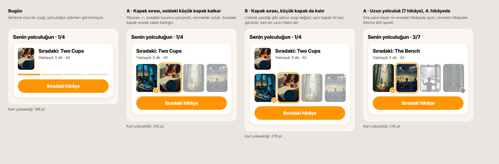
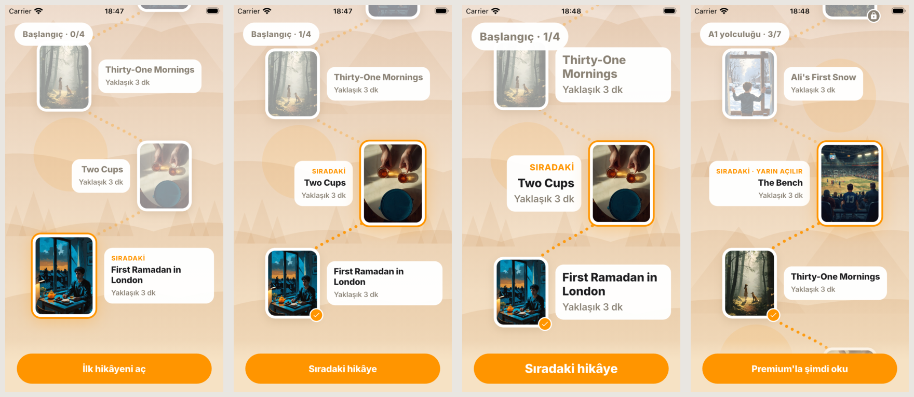
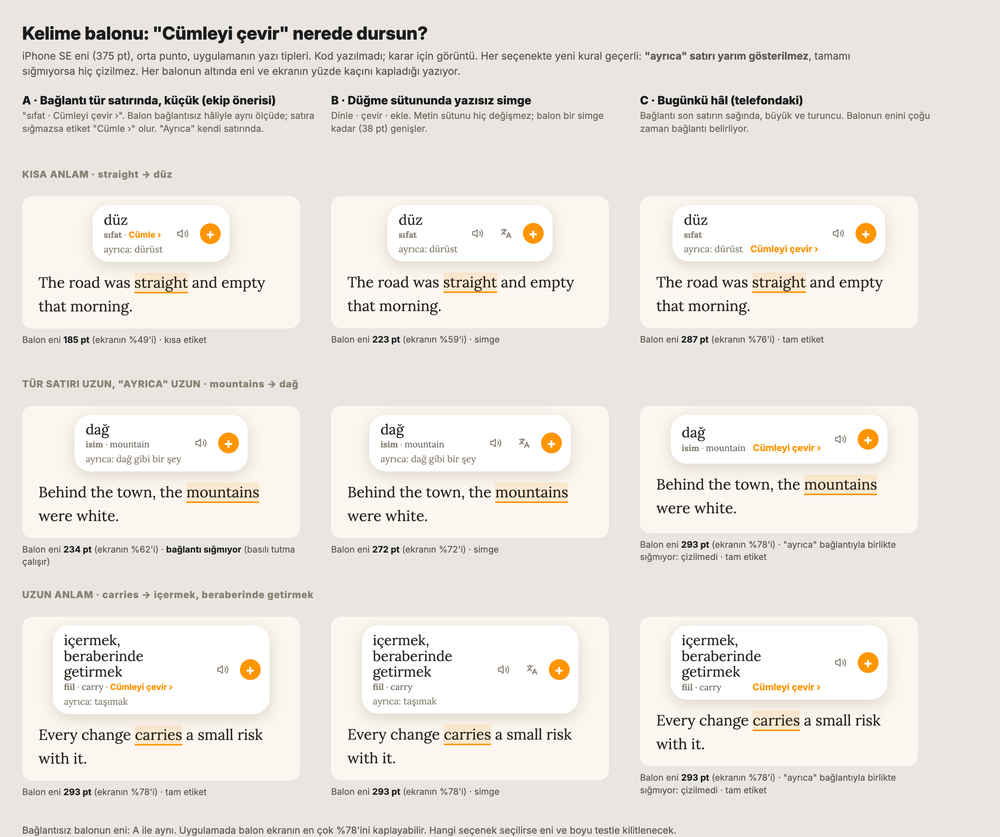

# Editör durum raporu – 20 Kasım 2026, gece

Ekibe: 19 Kasım akşamından bu yana olanların özeti. Ayrıntı ve kanıtlar `raporlar/2026-11-19_surum_adayi_1.0.4.md` dosyasının son bölümlerinde ("Altı sorun turu", "Yayın", "T9 ve T10").

## Kısaca

Sürüm 1'in kodu hazır, ama derleme 49 henüz çıkarılmadı. Bu gece ödeme ve hesap tarafında beş gerçek hata kapandı; üçü canlıda, ikisi derleme 49 ile çıkacak. Derleme, Mehmet'in üç görünüm kararını ve "Kontroller bitti" sözünü bekliyor.

## Canlıda olanlar

| Ne | Ne zaman | Doğrulama |
|---|---|---|
| Google iadesinin tanınması (erişim kaldırılmadan yapılan iade dahil) | 20 Kas 00:59 (PR #13) | İlk çalışmada abonelik 29 "iade edildi" oldu, hesap türü testçiye döndü |
| Aynı satın almanın ve "deneme başladı" olayının bir kez yazılması (sunucu tarafı) | 20 Kas 00:59 | Testlerle; canlıda yeni bir satın alma gelince görülecek |
| Panel: "Premium" yalnız ödeyen; deneme, promosyon, iade, test ayrı adla. Bir kişinin hesapları bağlanabiliyor | 20 Kas 00:59 | Yerel sunucuda görüntülendi (`ekran_2026-11-19/panel_*.png`) |
| Misafir hesabı aynı telefona geri verme (sunucu tarafı) | 20 Kas 00:59 | Yerelde uçtan uca; uygulama tarafı derleme 49'da |
| Canlı veri: 7 fazla abonelik geçmişi satırı silindi; bir kişinin eski misafir hesabındaki birikim üye hesabına taşındı | 19 Kas gece | İki işlem de yedekli; Mehmet'in onayıyla |

Yayınlardan sonra birer saat izlendi: sunucu hatası yok (yalnız panelin Google Analytics ucunda, eskiden beri ara ara görülen iki hata).

## Derleme 49'a girecek, dalda hazır olanlar

| Ne | Durum |
|---|---|
| T9: uygulama içinden iptal. Android'de sunucu iptali Google'da yapar; iOS'ta kullanıcı App Store'a yönlendirilir | Kod ve test bitti. Sunucu kısmı PR #14; Mehmet "yayınla" dedi, bu rapordan sonra yayınlanacak |
| T10: Play Store'da kullanılan promosyon kodu. Android'de açılışta ve öne gelince mağazaya kendiliğinden sorulur | Kod ve test bitti; gerçek kodla cihazda denenmedi |
| Telefon kimliğinin özetini gönderme (misafir geri dönüşü) | Bitti; Android emülatörde silip kurunca kimlik aynı kaldı |
| "Deneme başladı" ve "abonelik tamamlandı" yalnız yeni satın almada gönderilir | Bitti |
| T1 (balondaki bağlantı), T3 (yorum ekranı) | Kod var; ikisi de Mehmet'in görünüm kararını bekliyor |

Testler: sunucu 1.741, uygulama 1.159 geçti.

## Mehmet'in bu gece verdiği kararlar

- Misafirin uygulamayı silip yeniden kurunca ilerlemesini kaybetmesi **sorun sayılmaz** (kullanıcı uyarılıyor). Kayıtlı kullanıcının verisi girişte gelmeli. Ölçü: "bizden kaynaklanan hata olmasın."
- Telefon kimliğiyle kurtarma yine de kalıyor: 30 gün açmayan misafirin hesabının düşmesi bizim oturum süremizden kaynaklı.
- Uygulama içinden iptal: yapılabiliyorsa yapılsın, yapılamıyorsa mağazaya yönlendirilsin.
- İki mağazada gizlilik beyanı güncellendi (cihaz kimliği zaten beyanlıydı; amaç eklendi).

## Bir kullanıcının kaybının gerçek nedeni

Promosyon verilen kullanıcının 362 XP'lik birikimi eski hesabında kalmıştı. Kayıtlardan çıkan: 19 Kasım 14:36 ile 15:10 arasında uygulama silinip mağazadan yeniden kurulmuş (tanıtım turu baştan başlamış, kurulum kaynağı ve bildirim adresi değişmiş, sürüm aynı). Beta'dan mağaza sürümüne güncelleyerek geçmek hesabı koruyor; kaybı silme yapmış. Birikim elle taşındı.

## Benim yanlışlarım

- PR #11'de iadeyi Google'ın "iptal edilen satın almalar" listesinden öğrenmeye çalıştım. O liste erişimi kaldırılmayan iadeyi hiç göstermiyor; belgesinde yazıyor, okumamıştım. Doğrusu siparişin kendisini sormak; PR #13'te düzeldi.
- T9 ve T10 iş listesinde bana yazılıydı; Mehmet "yayından önce ne kaldı" diye sorana kadar fark etmedim. Listeyi her oturum başında baştan okuyacağım.
- Mağaza görsellerini sorduğunda mağazadaki 18 Eylül setine bakıp konuştum; 16 Kasım'da çekilen yeni set depoda hazır duruyordu.

## Ekipten istediğim

1. **T9 metinleri:** iptal penceresinin yeni yazıları ses belgesine uygun mu? "Premium, dönem sonuna kadar açık kalır · Yenileme durur, yeni ücret alınmaz · İstediğin zaman yeniden başlatabilirsin"; düğme "Üyeliği iptal et". iOS'ta: "Aboneliğin App Store üzerinden yönetiliyor. İptal için seni oraya götürelim mi?"; düğme "App Store'a git".
2. **Testçilere not:** derleme 49 çıkana kadar uygulamayı silmeden güncellesinler, ya da silmeden önce "Hesap oluştur" ile üye olsunlar. Kurtarma yalnız derleme 49'un en az bir kez açıldığı kurulumlarda çalışır.
3. **Mağaza görselleri:** 16 Kasım setinde okuma yolculuğu karesi yok. 1.0.4 ile giderken yedinci kare olarak eklensin mi?
4. **"Daily English Founder" kodları** 30 Kasım'da bitiyor, hiç kullanılmamış. T10 düzeltmesi derleme 49'da; kodlar ondan önce dağıtılırsa kullananlar "Satın alımları geri yükle"ye basmak zorunda kalır.

## Yayından önce kalanlar

- Mehmet'in üç görünüm kararı: balondaki "Cümleyi çevir" bağlantısının yeri, onboarding sonunda ilk görünecek ekran, üç yorumlu yorum ekranı.
- Mehmet'in kontrolleri (listedeki 10. adım) ve T2, T8.
- "Kontroller bitti" sözünden sonra: tek derleme (49), tek tam sürüş (SE 3 ve büyük yazı), görüntüler rapora, TestFlight ve Android paketi.
- Play'de veri güvenliği onayı gelince yayınlamak; "Satıcı statünüzü beyan edin" uyarısı.

## Bu turda yapılmayanlar

Geçmiş Android kayıtlarının geriye dönük düzeltilmesi; aboneliğin ilk satın alma anahtarıyla tutulması; iptal edilmiş ama süresi dolmamış aboneliğin geri yüklenememesi; bildirim tercihi ucundaki 500 (6 müşteri); misafirin var olan bir hesaba girerken birikiminin taşınmaması (uygulama uyarıyor, Mehmet değişiklik istemedi).

Çeviri işi (tur04): 261 parçanın 150'si hazır (20 Kas 01:54), 4 işçi çalışıyor.

## Ek (20 Kasım öğleden sonra): T11 ve T13 bitti, T13 için ekibin kararı gerek

**T11 (kapaktan giriş) bitti** (`edc85742`): onboarding sonu, satın alma sonrası ve ana sayfa kartı aynı yoldan geçiyor; okunabilen hikâyede önce kapak sayfası açılıyor. Olay: `first_story_cover_shown` (ilk deneyim adımı). Eski `onboarding_first_story_tapped` olayı kalktı; sunucuda kullanan yer yoktu.

**T9 metni** ekibin sadeleştirdiği hâliyle (`96d4d658`).

**T13 (balonun eni) yazıldığı gibi uygulandı** (`59eefc1e`): balonun eni ve boyu bağlantısız hâliyle birebir aynı; test bunu beş durumda ve iki yazı boyunda kilitliyor. Bağlantı son satırın sağında; ilk kelime uzun etiketin yanına sığmıyorsa kısa etiket ("Cümle ›"); tür satırı bağlantı için kırpılmıyor.

**Ama ölçüm kuralın bedelini gösteriyor.** Gerçek yazı tipleri (Lora, Inter) ve canlıdan rastgele 800 gerçek anlamla, iPhone 13 eninde, orta puntoda:

| Sonuç | Kelime | Oran |
|---|---|---|
| Tam etiket "Cümleyi çevir ›" | 0 | %0 |
| Kısa etiket "Cümle ›" | 398 | %50 |
| Bağlantı yok | 402 | %50 |

Ayrıntı: "ayrıca"sı olmayan 265 kelimenin 228'inde bağlantı yok (balon, kısa etiketin kendisinden dar); "ayrıca"sı olan 535 kelimenin 361'inde kısa etiket var, 174'ünde yok. Balon hiç büyümezse bağlantı kelimelerin yarısında görünmüyor; Y5'in amacı (cümle çevirisi görünür olsun) yarı yarıya kayboluyor.

**Seçenekler (kod küçük, karar ekipte ve Mehmet'te):**

| | Ne | Balon | Bağlantı |
|---|---|---|---|
| A | Bugünkü hâl (T13 yazıldığı gibi) | Hiç büyümez | %50 kısa, %50 yok |
| B | Dar balon yalnız "Cümle ›" sığacak kadar genişler (en çok ~60 pt); geniş balon hiç büyümez | Yalnız dar balonlarda biraz | Hemen hepsinde, kısa etiket |
| C | Etiket yerine küçük bir simge (yaklaşık 18 pt) | Hiç büyümez | Hemen hepsinde; ama simgenin ne olduğu ilk bakışta anlaşılmayabilir |

Mehmet'in şikâyeti bağlantı uzun "ayrıca"nın yanına gelince balonun belirgin biçimde uzamasıydı; B o durumu yine engelliyor. Önerim B. Karar gelene kadar A dalda duruyor.

### T12 (kartta kapaklı adım sırası): taslak hazır, kod Mehmet'in seçiminden sonra

Var olan bir ekranın görünümü değiştiği için önce taslak: `raporlar/ekran_2026-11-20/taslak_kart_kapak_sirasi.png` (gerçek kapaklar, iPhone SE eni).

| | Ne | Kart yüksekliği |
|---|---|---|
| Bugün | İnce ilerleme çizgisi | 188 pt |
| A | Kapak sırası; soldaki küçük kapak kalkar (sıradaki kapak sırada zaten çerçeveli) | 245 pt (+57) |
| B | Kapak sırası; küçük kapak da kalır (listede yazdığı gibi yalnız çizgi değişir) | 279 pt (+91) |

Önerim A: aynı kapak iki kez görünmez, SE 3'te düğmenin ekranda kalması daha kolay. Uzun yolculukta sıra yana kayar ve sıradaki hikâyede açılır; ücretsiz hikâyeler bitince kilit işareti.

## Ek 2 (20 Kasım, 14:30): "Senin Yolculuğun" sayfası ve balon taslağı

### T11: "Senin Yolculuğun" sayfası (kod bitti, `80619066`)

Onboarding'den sonra ("Ücretsiz başla" ya da deneme) ilk açılan ekran artık bu sayfa. Akış: yolculuk sayfası → kapağa ya da düğmeye dokun → hikâyenin kapak sayfası → okuma.

Görüntüler iPhone SE 3 simülatöründen, uygulamanın kendi temasıyla; kapaklar canlıdaki gerçek kapaklar.

Soldan sağa: ilk açılış (0/4, "İlk hikâyeni aç") · ikinci hikâyede (1/4, "Sıradaki hikâye") · aynı durum büyük yazıda (x1,35) · uzun yolculuk, sıradaki yarın açılıyor ve ileride Premium hikâyeler var.

| Ne | Nasıl |
|---|---|
| Yol | Aşağıdan yukarı kıvrılan noktalı yol; ilk hikâye en altta. Okunan kısım dolu turuncu, kalanı soluk |
| Duraklar | Kapak beyaz çerçevede; yanında ad ve süre. Okunan ✓, sıradaki büyük, turuncu çerçeveli ve hafifçe nefes alıyor (hareket azaltma açıksa durur), açılmayan soluk, Premium olan kilit işaretli |
| Üst | Yolculuğun adı ve n/toplam; başka sayfadan gelindiyse geri düğmesi |
| Alt | Sabit tek düğme: hiç okunmamışsa "İlk hikâyeni aç", sonra "Sıradaki hikâye"; yarın açılacaksa "Premium'la şimdi oku" |
| Dokunma | Kapak da düğme de hikâyenin kapak sayfasını açar. Sıradaki olmayan kapakta da kapak sayfası açılır; kilit orada durur |
| Uzun yolculuk | Sayfa sıradaki hikâyede açılır, yukarı doğru kayar |
| Deneme başlatan | Satın alma sonrası aynı sayfaya düşer |
| Yolculuk yoksa (sunucu vermediyse) | Eskisi gibi seviyenin ilk hikâyesinin kapak sayfası |

Ölçüm, adım adım: `journey_page_shown` (kaynak: onboarding / purchase / home) → `journey_page_stop_tapped` (kapak mı düğme mi, sıradaki mi) → kapak sayfası → `journey_stop_started`.

18 Kasım'da geri alınan kod düz bir listeydi; kullanılmadı. Sayfa, o gün onaylanmak üzere çizilen taslaktaki (`ekran_2026-11-18b/taslak_harita.png`) yol düzeniyle yeniden yazıldı. Kariyer sayfasına dokunulmadı.

Testler: durak durumları, düğme metni, kapağa dokunma, SE boyutunda normal ve büyük yazıda taşma yok. Uygulama tam testi 1.175 geçti.

**Bilinen eksikler:** sayfa gerçek sunucu verisiyle telefonda henüz baştan sona sürülmedi (görüntülerde yolculuk verisi örnek, kapaklar gerçek); "sıradaki yolculuk" bölümü (taslakta yolun sonunda) yok; koyu tema yok (sayfa açık temada sabit).

### T12: ana sayfa kartı (kod bitti, aynı commit)

Kart sade kaldı, kapak sırası eklenmedi. Başlık satırının sağına "Yolculuğunu gör ›" bağlantısı geldi; ilerleme çizgisi de dokunulur oldu (dokunma alanı çizginin üstüne ve altına 10 pt taşıyor, yerleşim değişmedi). İkisi de yolculuk sayfasını açar. Görüntüsü derleme 49 sürüşünde.

### T13: balon taslağı (kod yok, Mehmet seçecek)

Üç kelime (straight, mountains, uzun anlamlı "carries"), üç seçenek, hepsinde "ayrıca yarım gösterilmez" kuralı. iPhone SE eni, uygulamanın yazı tipleri.

| | straight | mountains | carries |
|---|---|---|---|
| A · tür satırında küçük bağlantı | 185 pt (%49), kısa etiket | 234 pt (%62), **bağlantı sığmıyor** | 293 pt (%78), tam etiket |
| B · düğme sütununda simge | 223 pt (%59) | 272 pt (%72) | 293 pt (%78) |
| C · bugünkü hâl | 287 pt (%76) | 293 pt (%78), "ayrıca" çizilmiyor | 293 pt (%78), "ayrıca" çizilmiyor |

Taslağın gösterdikleri:
- **A'da "mountains" bağlantısız kalıyor:** "isim · mountain · Cümle ›" bağlantısız balonun enine 7 pt sığmıyor. Balon aynı ölçüde kalacaksa bu tür kelimelerde bağlantı olmaz. Sabah gerçek 800 anlamla yaptığım ölçüm de aynı yönü gösteriyordu (o ölçüm bağlantıyı "ayrıca" satırında deniyordu; A için yeniden ölçmedim).
- **B her kelimede çalışıyor**, metin sütununa hiç dokunmuyor; bedeli balonun her zaman 38 pt geniş olması ve simgenin ne olduğunun ilk bakışta anlaşılmaması.
- **C'de** "ayrıca yarım gösterilmez" kuralı iki kelimede "ayrıca"yı tamamen siliyor.

**Dalda duran kod:** bu talimat gelmeden önce `59eefc1e` ile "balon bağlantısız hâliyle aynı ölçüde, bağlantı son satırda" kuralını yazıp göndermiştim (A'ya yakın ama bağlantı "ayrıca" satırında). Mehmet seçince yerine seçilen yazılacak; C seçilirse o commit geri alınır. Derleme 49 seçimden önce çıkarılmamalı.

### Ek 3 (20 Kasım, 18:50): Mehmet telefonda baktı, iki düzeltme (`101e13e8`)

Mehmet (18:40): "Yolculuk sayfası var ama kutuların içinde kitap görselleri yok; arka plan da sade gelmiş."

- **Kapaklar boş çıkıyordu; benim hatam.** Sunucu durağın kapağını kısa yol olarak veriyor (`/images/…`); yolculuk verisi bunu tam adrese çevirmiyordu. İlk görüntüleri tam adresle aldığım için hata gizli kalmıştı (raporda "gerçek sunucu verisiyle sürülmedi" diye yazdığım eksik tam buydu). Düzeltildi; görüntü koşusu artık sunucunun verdiği kısa yolu kullanıyor, bir de testle kilitli.
- **Arka plan:** düz geçişin yerine kariyer sayfasının manzara dili geldi: güneş, tepe sıraları, çamlar ve sırtlar; her sıra tepesinde belirgin, aşağı doğru saydamlaşıyor (keskin kenar yok). Saydamlıklar düşük; kapaklar ve adlar öne çıkıyor.

Görüntüler yenilendi: `ekran_2026-11-20/yolculuk_pano.png` ve tekil dosyalar.
