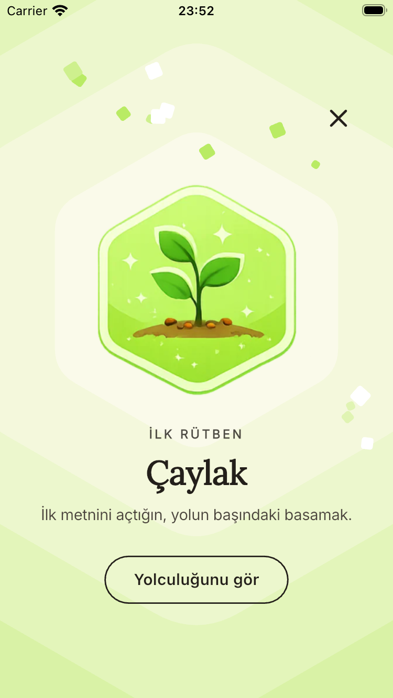

# İlerleme verisi ("İngilizce Yolculuğun" planı için)

**Tarih:** 20 Kasım 2026, 23:55 · **Görev:** `ortak/editor_gorevi_2026-11-20_ilerleme_verisi.md` · **Hazırlayan:** editör
**Yöntem:** kod okuma (sunucu `master` c8497c6, uygulama `feat/journey-core` c639a389) ve canlı veritabanı, salt okuma. Yalnız müşteri hesapları (350); kişisel bilgi yok. Kod ve veri değişmedi. Bölüm 5, 1.0.4 canlıya çıktıktan bir hafta sonra eklenecek.

## Özet

1. **Dört sayının dördü de bugün hesaplanabiliyor, geriye dönük de.** Yeni alan gerekmiyor; eksik olan, dördünü birden veren bir sunucu ucu.
2. **"Öğrenilen kelime" bugünkü tanımıyla neredeyse herkeste sıfır:** 350 müşteriden 2'sinde var. Tanım "tekrar aralığı en az 7 gün"; ilk hafta içinde kimse oraya varamaz.
3. **Müşterinin tipik hâli:** 1 hikâye, 217 kelime, defterde 0 kelime, 1 okuma günü. İlk haftasında en az 3 gün okuyan 30 kişide: 4 hikâye, 758 kelime, 15 kelime, 3 gün.
4. **20 XP eşiği** ilk gün kaydolanların yarısına (87/174), o gün XP kazananların %70'ine rütbe verir. **350** dördüncü günde hâlâ etkin olanların üçte birine. Üçüncü eşik için 800 ile 1.000 arasındaki fark bugünkü veride 2 kişi: **az veri**.
5. **Seviye yolu (aşama 3) göründüğünden pahalı.** "Hazırsın" sinyali ve seviye geçiş sınavı Eylül'de koddan silinmiş; tabloları duruyor, ucu yok. Çalışan iki şey var: seviye ölçümü ve "Seviyeni belgele". İkincisini bugüne kadar hiçbir müşteri denemedi.

## 1. Bugün ne tutuluyor

| Sayı | Nerede | Geriye dönük | Not |
|---|---|---|---|
| Okunan hikâye | `ReadingProgresses.IsCompleted`, `CompletedAt` | evet | "Bitti" kuralı tek yerde (`WorkCompletionRule`): son sayfada olmak ve en az okuma süresi (sayfa başına 8 sn; en az 30 sn, en çok 180 sn) |
| Okunan kelime | sayaç yok; bitirilen hikâyelerin `ReadingTexts.WordCount` toplamı | evet | Bütün etkin metinlerde kelime sayısı dolu (287/287). Bölümlü 36 metinde bölüm metniyle karşılaştırdım, tutuyor |
| Okuma süresi | `ReadingSessions.DurationSeconds` (oturum), `ReadingActivityDaily.DurationMs` (gün) | evet | Eski dönem süreleri üst sınırdır (5 Kasım raporu) |
| Okuma günü | `ReadingActivityDaily.LocalDate` (kullanıcının yerel günü) | evet (31 Ağustos'tan beri) | Panel de böyle sayıyor |
| Defterdeki kelime | `UserVocabularies` (`DeletedAt` boş olanlar) | evet | |
| Öğrenilen kelime | `UserVocabularies.Status`: `known` ya da `mastered` | evet | Kural `Sm2Scheduler.StatusFor`: aralık 7 günden kısaysa "öğreniliyor", 7–20 gün "biliniyor", 21 gün ve üstü "ustalaşıldı". Rozetler ve `/api/gamification/projection` aynı kuralı kullanıyor |

- **Okunan kelime dürüst bir sayı mı (Paul'un itirazı):** müşterilerin 364 bitirişinde ortanca hız dakikada 46 kelime. Dakikada 300 kelimenin üstünde 6 bitiriş var (toplam kelimenin %1,7'si). Hızlı geçilen sayfa sayıyı şişirmiyor.
- **Kullanılmaması gereken sütunlar:** `ReadingProgresses.WordsRead`, `TotalWords`, `TotalActiveReadingMinutes` boş. Onları yazan servis (`ReadingActivityService`) hiçbir yerden çağrılmıyor; 909 satırın 1'inde değer var.
- **Bugün bu sayıları veren uçlar:** profil yalnız okunan hikâye sayısını veriyor (`totalReadBooks`); defter istatistiği (`/api/ApiUserVocabulary/stats`) duruma göre kelime sayılarını; `/api/ProgressStats/streak` toplam okuma dakikasını. Toplam okunan kelimeyi ve toplam okuma gününü veren uç yok.

## 2. Dağılım (350 müşteri, 20 Kasım 23:00)

| | En az 1 olan | Ortanca | %75 | %90 | En çok | En az 1 olanlarda ortanca · %75 · %90 |
|---|---|---|---|---|---|---|
| Bitirilen hikâye | 187 (%53) | 1 | 1 | 3 | 11 | 1 · 2 · 4 |
| Okunan kelime | 187 | 217 | 332 | 730 | 2.587 | 332 · 613 · 895 |
| Defterdeki kelime | 127 (%36) | 0 | 5 | 15 | 88 | 8 · 17 · 27 |
| Öğrenilen kelime | 2 | 0 | 0 | 0 | 29 | az veri |
| En az bir kez tekrar edilmiş kelime | 39 (%11) | 0 | 0 | 1 | 88 | 10 · 20 · 35 |
| Okuma günü | 252 (%72) | 1 | 1 | 2 | 9 | 1 · 2 · 3 |

Önceki sayılar için: hikâye bitirme hunisi ve özellik kullanımı `2026-11-18_genel_durum.md` bölüm 3.5; XP dağılımı aynı raporun 3.8'i.

**İlk hafta sonunda "kalan" kullanıcı** (kayıttan sonraki ilk 7 gün; çeyrekler: alt · ortanca · üst):

| Grup | Kişi | Hikâye | Kelime | Deftere eklenen | Öğrenilen (bugün) | Okuma günü |
|---|---|---|---|---|---|---|
| 7 günü dolmuş bütün müşteriler | 174 | 0 · 0 · 1 | 0 · 0 · 332 | 0 · 0 · 4 | 0 | 0 · 1 · 1 |
| Kayıttan sonraki 7. gün uygulamayı açan | 6 (az veri) | 1 · 1 · 2 | 287 · 332 · 498 | 0 · 4 · 5 | 0 | 1 · 1 · 4 |
| İlk hafta en az 3 gün okuyan | 30 | 3 · 4 · 5 | 498 · 758 · 1.227 | 1 · 15 · 24 | 0 (en çok 29) | 3 · 3 · 4 |

- 7. gün dönenler 18 Kasım raporunda 4/153'tü; bugün aynı tanımla (takvim günü olarak kayıt günü + 7) 6/174.
- 7. gün dönen 6 kişi çok okuyanlar değil: ortancaları 1 hikâye. Dönüşü okuma miktarı açıklamıyor; 6 kişiyle bundan fazlası söylenemez.
- Sayfaya konacak dört sayıdan üçü, kalan kullanıcıda ilk haftada anlamlı büyüklüğe varıyor (4 hikâye, ~750 kelime, 3 gün). Dördüncüsü (öğrenilen kelime) hepsinde sıfır.

## 3. Rütbe ve kutlama

### Rütbe atlayınca ne oluyor

- **Ekran:** tam ekran kutlama katmanı (`BadgeCelebration`). Üstte "İLK RÜTBEN" (sonrakilerde "YENİ RÜTBEN"), rütbe adı, tek cümle (sunucudaki rütbe açıklaması; yalnız Türkçe), rütbe görseli. XP gösterilmez, ses yok, kendiliğinden kapanmaz. Görüntü SE 3'ten, kutlamayı tetikleyen kodla aynı değerlerle alındı.
- **Düğmeler:** "Yolculuğunu gör" kariyer sayfasını açar (kaynak `celebration`; sayfa eski XP'den yenisine dolma canlandırması oynatır). Sağ üstteki X yalnız kapatır.
- **Ne tetikliyor:** sunucunun anlık bağlantıdan (SignalR) gönderdiği `LevelUp` olayı. Okuma oturumunu bitiren uç yanıtında rütbe bilgisi yok. Bağlantı kopuksa uygulama seviye ucunu yoklayıp karşılaştırıyor; bir de "rütbe rozeti" yedeği var.
- **Ne zaman görünüyor:** okuma ekranı açıkken kutlama bekletilir; kullanıcı okuma ekranından çıkınca gösterilir. Bitiş ekranındaki "Artık Çaylak! Yolunu gör ›" satırı ayrıdır ve uygulamanın kendi hesabıdır.
- **Uygulama arka plandaysa:** kutlama yerine bildirim: "Yeni rütben: {ad}" / "{ad} rütbesine ulaştın. Kariyer sayfanda gör."
- **Ölçüm boşluğu:** kutlamanın gösterildiğine ve "Yolculuğunu gör"e dokunulduğuna dair olay yok. Yalnız sonrası ölçülüyor (`career_opened`, kaynak `celebration`). 1.0.4 bunu değiştirmiyor.

### Aynı anda başka ne tetiklenebiliyor (ilk hikâye bitişi)

Sırayla: bitiş ekranı (XP ya da rütbe satırı) → 1,4 sn sonra "Yarın da hatırlatalım mı?" alt sayfası (yolculuk hikâyesinde çıkmaz; yerine "Yarın hatırlat" kapısı var) → bitiş ekranı kapanınca bekletilen "+XP" ve seri bildirimleri → okuma ekranından çıkınca rütbe kutlaması, 3 sn arayla rozet kutlamaları.

- Kutlama katmanında bugünkü sınır: bir anda en çok 2 kutlama (rütbe biri sayılır), ilk gün en çok 3 rozet. Fazlası sessizce düşer.
- İlk bitişte mağaza yorumu istenmez (3 hikâye ve 3 gün şartı), ilk hafta paywall açılmaz.
- İlk bitişte düşen rozet sayıları için: `2026-11-18_genel_durum.md` 3.8 (163 kişide: hiç 28, bir 49, iki 58, üç 23, dört 5).

### Önerilen eşikler (20 / 350; üçüncü 800 ya da 1.000)

**Bugünkü 350 müşteri:**

| Rütbe | Bugünkü eşik | Bugün varan | Önerilen eşik | Öneride varan |
|---|---|---|---|---|
| Çaylak | 200 | 76 | 20 | 224 |
| Meraklı | 900 | 3 | 350 | 39 |
| Okur | 1.940 | 0 | 800 | 8 |
| | | | 1.000 | 2 |

148 kişi ilk kez rütbe alır (kutlamasız; bölüm 6); çoğu artık uygulamayı açmıyor. (18 Kasım raporundaki tablo 20 / 150 / 500 içindi; bu tablo yeni öneri için.)

**Yeni kullanıcı** (7 günü dolmuş 174 müşterinin o günün sonundaki toplam XP'si; çeyrekler):

| Gün sonu | Grup | Kişi | XP | 20'ye varan | 350'ye varan | 800 | 1.000 |
|---|---|---|---|---|---|---|---|
| 1. gün | Herkes | 174 | 0 · 17 · 75 | 87 (%50) | 0 | 0 | 0 |
| 1. gün | O gün XP kazanan | 124 | 11 · 47 · 109 | 87 (%70) | 0 | 0 | 0 |
| 4. gün | 4. gün ya da sonrasında hâlâ etkin | 35 | 30 · 198 · 416 | 28 (%80) | 12 (%34) | 1 | 0 |
| 7. gün | 7. gün ya da sonrasında hâlâ etkin | 21 | 35 · 199 · 423 | 17 (%81) | 8 (%38) | 2 | 2 |
| 4. gün | İlk hafta en az 3 gün XP kazanan | 17 | 325 · 416 · 635 | 17 | 11 | 1 | 0 |
| 7. gün | aynı grup | 17 | 383 · 564 · 761 | 17 | 13 | 4 | 2 |

- Tipik etkin kullanıcı: 1. gün sonunda Çaylak, 4. gün sonunda Çaylak (ortanca 198 XP; üçte biri Meraklı), 7. gün sonunda yine Çaylak (ortanca 199). Düzenli okuyan (haftada 3 gün ve üstü) 4. günde Meraklı, 7. günde hâlâ Meraklı.
- "İlk oturumda rütbe alan yeni müşteri ≥ %50" hedefi 20 eşiğiyle sınırda: ilk gün 87/174.
- Üçüncü eşik: 800'de ilk hafta 4 kişi, 1.000'de 2 kişi varıyor. **17–21 kişiyle eşik seçilmez.**

### İlk bitişte tek kutlama: kodda neresi

- **Dar hâli (küçük iş):** kutlama katmanının sınırı tek sınıfta (`CelebrationBatch`: bir anda en çok 2). İlk bitişte bunu 1'e indirmek ve rütbe ile rozetten hangisinin kalacağını seçmek 1–2 dosya.
- **Geniş hâli (orta iş):** bitiş ekranındaki rütbe satırı, hatırlatma alt sayfası, bekletilen bildirimler ve ana sayfaya dönünce açılanlar da "tek an"a dahil edilecekse 7–8 dosya, kabaca 30–35 çağrı yeri. Tek bir düzenleyici yok; beş ayrı kapı var (kutlama kapısı, kutlama sırası, sahne bastırma, oturum kesintileri, izin ve yorum servisleri).
- Karar gerektiren: bitiş ekranındaki "Artık Çaylak!" satırı ile çıkışta gelen tam ekran kutlama aynı şeyi iki kez söylüyor. 20 XP eşiğiyle her yeni kullanıcı ikisini de görür.

## 4. Seviye altyapısı

| Parça | Ne yapıyor | Müşteriye bugün | Kullanım (müşteri) |
|---|---|---|---|
| `LevelReadinessService` | Adı eski. Bugün yalnız seviyeyi yazan tek kapı ve geçmiş kaydı. "B1'e hazırsın" sinyali, teklif kartı ve XP kapısı 8 Eylül'de silindi | kapalı (kod yok) | `LevelReadinesses` tablosu boş |
| Seviye geçiş sınavı | Denetleyici, servis ve uygulama ekranı 8 Eylül'de silindi. Tablolar duruyor: 4 sınav, 40 soru | kapalı (uç yok) | 0 deneme |
| Yerleştirme ve yeniden ölçüm | Kısa okuma + kelime ölçümü; sonucu seviyeyi yazar. Tekliften başlatılan yeniden ölçüm seviyeyi yalnız yükseltebilir | açık: onboarding'de bağlantı, profilde "Seviyeni yeniden ölç", ana sayfada ölçüm teklifi kartı (2 hikâyeden sonra) | 97 tamamlanmış, 10 yarım ölçüm |
| "Seviyeni belgele" (okuma değerlendirmesi + belge) | 176 soruluk havuz, A1–B2; ayda bir; ayrıntılı rapor Premium'da. Sonuç yeterince güvenliyse seviyeyi yazar | açık: profilde | **0 deneme** (bütün hesaplarda 2; biri benim) |

- **Seviye bugün üç yolla değişiyor:** kullanıcının kendi seçimi (onboarding ve tercihler), yerleştirme/yeniden ölçüm, okuma değerlendirmesi. Okuyarak seviye atlamak diye bir yol yok.
- **Kayıttan sonra seviyesi değişen:** 246 müşterinin seviye kaydı var (171 kendi seçimi, 97 ölçüm; çoğu kayıt anında). **Kayıt gününden sonra seviyesi gerçekten değişen 9 müşteri:** 8'i yeniden ölçümle (4 yukarı, 4 aşağı), 1'i elle.
- **Bugünkü seviyeler:** A1 125 · A2 143 · B1 57 · B2 17 · C1 5 · C2 1 · A1 öncesi 2. A1'in içinde hiç seçim yapmamış 104 kişi var (varsayılan).
- **Tuzak:** "A1 öncesi" değeri veritabanında 7; sayıya göre sıralayan her şey onu C2'nin üstüne koyar. Seviye yolu çizilirken sıra `CefrLevelOrder` ile kurulmalı.

**Seviye başına etkin hikâye** (günde bir hikâyeyle seviyenin tamamı = hikâye sayısı kadar gün):

| Seviye | Etkin hikâye | Toplam kelime | Toplam süre (dk) | Günde bir hikâyeyle |
|---|---|---|---|---|
| A1 | 24 | 7.250 | 76 | 24 gün |
| A2 | 60 | 69.091 | 439 | 60 gün |
| B1 | 107 | 154.532 | 1.000 | 107 gün |
| B2 | 72 | 119.447 | 781 | 72 gün |
| C1 | 20 | 57.007 | 338 | 20 gün |
| C2 | 4 | 31.593 | 175 | 4 gün |

Sayıya dizi bölümleri dahil. Ücretsiz kullanıcı için süre bununla ölçülmez: günde bir hikâye açılıyor ve günlük havuz 22 metin.

## 5. Kariyer ve yolculuk sayfası ölçümü

1.0.4 canlıya çıktıktan bir hafta sonra eklenecek. Ölçülecek kaynaklar kodda hazır: `career_opened` (kutlama, bitiş ekranı, kişi kartı, ana sayfa satırı, hedef kartı, profil), `journey_page_shown` (onboarding, satın alma, ana sayfa), `journey_page_stop_tapped`. Bildirimden gelen kariyer açılışı kaynaksız yazılıyor (`unknown`).

## 6. Görüşüm

- **En az kodla en çok şeyi değiştiren: aşama 1'in eşik kısmı.** Eşikler tek dosyada (`LevelLadder.cs`), tablo açılışta eşitleniyor. Bugün müşterinin %22'si rütbeli; 20 ile %64 olur. İki şey bilinerek yapılmalı: (1) eski kullanıcı kutlama görmez. Sunucu "önceki" ve "sonraki" rütbeyi aynı tabloyla hesaplıyor (`XPGateway.ResolveRankAsync`); eşik inince 148 kişi rütbeyi sessizce almış olur. Onlara da bir an isteniyorsa ayrı iş. (2) Kutlamanın gösterildiği ölçülmeli; yoksa aşamanın etkisi yalnız dolaylı görülür.
- **Aşama 2 beklenenden ucuz, bir sayı hariç.** Dört sayı için yeni alan gerekmiyor; bir sunucu ucu ve sayfada bir kart. Ama "öğrenilen kelime" bugünkü tanımla herkeste haftalarca 0 kalır. Öneri: sayfaya "tekrar ettiğin kelime" (39 kişide var) ya da "defterindeki kelime" konsun; "öğrenilen" tanımı değişmeden başa yazılmasın. Karar ekipte.
- **Göründüğünden pahalı olan: aşama 3.** İncelemede "kodda seviye hazırlığı ve değerlendirme altyapısı var" deniyor; hazırlık sinyali ve sınav silinmiş, yeniden yazılacak. Değerlendirme çalışıyor ama soruları okunmadı ve müşteriden tek deneme yok. İçerik de dengesiz: A1'de 24, C1'de 20, C2'de 4 hikâye. Ayrıca bugün seviyesi sonradan değişen 9 kişinin yarısı aşağı indi; "seviye yolu" yalnız yukarı giden bir resim çizerse veriyle çelişir.
- **Aşama 4'ün bir parçası hazır:** `/api/gamification/projection` tahmini gün sayısını zaten veriyor ("~3 gün → Çaylak" oradan). Tarihe çevirmek küçük iş; anlamlı olması için düzenli okuyan sayısı az (ilk hafta 3 gün ve üstü okuyan 30 kişi).

## Yan bulgular (bu görevde değiştirilmedi)

- Uygulamanın Türkçe ve İngilizce metin dosyasında `journeyPremiumCta` iki kez tanımlı (17 Kasım'dan beri). Sonraki tanım geçerli olduğu için kariyer sayfasındaki Premium kartının düğmesi "İncele" yerine "Bütün yolculukları aç" yazıyor. İkisi de satın alma sayfasını açıyor; derleme 49'da da böyle.
- Sunucuda `api/test/...` uçları yalnız geliştirme derlemesinde var; canlıda 404 dönüyor (denedim).

## Bilinmeyenler

- Kutlamayı kaç kişinin gördüğü: olay yok.
- "Öğrenilen kelime"nin ilk haftadan sonra nasıl büyüdüğü: müşterilerin çoğu 3 haftadan yeni; 2 kişiyle söylenemez.
- Üçüncü rütbe eşiği: az veri.
