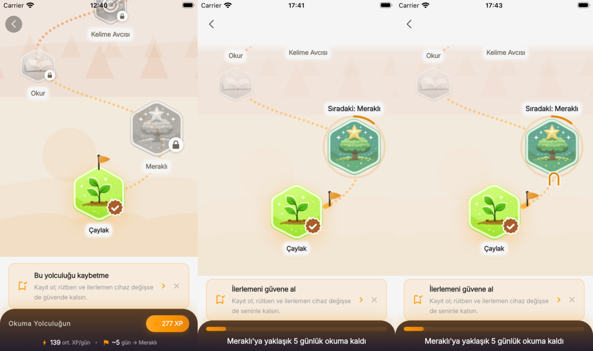
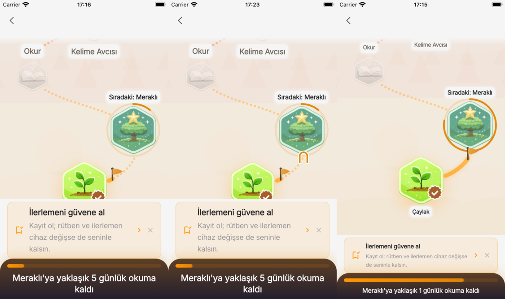
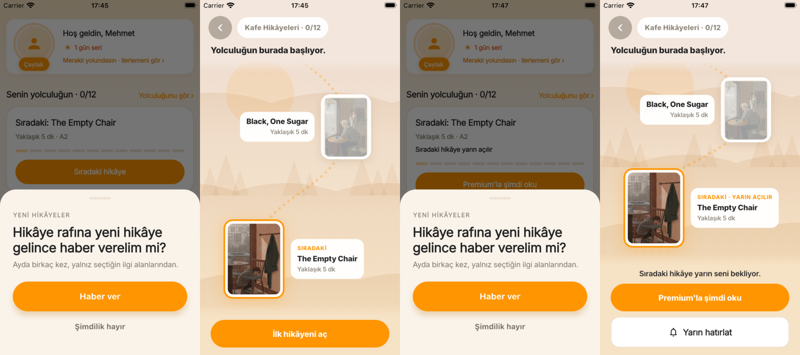

# Editör toplu iş raporu

**Tarih:** 21 Kasım 2026 · **Görev:** `ortak/editor_gorevi_2026-11-21_toplu.md` · **Hazırlayan:** editör
Görev kapsamında canlıya yazma, PR birleştirme ve yayın yapılmadı. A bittikten sonra Mehmet "PR 15 yayınla" dedi; PR #15 13:30'da birleştirildi, canlı yayın 13:33'te başarılı.

## Durum

| | İş | Durum |
|---|---|---|
| A | Sunucu PR #15: "geri dön" kuralları, tam test | **Bitti ve canlıda** (Mehmet'in sözüyle, 21 Kas 13:33) |
| B | Açılışta kendiliğinden satın alma ekranı | **Yok.** Kod değişikliği gerekmedi |
| C | Dizilerin ilk bölümü | Bitti (sayılar aşağıda) |
| D | Ad ve açıklama dökümü | Bitti: `veri_2026-11-21/adlar_ve_aciklamalar.csv` |
| F | Güncelleyen eski kullanıcı | Bitti: durduran bulgu yok; bir metin hatası (aşağıda) |
| G | Ölçüm doğrulaması | Bitti: bir eksik vardı (yolculuk kartı gösterimi), derleme 50'ye eklendi |
| H | Ayar uyarısı metni | Bitti: derleme 50'ye eklendi |
| I | Sahiplenme verisi | Bitti: `raporlar/2026-11-21_sahiplenme_verisi.md` |
| E | Kariyer sayfası taslağı | Bitti: görüntüler `ekran_2026-11-21/`; kod ayrı dalda (`mockup/career-readability`), ana dala ve derleme 50'ye girmedi |

## A. Sunucu PR #15

**PR #15 canlıda** (`fix/notification-rules`, son commit `10ecd26`; birleştirme `b5b7ee5`). Mehmet "PR 15 yayınla" deyince 13:30'da birleştirildi; Railway yayını 13:33'te başarılı. Doğrulama: canlı sağlık 200, `AddPushSendFailures` geçişi kurulu, yeni tablo boş, yayından sonraki ilk dakikalarda 5xx yok. Kuralların ilk etkisi bir sonraki saatlik gönderim turunda.

| İstenen | Yapılan |
|---|---|
| 1. "Geri dön" üç cevapsız susturma kuralının dışında | Yapıldı. Deneme bitiş uyarısı gibi sınıra girmiyor |
| 2. 3., 7., 14. günde öbür türlerin önünde; o gün başka tür gitmesin; 30. gün kalsın | Yapıldı. O günlerde "geri dön" o günün bildirimi; 30. gün eski sırasında |
| 3. Bırakmış kişiye kelime tekrarı ve günün quizi gitmez | Değişmedi; testle kilitli |
| 4. Tam test koşusu | **1.767 geçti, 0 düştü, 3 atlandı** (5 dk 9 sn) |
| 5. Yayınlama | Görev "yayınlama" diyordu; Mehmet sonra "yayınla" dedi, yayınlandı |

**İstenenden farklı tek nokta:** "geri dön" öbür türlerin önünde, ama iki türün arkasında kaldı: **deneme bitiş uyarısı** ve **seri telafisi**. İkisi de yalnız tek bir günde gönderilebiliyor (deneme bitişinden iki gün önce; serinin kırıldığı gün). O gün "geri dön"e yenilirlerse kullanıcı uyarılmadan ücretlendirilir ya da "bugün okursan serin geri gelir" sözü hiç söylenmez. İlk tam koşuda düşen tek test de bunu koruyordu (seri telafisi "geri dön"ün önünde). Pratikte çakışma nadir: seri telafisi okumayı bıraktıktan sonraki 2. güne, "geri dön" 3. güne denk gelir. Ekip başka türlü isterse tek satır.

**Bu sırada bulunan ve düzeltilen bir kusur:** susturma kuralı, o günün bildirimi seçildikten sonra uygulanıyordu. Sınırdaki kullanıcının en öncelikli adayı kelime tekrarı olunca o susturuluyor, sınıra girmeyen "geri dön" de o gün gitmiyordu. Kural artık seçimden önce uygulanıyor.

**Bırakmış bir kullanıcı artık ne alır:** bıraktıktan sonraki günlerde en çok üç bildirim (hangisi sırası gelirse); sonra kelime tekrarı ve quiz susar; 3., 7., 14. ve 30. günde "geri dön". Sadık kullanıcılar raporundaki altı kişiye bu kuralla 45 yerine en çok 7'şer bildirim giderdi ve dördü "geri dön" olurdu.

"Geri dön" metinlerine dokunmadım (Paul yazacak).

## B. Açılışta kendiliğinden satın alma ekranı

**Sonuç: 1.0.4 kodunda, kullanıcı bir şeye dokunmadan açılışta satın alma ekranı açan bir yol yok.** Bu kural 30 Ekim'den (derleme 41) beri böyle; 1 numaralı kullanıcının sürümü (1.0.2, derleme 45) de aynı kuralı taşıyor. Kapatılacak bir şey olmadığı için anahtar eklemedim; derleme 50'ye bu başlıktan bir şey girmiyor.

**Açılışta ne çalışıyor** (`home_page.dart`, `_runOpenInterrupts`; açılıştan 3 saniye sonra, en fazla biri):
1. Deneme bitiş hatırlatması: yalnız denemesi bitmek üzere olan kullanıcıya, bir kez. Satın alma ekranı değil.
2. Bildirim izni sorusu (3. günde).
3. Misafire hesap açma hatırlatması.

**Satış teklifleri ne zaman çalışıyor** (`_runSalesInterrupts`): yalnız o oturumda bir bölüm ya da hikâye bitmişse ve kullanıcı ana sayfaya dönmüşse (`SessionInterrupts.salesAllowed`). Sırayla ilk uygun olan: geri kazanma teklifi, hediye teklifi, ertelenmiş satın alma ekranı, deneme teklifi. Oturum başına en çok bir kesinti. Ekibin kararına ("satış anı bitişte ve kullanıcının dokunduğu kilitte; kapıda değil") uyuyor.

**Dokunmayla açılanlar:** Premium şeridi, kilitli kitap ve dizi bölümü, kariyer sayfası kartı, abonelik kartı, hediye çipi, giriş ekranındaki "teklifi gör", okuma ve quiz bitişindeki teklif pencereleri.

**Bildirimden gelenler:** hiçbir bildirim doğrudan satın alma ekranı açmıyor; teklif bildirimleri ana sayfaya iniyor.

**1 numaralı kullanıcıda ne oldu:** 14 Kasım 19:24:07'de uygulama açıldı, 19:24:11'de (3,6 saniye sonra) satın alma ekranı gösterildi, ana sayfanın içerik istekleri hiç atılmadı ve oturum bitti. Önünde şerit dokunuşu ya da kilit kaydı yok. Kodda bunu kendiliğinden yapan yol olmadığına göre kalan açıklama, ilk saniyelerde bir Premium girişine dokunulması; o sürüm neyin açtığını yazmıyor (hepsi "manual"), kesinleştiremiyorum. 1.0.4 neyin açtığını yazıyor; tekrarlanırsa görülecek.

**Baktığım dosyalar:** `lib/features/home/presentation/pages/home_page.dart` (açılış ve satış kesintileri), `lib/core/services/session_interrupts.dart`, `lib/features/subscription/data/services/paywall_trigger_service.dart`, `lib/core/navigation/app_navigator.dart` (bildirim rotaları), `lib/main.dart`, `lib/features/auth/presentation/pages/login_page.dart`, `premium_banner.dart`, `premium_gate.dart`, `onboarding_v2_page.dart`; ayrıca derleme 45'in aynı dosyaları (`383edc66`).

**Bu incelemenin yan sonucu:** sadık kullanıcılar raporunda 1 numaranın son ziyareti yanlıştı. Uygulama olaylarına göre 14 Kasım'dı; sunucunun istek kaydına göre 16 Kasım'da bir kez daha gelmiş (günün quizini çözmüş, metin açmamış). O oturumun olayları sunucuya ulaşmamış. Rapor düzeltildi; öbür 16 kişide iki kayıt aynı günü gösteriyor. Ders: "son ziyaret" için olay kaydı tek başına yetmiyor, istek kaydıyla doğrulanmalı.

## C. Dizilerin ilk bölümü

12 dizi var, 99 bölüm. Hepsi bugün Premium; ilk bölüm dahil.

**Tek seviyeli (ya da komşu seviyeli) yedi dizi:**

| Dizi | Bölüm | Seviye | İlk bölüm | İlk bölüm seviyesi | Kelime | Süre | Merak cümlesi |
|---|---|---|---|---|---|---|---|
| New in Town | 10 | A1 | Box Number Twelve | A1 | 390 | 4 dk | var |
| Coffee Shop Stories | 12 | A2 | The Empty Chair | A2 | 603 | 5 dk | var |
| Room 214 | 10 | B1 | The Name on the Badge | B1 | 755 | 7 dk | yok |
| The Lending Library | 10 | B1 | The Shelf at the Back | B1 | 1.057 | 8 dk | yok |
| The Lighthouse Letters | 12 | B1–B2 | The Box in the Lighthouse | B1 | 954 | 8 dk | yok |
| Why? | 9 | B1–B2 | Why Does Bread Go Stale? | B1 | 598 | 6 dk | yok |
| Second Chances | 12 | B2 | Back to Millbrook | B2 | 792 | 7 dk | yok |

**Karışık seviyeli beş derleme** (bölümler birbirinden bağımsız; "ilk bölüm" numara sırasına göre ilk olan):

| Derleme | Bölüm | İlk bölüm | Seviyesi | Kelime | Öbür bölümlerin seviyeleri | Merak cümlesi |
|---|---|---|---|---|---|---|
| Game Day | 4 | Second Half | A2 | 446 | B2, B1, A1 | yok |
| Passport | 5 | One Night in Lisbon | A2 | 400 | C1, B2, A1, B1 | yok |
| Spotlight | 5 | The Autograph | B1 | 703 | B1, B2, C1, A2 | yok |
| Signal | 5 | Autocomplete | **C1** | 1.147 | A2, B2, B1, A2 | yok |
| Wild | 5 | A Photograph of Snow | **C1** | 1.000 | B2, A1, B1, A2 | yok |

- Derlemelerde numara sırası seviye sırası değil: Signal ve Wild'ın ilk bölümü C1. "İlk bölüm ücretsiz" kuralı bu beşinde anlamlı sonuç vermez; orada "en düşük seviyeli bölüm" ya da "kullanıcının seviyesindeki bölüm" seçilmeli.
- Merak cümlesi 12 ilk bölümün 2'sinde dolu (New in Town, Coffee Shop Stories). Bütün katalogda 43 metinde dolu.

**İlk bölümler ücretsiz olursa seviye başına ücretsiz metin:**

| Seviye | Bugün | Yedi dizinin ilk bölümü | Beş derleme de eklenirse (numara sırasına göre) |
|---|---|---|---|
| A1 | 9 | 10 | 10 |
| A2 | 8 | 9 | 11 |
| B1 | 5 | **9** | 10 |
| B2 | 2 | 3 | 3 |
| C1 | 0 | 0 | 2 |

En çok kazanan B1 (5'ten 9'a). B2 yine zayıf kalıyor (3). İlk bölümler günlük havuz metinlerinden uzun: 390–1.057 kelime (havuzun ortancası 291).

## D. Ad ve açıklama dökümü

`veri_2026-11-21/adlar_ve_aciklamalar.csv`: 287 etkin metin, metin başına bir satır. Sütunlar: kimlik, İngilizce ad, Türkçe alt başlık, İngilizce alt başlık, İngilizce açıklama, Türkçe açıklama, tür (kategori), seviye, kelime, dizi, bölüm, erişim (ücretsiz/günlük havuz/Premium), başlangıç yolculuğu, yolculuklar, ilk 80 kelime, merak cümlesi. Excel'de Türkçe karakterler doğru açılsın diye dosya BOM'lu UTF-8.

**"Türkçe ad" diye ayrı bir alan yok.** Ana ad İngilizce (`Title`); Türkçesi alt başlık (`SubtitleTR`) olarak tutuluyor. Dökümde "Türkçe alt başlık" sütunu odur.

**Sayılar:**

| | Sayı |
|---|---|
| Türkçe açıklaması boş | 0 |
| İngilizce açıklaması boş | **205** (287'nin %71'i) |
| 40 karakterden kısa açıklama (TR ya da EN) | 0 |
| Aynı açıklamayı paylaşan metin | 0 |
| Türkçe alt başlığı boş | 0 |
| İngilizce alt başlığı boş | 235 |
| Merak cümlesi dolu | 43 |
| Türkçe açıklama uzunluğu (ortanca) | 187 karakter |

- İngilizce açıklaması boş 205 metin, uygulama İngilizce kullanılırken Türkçe açıklamayı gösterir (kapak sayfası önce uygulamanın dilindeki açıklamaya, yoksa öbür dile, o da yoksa özete bakıyor).

**Kullanıcı bu alanları nerede görüyor** (koddan; görüntü örnekleri `ekran_2026-11-20/d49_surus_normal.png` içinde: yolculuk sayfası, kapak sayfası, ana sayfa):

| Yer | Görünen alanlar |
|---|---|
| Raf ve keşif kartı | İngilizce ad, altında Türkçe alt başlık |
| Kapak sayfası | İngilizce ad, Türkçe alt başlık, yazar, seviye, süre; "Hakkında" başlığı altında açıklama |
| Yolculuk sayfası | İngilizce ad ve süre; açıklama ve alt başlık yok |
| Bitiş ekranındaki "sıradaki hikâye" kartı | Ad ve bir satır: merak cümlesi varsa o, yoksa Türkçe açıklama, o da yoksa alt başlık |
| Ana sayfa yolculuk kartı | Ad, süre, seviye |

- **Tür (kategori) kartta ve kapak sayfasında yazmıyor.** Kategori adı raf kurmada ve ilgi alanı eşleşmesinde kullanılıyor; kullanıcıya "kurgu / gerçek hikâye / efsane / klasik" diye bir etiket gösterilmiyor. Veride de böyle bir ayrım yok: 12 kategori konu adı (Daily Life 46, Literature 37, Culture 34, Mystery 20, Travel 15, Romance 12, Sports 11, Thriller 10, Fantasy 10, Nature 9, Legends 9, Drama 9…).
- Bu bölüm için yeni ekran görüntüsü almadım; var olan sürüş karelerine bağladım.

**Dizilerde açıklama kimin:** ikisi de var. 12 dizinin hepsinin kendi Türkçe açıklaması dolu; 99 bölümün hepsi de kendi açıklamasını taşıyor ve hiçbiri dizinin açıklamasıyla aynı değil.

## E. Kariyer sayfası taslağı

Görüntüler gerçek uygulamadan, SE 3 simülatöründe, yerel sunucuyla ve **aynı kullanıcı durumuyla** (misafir, 277 XP, Çaylak kazanılmış) alındı. Kod `mockup/career-readability` dalında; tek bir anahtar bugünkü hâli, E1'i ve E2'yi çiziyor. Rütbe adları ve rozet çizimleri değişmedi.

Tek kareler: `kariyer_bugun.png`, `kariyer_e1.png`, `kariyer_e2.png`, `kariyer_e1_buyuk.png`, `kariyer_e2_buyuk.png`, `kariyer_esik_20_350_1000.png`.

**Ortak maddeler nasıl karşılandı:**

| | İstenen | Taslakta |
|---|---|---|
| 1 | Yol kenardan kenara | Yol bir rozetin görünen kenarının 5 pt dışında başlıyor, sıradakinin kenarında bitiyor. Hiçbir nokta rozetin üstünden ya da altından geçmiyor. Yol rozete alttan giriyorsa (Meraklı, Okur) rütbe adı rozetin üstüne yazılıyor; yoksa yol adın içinden geçiyordu |
| 2 | Yol dolar | Geçilen kısım dolu ve renkli, kalan kısım noktalı. Bayrak dolumun ucunda, yolun üstünde (277 XP: Çaylak'tan Meraklı'ya yolun %11'i) |
| 3 | Sıradaki rütbe öne çıkar | Meraklı yarı renkli, çevresinde dolan halka (%11), üstünde "Sıradaki: Meraklı". Uzak rütbeler küçük ve soluk, kilit simgesi yok |
| 4 | Alt şerit tek cümle | İlerleme çubuğu ve "Meraklı'ya yaklaşık 5 günlük okuma kaldı". "~" ve ok yok. Kalan XP 60 ve altındaysa "Meraklı olmana çok az kaldı!" (uygulamanın sesi tablosu) |
| 5 | Üst kenar | Durum çubuğunun altında sabit, zemin renginde üst alan; geri düğmesi bu alanda koyu renk ve rozetlerle çakışmıyor. Sayfa açılırken bir rozet üst alanın altında yarım kalacaksa kaydırma onu ya tamamen gösterecek ya tamamen yukarıda bırakacak biçimde ayarlanıyor |
| 6 | Arka plan sakinleşsin | Dağlar ve tepeler kaldırılmadı, %35 saydamlığa indi; yolla karışmıyor |
| 7 | Kayıt kartı | Başlık "İlerlemeni güvene al", alt satır "Kayıt ol; rütben ve ilerlemen cihaz değişse de seninle kalsın." Kart iç boşluğu küçüldü |

**E2:** sıradaki rütbenin (Meraklı) yolun bağlandığı kenarında küçük bir kemer biçimli eşik işareti; kilidin yerini alıyor. Uzak rütbelerde ne eşik ne kilit.

**Eşikler 20 / 350 / 1.000 olsaydı** (yalnız yerelde; sunucu değeri değişmedi): aynı kullanıcı Meraklı'ya 73 XP uzakta; yolun ve halkanın %79'u dolu; alt şerit "Meraklı'ya yaklaşık 1 günlük okuma kaldı". Kalan 60'ın altına inince cümle "Meraklı olmana çok az kaldı!" olur.

**Ölçümler:**

| | Bugün | Taslak |
|---|---|---|
| Sıradaki rütbe adının zeminle karşıtlığı | 5,3:1 (koyu gri #6E6455, 13 pt) | **15,4:1** (#1D1D1F, 14 pt kalın) |
| Alt şerit yazısı | 13 pt başlık + 11 pt ikincil satır (ikincil satır karşıtlığı yaklaşık 5,6:1) | **15 pt kalın, tek cümle**, karşıtlık 16:1 |
| En küçük dokunma alanı | Kayıt kartının kapatma (×) düğmesi, yaklaşık 24 × 24 pt | Aynı (değişmedi). 44 pt altında; ayrıca düzeltilmeli |
| Geri düğmesi | 44 × 44 pt | 44 × 44 pt |
| Uzak rozet | 68 pt | 68 pt |

**Taslakta görülen sorunlar:**
- **Büyük yazıda kayıt kartı üç satıra çıkıyor ve kullanıcının bulunduğu rozetin (Çaylak) yarısını kapatıyor.** Yedinci madde ("kart yolu kapatmayacak yükseklikte") büyük yazıda tutmuyor. Çözüm seçenekleri: kart büyük yazıda tek satıra (yalnız başlık + ok) insin ya da kaydırma kartın yüksekliğini hesaba katsın.
- Üst alanın hemen altında, rozeti yukarıda kalmış bir rütbenin adı yalnız görünebiliyor ("Kelime Avcısı"). Rozet kesilmiyor ama ad sahipsiz kalıyor.
- Bayrak dolumun ucuna taşındı; 277 XP'de uç Çaylak'a çok yakın olduğu için bayrak rozetle yolun arasına sıkışıyor. Yüzde büyüdükçe yolun üstüne açılıyor (eşik karesinde görülüyor).

**Kod:** `mockup/career-readability` dalı, uzak depoya gönderildi; ana dala birleştirilmedi. Taslak metinler kodda sabit yazılı (çeviri dosyasına girmedi). Karar Mehmet'in; onay gelirse metinler çeviri dosyasına alınır ve anahtar kaldırılır.

## F. Güncelleyen eski kullanıcı ne görecek

**Sonuç: sürümü durduran bulgu yok.** Başlangıç yolculuğunu bitirmiş kullanıcının ana sayfasında yolculuk kartı dolu geliyor; kart boş değil, yalnız kilitli metin de göstermiyor.

Soldan sağa: ana sayfa ve yolculuk sayfası (bugünkü hak kullanılmamış), ana sayfa ve yolculuk sayfası (bugünkü hak kullanılmış).

**Nasıl denendi:** SE 3 simülatörü, yerel sunucu, yerel veritabanı. Kullanıcı yerelde eski bir kullanıcı gibi kuruldu: A2 seviyesi, kaydı 8 gün önce, onboarding'i tamamlanmış, başlangıç yolculuğunun 4 hikâyesi ve 2 günlük havuz metni 15–20 Kasım arasında okunmuş. Uygulama 1.0.4 (sürüm dalı; kariyer taslağının bulunduğu dal, ana sayfa ve yolculuk sayfası aynı). **Sınır:** eski sürümden gerçek güncelleme yapılmadı (derleme 45'i kurup üstüne 1.0.4 kurmak); telefondaki eski sürüm bayraklarının etkisi koddan okundu.

| Soru | Cevap |
|---|---|
| 1. Ana sayfada yolculuk kartı, "sıradaki" dolu mu, yolculuk sayfası boş mu | Kart var: "Senin yolculuğun · 0/12", "Sıradaki: The Empty Chair". Yolculuk sayfası dolu (Kafe Hikâyeleri, kapaklar ve süreler) |
| 2. Başlangıç yolculuğunu bitirmiş kişide sıradaki ne | Sunucu sıradaki yolculuğu kendiliğinden atıyor: A1 → New in Town, A2 → Coffee Shop Stories, B1 → World Cities. Bu yolculukların ilk **2** durağı ücretsiz (günlük hakla açılır), sonrası Premium |
| 3. Onboarding sonu teklifi ya da tanıtım yeniden çıkıyor mu | **Hayır.** Açılışta onboarding'e yönlendiren kural derleme 45'ten beri değişmedi (`onboarding_completed` bayrağı); eski sürümde onboarding'i bitiren kullanıcı onboarding'i ve sonundaki teklifi yeniden görmez. Cihazda açılışta yalnız "yeni hikâye gelince haber verelim mi?" sorusu çıktı; bu teklif değil, 3. günden sonra bir kez soruluyor ve eski sürümde de vardı |
| 4. Günlük hakkını kullanmış kişide "yarın açılacak" ve Premium kapısı | Var. Ana sayfada "Sıradaki hikâye yarın açılır" ve "Premium'la şimdi oku"; yolculuk sayfasında "SIRADAKİ · YARIN AÇILIR", "Sıradaki hikâye yarın seni bekliyor.", "Premium'la şimdi oku" ve "Yarın hatırlat" |

**Bulunan metin hatası (durdurucu değil):** ikinci yolculuğa geçen kullanıcıya yolculuk sayfası **"İlk hikâyeni aç"** düğmesini ve **"Yolculuğun burada başlıyor."** satırını gösteriyor. 6 hikâye okumuş birine yanlış. Neden: ikisi de yalnız *bu* yolculukta okunan hikâye sayısına bakıyor (0/12). Öneri: bu ikisi yalnız başlangıç yolculuğunda çıksın; sonraki yolculuklarda düğme "Sıradaki hikâye", satır hiç çıkmasın. İki satırlık iş; derleme 50'ye girip girmeyeceği ekibin kararı. Kod yazmadım.

**Ayrıca:** B1'in sonraki yolculuğu (World Cities) bittiğinde zincir bitiyor; o kullanıcının kartında "sıradaki" boş kalır. Bunun için 10 durağın 8'i Premium olan yolculuğu bitirmek gerekiyor; bugün böyle bir müşteri yok.

## G. Ölçüm var mı

| Soru | Ölçülüyor mu | Olay |
|---|---|---|
| Yolculuk kartı gösterildi | **Hayır → eklendi** | `user_action`, `journey_card_shown` (kaynak `home`); ana sayfa her kurulduğunda bir kez. Derleme 50'de (`9e302862`) |
| Yolculuk kartına dokunuldu | Evet | Düğme: `journey_next_tapped` (kaynak `home`); bağlantı ve çizgi: `journey_page_shown` (kaynak `home`) |
| Uygulama açıldı ama metin açılmadı | Evet, türetilerek | `app_open` ile `reading_started` aynı oturum kimliğini taşıyor (son 3 günde ikisinin de %100'ünde oturum kimliği dolu); oturumda `reading_started` yoksa "açtı, okumadı" |
| "Yarın hatırlat" seçildi | Evet | `remind_tomorrow_tapped`, `remind_tomorrow_result` (`granted`) |
| Bitiş ekranında Premium kapısına dokunuldu | Evet | `finish_cta_tapped` (`cta_type`: `journey_locked` ya da `journey_premium_now`) ve `offer_accepted` |

Yeni olayın birim testi yok (kart, test ortamında kurulmayan iki servise bağlı); uygulama testleri 1.223 geçti.

## H. Metin

Ayar sunucuya yazılamazsa çıkan uyarı Paul'un metniyle değişti: "Ayarın bu telefonda kayıtlı, ama sunucuya ulaşamadık. Birazdan yeniden dener misin?" İngilizcesi de aynı tonda. Derleme 50'de (`9e302862`).

## I. Sahiplenme verisi

Ayrı rapor: `raporlar/2026-11-21_sahiplenme_verisi.md`. Öne çıkanlar:
- Müşterilerin %89'u misafir (324/365); üyeliğe geçenlerin %71'i ilk gün geçiyor.
- Kendi yüklediği profil resmi olan müşteri yok; resmi olan 7 kişinin resmi Google hesabından.
- Rozet: müşterilerin %56'sında en az bir; "Top 100" 83 kişide (sıralama hiçbir yerde görünmüyor). İkinci okuma ve kelime rozeti birer kişide.
- Defter sınırına çarpan 13 kişi, 244 kez; satın alan yok.
- Haftalık özet sayfası kimseye ulaşmıyor (bildirimi gönderilmiyor).
- Mevcut durum notunda düzeltilecek beş nokta raporda.

## Derleme 50'yi bekleyenler (güncel)

`feat/journey-core`, son commit `9e302862`, uygulama testleri 1.223 geçti:
- Seslendirme devamında geri sarma (`a9249148`)
- T15 iptal penceresi, T17 sessiz çeviri simgesi, T18 Quiz sekmesi rozeti, T19 "Seviyeni belgele" gizli (`3e6fd9b9`)
- Bildirime dokunma ölçümü ve ayar kaydetme (`7273ca60`)
- G: yolculuk kartı gösterimi; H: ayar uyarısı metni (`9e302862`)

## Mehmet'ten beklenen

1. **Derleme 50:** "çıkar" denince derlenir.
2. **F'deki metin hatası** ("İlk hikâyeni aç" ikinci yolculukta): derleme 50'ye girsin mi? İki satır.
3. **Kariyer taslağı:** E1 mi E2 mi, ya da ikisi de değil. Büyük yazıda kayıt kartının rozeti kapatması ayrıca çözülmeli.
4. **Çeviri:** işçiler durdu (205/261), 22 Kasım 04:30'da kendiliğinden devam edecek.
